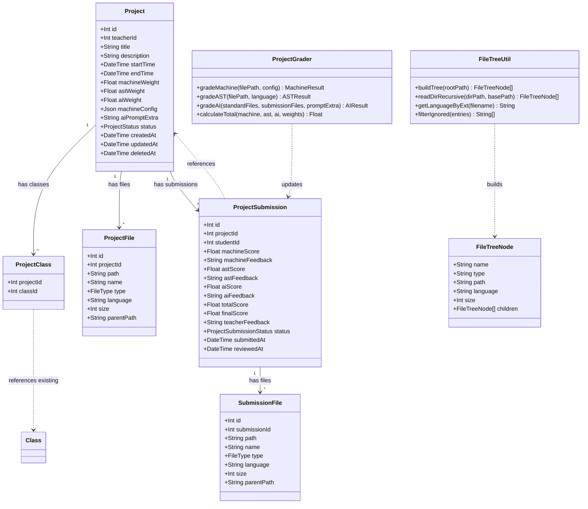
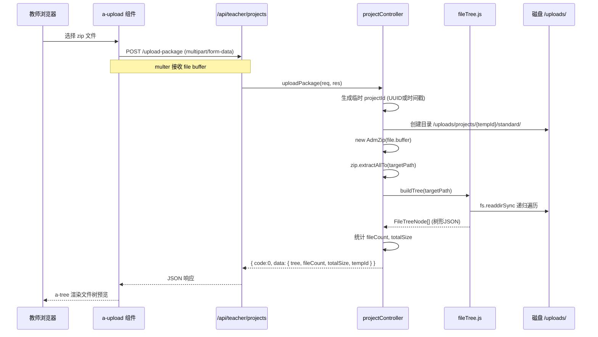
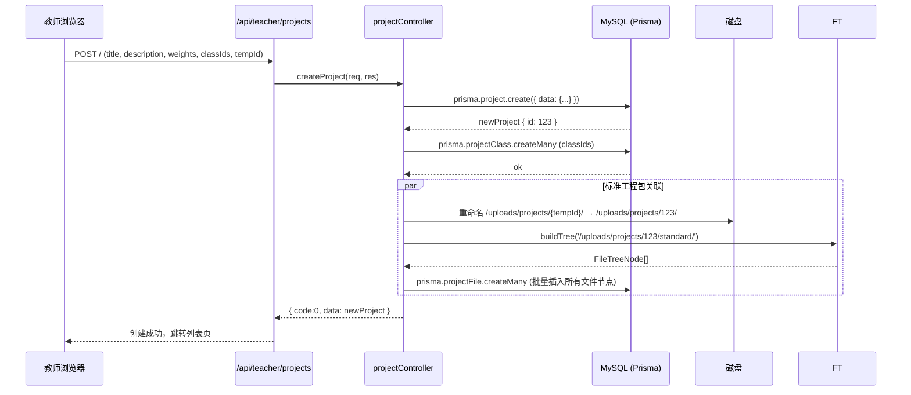
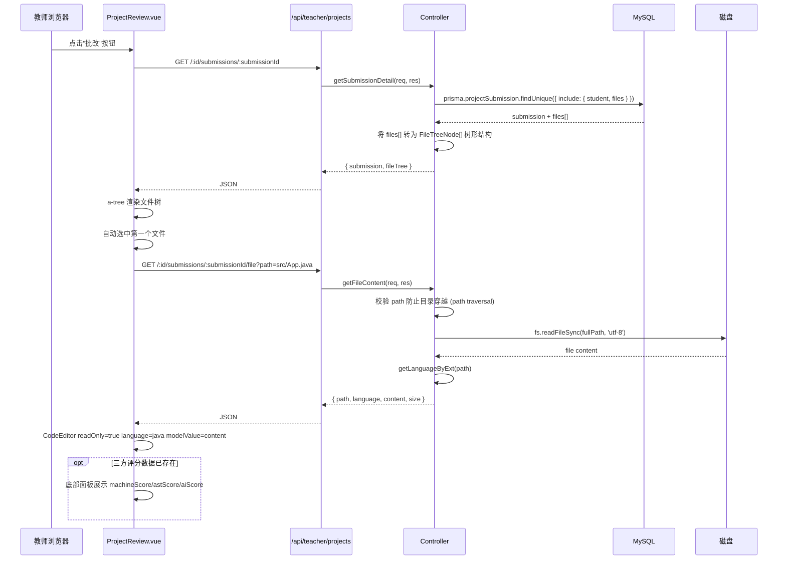
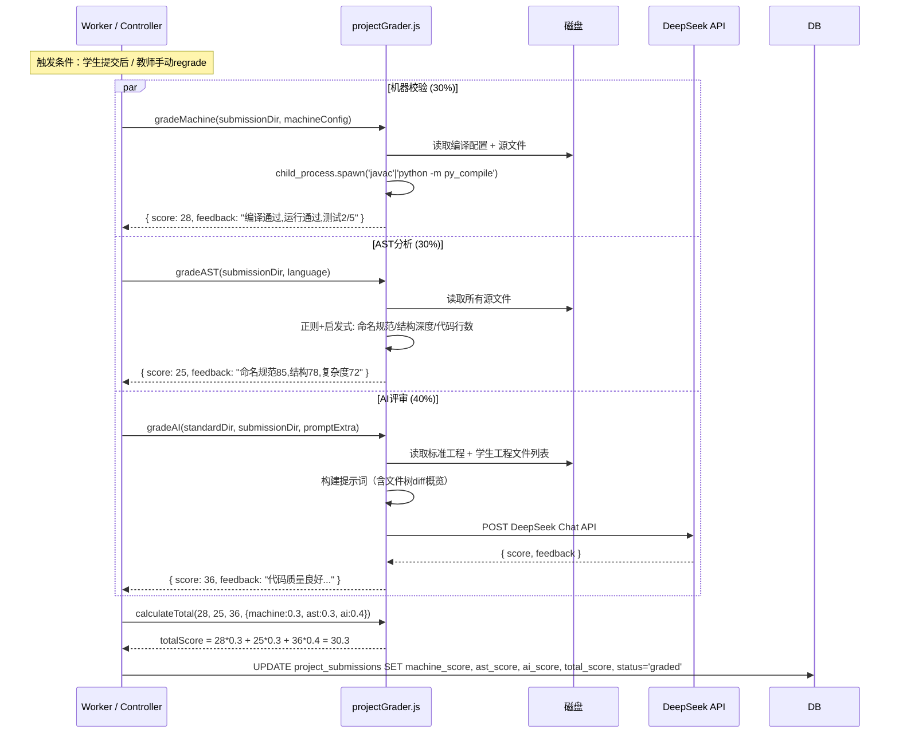
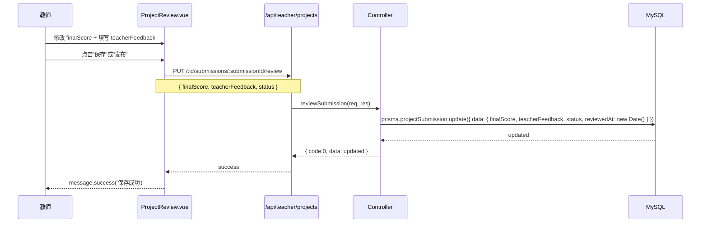
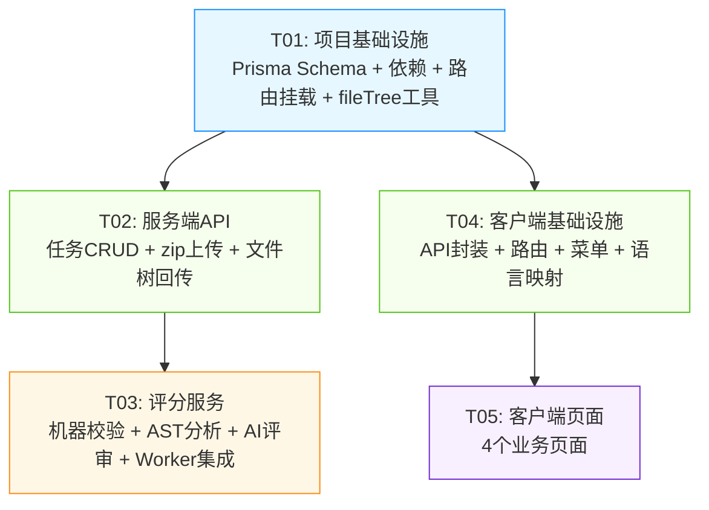

# 工程项目批改 — 系统架构设计文档

> **版本**：v1.0  
> **作者**：高见远（架构师）  
> **日期**：2025-08-03  
> **基于**：PRD-工程项目批改 v1.0  
> **项目**：Exam-DeepSeek（Deadpan 判题）

---

## 目录

- [Part A: 系统设计](#part-a-系统设计)
  - [1. 实现方案与框架选型](#1-实现方案与框架选型)
  - [2. 文件列表](#2-文件列表)
  - [3. 数据结构与接口](#3-数据结构与接口)
  - [4. 程序调用流程](#4-程序调用流程)
  - [5. 待明确事项](#5-待明确事项)
- [Part B: 任务分解](#part-b-任务分解)
  - [6. 依赖包列表](#6-依赖包列表)
  - [7. 任务列表](#7-任务列表)
  - [8. 共享知识](#8-共享知识)
  - [9. 任务依赖图](#9-任务依赖图)

---

# Part A: 系统设计

## 1. 实现方案与框架选型

### 1.1 核心难点分析

| 难点 | 分析 | 对策 |
|---|---|---|
| zip 解压与目录遍历 | 服务端需解压用户上传的 zip 并递归遍历目录结构 | 使用 `adm-zip`（纯 JS，跨平台，无原生依赖）；递归 `fs.readdirSync` + `fs.statSync` 构建树形 JSON |
| 工程文件树渲染 | 前端需以树形结构展示解压后的多级目录 | Ant Design Vue `a-tree` 原生支持 `tree-data` + `field-names`，直接绑定服务端 JSON |
| 多语言代码只读展示 | 不同后缀文件需自动切换 Monaco 语言 | CodeEditor.vue 已支持 `language` prop + `readOnly` prop，新增 `fileLang.js` 映射表即可 |
| 三方评分体系 | 机器校验 + AST 分析 + AI 评审需协同工作 | 复用现有 Worker 轮询模式；P0 评分同步执行（不阻塞响应），P1 迁移到独立 Worker |
| 零侵入集成 | 不能修改现有题库/作业体系的表结构和逻辑 | 新增独立 Prisma 模型、独立路由文件、独立控制器，仅修改 app.js 路由挂载和 Layout.vue 菜单 |

### 1.2 框架与库选型

#### 服务端新增依赖

| 包名 | 版本 | 用途 | 选型理由 |
|---|---|---|---|
| `adm-zip` | `^0.5.16` | zip 解压/压缩 | 纯 JS 实现，无原生依赖（不涉及 node-gyp），跨平台部署友好；API 简洁（`new AdmZip(buffer).getEntries()`）；npm 周下载量 600 万+，成熟稳定 |

> **不新增 `jszip`（前端）**：PRD 提到 `jszip` 用于"前端预处理"，但实际流程中 zip 上传由 `a-upload` + `FormData` → `multer` 直接发送到服务端，前端无需解压。仅教师上传标准包时需预览文件树，此时由服务端解压后返回 JSON 即可。`jszip` 在 P2 学生端（浏览器端预检 zip 结构）时可重新评估。

#### 不新增的依赖

| 候选 | 不引入理由 |
|---|---|
| `acorn` / `@babel/parser` (AST) | P0 仅 Java + Python AST，Java 用 `java-parser`（P1），Python 用内置 `ast` 模块。P0 阶段 AST 分析可简化为正则匹配 + 结构检测，避免引入重型解析器 |
| `dockerode` (沙箱) | PRD Q3 明确 P0 仅编译检查，运行测试在 P1。`child_process.spawn` + 超时控制即可满足 |
| `archiver` (压缩) | 教师下载标准包（P2）才需要压缩回 zip，P0 不需要 |
| `diff` / `jsdiff` (文件对比) | P1-02 文件对比延后，P0 不引入 |

#### 复用现有基础设施

| 组件 | 现状 | 复用方式 |
|---|---|---|
| `multer` | 已安装 `^2.1.1` | 直接用于 zip 上传，配置 `dest: 'uploads/projects/'` |
| `@monaco-editor/loader` + `monaco-editor` | 已安装，CodeEditor.vue 已封装 | 直接使用 `<CodeEditor :readOnly="true" :language="xxx" />` |
| `a-tree` | Ant Design Vue 4 内置 | 直接使用 `tree-data` + `field-names` 绑定 |
| `a-upload` | Ant Design Vue 4 内置 | 直接用于 zip 上传 |
| Worker 评分机制 | `worker.js` + `gradingWorker.js` | 新增 `projectGrader.js`，在现有 Worker 轮询中增加 project_submissions 扫描 |
| WebSocket 推送 | `socket.js` + `notifyGraded` | 项目评分完成后复用同一推送通道 |

### 1.3 架构模式

```
┌─────────────────────────────────────────────────────────────┐
│                    教师端 (Vue 3 + AntDV 4)                   │
│  Projects.vue → ProjectEdit.vue → ProjectSubmissions.vue    │
│                              ↘ ProjectReview.vue             │
│                     (a-tree + CodeEditor.vue)                 │
├─────────────────────────────────────────────────────────────┤
│                     HTTP REST API (JSON)                     │
├─────────────────────────────────────────────────────────────┤
│                    Express 5 路由层                           │
│  /api/teacher/projects/*   (挂载在 teacher 路由下)            │
│       ↓                                                     │
│  projectController.js  projectSubmissionController.js       │
├─────────────────────────────────────────────────────────────┤
│                      服务层                                   │
│  projectGrader.js (机器校验 + AST分析 + AI评审)               │
│  fileTree.js (递归目录遍历 → 树形JSON)                        │
│  deepseek.js (复用现有 AI 调用逻辑)                           │
├─────────────────────────────────────────────────────────────┤
│                   Prisma ORM → MySQL 8                       │
│  projects / project_classes / project_files                 │
│  project_submissions / submission_files                     │
├─────────────────────────────────────────────────────────────┤
│                     文件存储                                  │
│  /uploads/projects/{id}/standard/                            │
│  /uploads/projects/{id}/submissions/{submissionId}/          │
└─────────────────────────────────────────────────────────────┘
```

**集成策略 — 零侵入式挂载：**

1. **路由层**：新增独立路由文件 `server/src/routes/projects.js`，在 `server/src/app.js` 中挂载到 `/api/teacher/projects`（与现有 teacher 路由同级，共享 auth + role 中间件）
2. **数据层**：新增 5 张表，通过 Prisma migrate 独立迁移，不修改现有模型任何字段
3. **前端菜单**：在 `Layout.vue` 的 `<a-menu>` 中插入一项，路由前缀 `/teacher/projects`
4. **Worker**：在现有 `gradingWorker.js` 轮询中新增一个 `scanProjectSubmissions()` 并行扫描

---

## 2. 文件列表

### 2.1 新建文件

| # | 相对路径 | 端 | 说明 |
|---|---|---|---|
| 1 | `server/src/routes/projects.js` | 服务端 | 实训任务路由定义（CRUD + 上传 + 提交 + 评分） |
| 2 | `server/src/controllers/projectController.js` | 服务端 | 任务管理控制器（CRUD + zip上传解压 + 文件树） |
| 3 | `server/src/controllers/projectSubmissionController.js` | 服务端 | 提交与评分控制器（提交列表 + 文件内容 + 评分保存） |
| 4 | `server/src/services/projectGrader.js` | 服务端 | 三方评分服务（机器校验 + AST分析 + AI评审入口） |
| 5 | `server/src/utils/fileTree.js` | 服务端 | 工具函数：递归读目录→树JSON、文件后缀→语言映射、文件过滤 |
| 6 | `client/src/api/projects.js` | 客户端 | API 封装函数（所有实训任务相关请求） |
| 7 | `client/src/utils/fileLang.js` | 客户端 | 文件后缀 → Monaco Editor language ID 映射表 |
| 8 | `client/src/views/teacher/Projects.vue` | 客户端 | 实训任务列表页 |
| 9 | `client/src/views/teacher/ProjectEdit.vue` | 客户端 | 发布/编辑任务页（含zip上传 + 权重设置 + 班级选择） |
| 10 | `client/src/views/teacher/ProjectSubmissions.vue` | 客户端 | 提交列表页（按任务查看全班提交状态） |
| 11 | `client/src/views/teacher/ProjectReview.vue` | 客户端 | 批改工作台（文件树 + Monaco + 评分面板） |

### 2.2 修改文件

| # | 相对路径 | 端 | 修改内容 |
|---|---|---|---|
| 12 | `server/prisma/schema.prisma` | 服务端 | 新增 5 个模型：Project、ProjectClass、ProjectFile、ProjectSubmission、SubmissionFile |
| 13 | `server/src/app.js` | 服务端 | 挂载 `projectRoutes`（约 2 行代码） |
| 14 | `server/package.json` | 服务端 | dependencies 新增 `adm-zip` |
| 15 | `server/src/services/gradingWorker.js` | 服务端 | 轮询中新增 `scanProjectSubmissions()` 调用 |
| 16 | `client/src/router/index.js` | 客户端 | 新增 5 条路由（/teacher/projects...） |
| 17 | `client/src/views/teacher/Layout.vue` | 客户端 | 侧边栏菜单新增"实训任务"项 + selectedKeys 逻辑补充 |

---

## 3. 数据结构与接口

### 3.1 Prisma Schema 新增模型

```prisma
// ============================
// 实训任务表
// ============================
model Project {
  id             Int       @id @default(autoincrement()) @db.UnsignedInt
  teacherId      Int       @map("teacher_id") @db.UnsignedInt
  title          String    @db.VarChar(200)
  description    String?   @db.Text
  startTime      DateTime  @map("start_time")
  endTime        DateTime  @map("end_time")
  machineWeight  Float     @default(0.3) @map("machine_weight")
  astWeight      Float     @default(0.3) @map("ast_weight")
  aiWeight       Float     @default(0.4) @map("ai_weight")
  machineConfig  Json?     @map("machine_config")
  aiPromptExtra  String?   @map("ai_prompt_extra") @db.Text
  status         ProjectStatus @default(draft)
  createdAt      DateTime  @default(now()) @map("created_at")
  updatedAt      DateTime  @updatedAt @map("updated_at")
  deletedAt      DateTime? @map("deleted_at")

  teacher  User              @relation(fields: [teacherId], references: [id])
  classes  ProjectClass[]
  files    ProjectFile[]
  submissions ProjectSubmission[]

  @@index([teacherId])
  @@index([status])
  @@map("projects")
}

enum ProjectStatus {
  draft
  published
  closed
}

// ============================
// 任务-班级关联表
// ============================
model ProjectClass {
  projectId Int @map("project_id") @db.UnsignedInt
  classId   Int @map("class_id") @db.UnsignedInt

  project Project @relation(fields: [projectId], references: [id], onDelete: Cascade)
  class   Class   @relation(fields: [classId], references: [id])

  @@id([projectId, classId])
  @@index([classId])
  @@map("project_classes")
}

// ============================
// 工程文件树表（标准工程）
// ============================
model ProjectFile {
  id         Int    @id @default(autoincrement()) @db.UnsignedInt
  projectId  Int    @map("project_id") @db.UnsignedInt
  path       String @db.VarChar(500)
  name       String @db.VarChar(200)
  type       FileType
  language   String? @db.VarChar(30)
  size       Int?   @db.UnsignedInt
  parentPath String? @map("parent_path") @db.VarChar(500)

  project Project @relation(fields: [projectId], references: [id], onDelete: Cascade)

  @@index([projectId])
  @@index([projectId, parentPath])
  @@map("project_files")
}

enum FileType {
  file
  directory
}

// ============================
// 学生提交表
// ============================
model ProjectSubmission {
  id               Int                  @id @default(autoincrement()) @db.UnsignedInt
  projectId        Int                  @map("project_id") @db.UnsignedInt
  studentId        Int                  @map("student_id") @db.UnsignedInt
  machineScore     Float?               @map("machine_score")
  machineFeedback  String?              @map("machine_feedback") @db.Text
  astScore         Float?               @map("ast_score")
  astFeedback      String?              @map("ast_feedback") @db.Text
  aiScore          Float?               @map("ai_score")
  aiFeedback       String?              @map("ai_feedback") @db.Text
  totalScore       Float?               @map("total_score")
  finalScore       Float?               @map("final_score")
  teacherFeedback  String?              @map("teacher_feedback") @db.Text
  status           ProjectSubmissionStatus @default(draft)
  submittedAt      DateTime?            @map("submitted_at")
  reviewedAt       DateTime?            @map("reviewed_at")

  project Project           @relation(fields: [projectId], references: [id])
  student User              @relation(fields: [studentId], references: [id])
  files   SubmissionFile[]

  @@unique([projectId, studentId])
  @@index([projectId])
  @@index([projectId, status])
  @@index([studentId])
  @@map("project_submissions")
}

enum ProjectSubmissionStatus {
  draft
  submitted
  grading
  graded
  reviewed
  published
}

// ============================
// 学生提交文件树表
// ============================
model SubmissionFile {
  id           Int      @id @default(autoincrement()) @db.UnsignedInt
  submissionId Int      @map("submission_id") @db.UnsignedInt
  path         String   @db.VarChar(500)
  name         String   @db.VarChar(200)
  type         FileType
  language     String?  @db.VarChar(30)
  size         Int?     @db.UnsignedInt
  parentPath   String?  @map("parent_path") @db.VarChar(500)

  submission ProjectSubmission @relation(fields: [submissionId], references: [id], onDelete: Cascade)

  @@index([submissionId])
  @@index([submissionId, parentPath])
  @@map("submission_files")
}
```

### 3.2 关键数据结构（类图）



### 3.3 API 接口定义

#### 响应格式约定

所有 API 响应遵循现有格式：
```json
{
  "code": 0,
  "message": "ok",
  "data": { ... }
}
```

| code | 含义 |
|---|---|
| 0 | 成功 |
| 1001 | 参数错误 |
| 1002 | 未登录/Token过期 |
| 1003 | 权限不足 |
| 1004 | 资源不存在 |
| 2001 | 服务器内部错误 |

#### 实训任务 CRUD

| 方法 | 路径 | 请求/响应 |
|---|---|---|
| `POST` | `/api/teacher/projects` | **Body**: `{title, description, startTime, endTime, machineWeight, astWeight, aiWeight, machineConfig, aiPromptExtra, classIds[]}` → **Response**: `{id, ...project}` |
| `GET` | `/api/teacher/projects` | **Query**: `page, pageSize, keyword, status` → **Response**: `{list: Project[], total, page, pageSize}` |
| `GET` | `/api/teacher/projects/:id` | **Response**: `{...project, classes: Class[], files: FileTreeNode[]}` |
| `PUT` | `/api/teacher/projects/:id` | **Body**: 同 POST → **Response**: `{...project}` |
| `DELETE` | `/api/teacher/projects/:id` | **Response**: `{}`（软删除，设 deletedAt） |

#### 上传与文件

| 方法 | 路径 | 说明 |
|---|---|---|
| `POST` | `/api/teacher/projects/upload-package` | **multipart/form-data**: `file` (zip) → **Response**: `{tree: FileTreeNode[], fileCount: number, totalSize: number}`。说明：此接口独立于任务（创建/编辑前调用），返回文件树JSON供前端预览；实际关联在创建/更新任务时通过 `fileTree` 参数写入 project_files 表 |
| `GET` | `/api/teacher/projects/:id/submissions/:submissionId/file` | **Query**: `path=src/App.java` → **Response**: `{path, language, content, size}` |

#### 提交与评分

| 方法 | 路径 | 说明 |
|---|---|---|
| `GET` | `/api/teacher/projects/:id/submissions` | **Query**: `page, pageSize, status` → **Response**: `{list: ProjectSubmission[], total, stats: {submitted, unsubmitted, graded}}`。每条 submission 含 `student: {id, realName, username}` |
| `GET` | `/api/teacher/projects/:id/submissions/:submissionId` | **Response**: `{...submission, files: FileTreeNode[]}` |
| `PUT` | `/api/teacher/projects/:id/submissions/:submissionId/review` | **Body**: `{finalScore, teacherFeedback, status: 'reviewed'|'published'}` → **Response**: `{...submission}` |
| `POST` | `/api/teacher/projects/:id/submissions/:submissionId/regrade` | 手动触发重新评分 → **Response**: `{status: 'grading'}` |

#### 学生端（P2，仅定义路由，本期不实现）

| 方法 | 路径 | 说明 |
|---|---|---|
| `POST` | `/api/student/projects/:id/submit` | multipart/form-data 提交 zip |
| `GET` | `/api/student/projects/:id/package` | 下载标准工程包 |

---

## 4. 程序调用流程

### 4.1 教师上传标准工程包 + 预览文件树



### 4.2 创建实训任务（保存并发布）



### 4.3 教师进入批改工作台（完整加载流程）



### 4.4 三方评分流程（P0 同步 / P1 异步Worker）



### 4.5 教师保存评分



---

## 5. 待明确事项

| # | 问题 | 影响决策 | 建议方向 |
|---|---|---|---|
| Q1 | **学生 zip 包大小上限？** | 决定 multer `limits.fileSize` 和 nginx `client_max_body_size` | 建议 50MB，覆盖大多数课程项目。在 `.env` 中新增 `PROJECT_MAX_UPLOAD_MB=50` 配置项 |
| Q2 | **标准工程包中是否允许二进制文件？** | 影响 `fileTree.js` 中的文件过滤白名单 | 建议默认过滤 `node_modules/`、`.git/`、`__pycache__/`、`.class`、`.jar`、`.exe`、`.dll`、`.so`、`.o`、图片/视频等。白名单：`.java .py .js .ts .html .css .json .xml .yml .yaml .md .txt .c .cpp .h .cs .go .rs .properties .gradle .cfg .ini .env.example` |
| Q3 | **P0 阶段机器校验到什么程度？** | 影响 `projectGrader.gradeMachine()` 实现复杂度 | 建议 P0 仅做编译检查（Java: `javac -d /tmp/out *.java`，Python: `python -m py_compile *.py`），运行测试留 P1 |
| Q4 | **AST 分析 P0 策略？** | 如果不能用真实 AST 解析器，需要定义替代方案 | 建议 P0 用启发式规则：统计文件行数、函数数量（正则）、最大嵌套深度（缩进计数）、命名规范检查（正则）。P1 再引入 `java-parser` 和 Python `ast` |
| Q5 | **标准工程包修改后，已提交学生的评分？** | 影响评分一致性策略 | 建议任务发布后锁定标准包（禁止重新上传）。如果确实需要修改，在 P2 通过"新建版本"机制处理。P0 阶段在 PUT 接口中判断 `status==='published'` 时拒绝修改文件包 |
| Q6 | **是否需要小组提交？** | 影响 project_submissions 的 `student_id` 设计 | P0 仅个人提交（`student_id` → users.id），P2 小组模式可新增 `group_id` 字段 |
| Q7 | **上传文件存储空间预估？** | 影响服务器磁盘规划和清理策略 | 假设 50 个任务 × 50 学生 × 平均 5MB = 约 12.5GB。建议在 `setup.mjs` 中增加磁盘空间检查，Admin Monitor 页面追加存储用量统计 |

---

# Part B: 任务分解

## 6. 依赖包列表

### 服务端（server/package.json）

```
- adm-zip@^0.5.16: zip 解压
```

> 其余均为已有依赖，无需新增：`express`、`@prisma/client`、`multer`、`jsonwebtoken`、`pino` 等。

### 客户端（client/package.json）

> 无需新增依赖。`ant-design-vue`、`@monaco-editor/loader`、`monaco-editor`、`axios`、`vue-router`、`pinia` 均已存在。

### 安装命令

```bash
# 在 server/ 目录执行
npm install adm-zip@^0.5.16

# 生成 Prisma 迁移
npx prisma migrate dev --name add_project_tables

# 生成 Prisma Client
npx prisma generate
```

---

## 7. 任务列表

> **总任务数：5 个（硬性上限）**

### T01：项目基础设施 — Prisma 模型 + 依赖 + 路由挂载

| 属性 | 值 |
|---|---|
| **任务ID** | T01 |
| **任务名称** | 项目基础设施：Prisma Schema、依赖安装、路由注册、文件树工具 |
| **优先级** | P0 |
| **依赖** | 无 |
| **源文件** | |
| | `server/prisma/schema.prisma` — 新增 Project、ProjectClass、ProjectFile、ProjectSubmission、SubmissionFile 5 个模型 + 3 个枚举 |
| | `server/package.json` — dependencies 新增 `"adm-zip": "^0.5.16"` |
| | `server/src/app.js` — 在 teacher 路由下方新增 `import projectRoutes from './routes/projects.js'` 和 `app.use('/api/teacher/projects', auth, requireRole('teacher'), projectRoutes)` （注：路由前缀 `/api/teacher/projects`，内部路径不带 `/projects` 前缀） |
| | `server/src/utils/fileTree.js` — 新建工具模块，包含 `buildTree(rootPath)`、`getLanguageByExt(filename)`、`FILTER_IGNORED` 常量 |
| **说明** | 1. Schema 字段严格遵循 PRD 七、数据库设计，类型使用 `@db.UnsignedInt` 与现有风格一致；`deletedAt` 用于软删除（与 Question/Assignment 一致）。2. `fileTree.js` 的 `buildTree()` 使用同步 `fs.readdirSync` + `fs.statSync` 递归，返回 `FileTreeNode[]`；`getLanguageByExt()` 映射表覆盖 PRD 5.5 节的 16 种文件后缀；`FILTER_IGNORED` 包含 `node_modules`、`.git`、`__pycache__`、`.DS_Store` 等。 |

---

### T02：服务端 API — 任务 CRUD + zip 上传 + 文件树

| 属性 | 值 |
|---|---|
| **任务ID** | T02 |
| **任务名称** | 服务端 API：实训任务管理（CRUD + zip 解压 + 文件树回传） |
| **优先级** | P0 |
| **依赖** | T01 |
| **源文件** | |
| | `server/src/routes/projects.js` — 新建路由文件，定义所有实训任务 REST 端点 |
| | `server/src/controllers/projectController.js` — 新建控制器，实现 `listProjects`、`getProject`、`createProject`、`updateProject`、`deleteProject`、`uploadPackage` |
| | `server/src/controllers/projectSubmissionController.js` — 新建控制器，实现 `listSubmissions`、`getSubmissionDetail`、`getFileContent`、`reviewSubmission`、`regradeSubmission` |
| **说明** | 1. 路由结构保持与现有 `teacher.js` 一致风格（Router + auth + requireRole 中间件）。2. `uploadPackage` 使用 `multer` 内存存储（`multer.memoryStorage()`），通过 `new AdmZip(file.buffer)` 解压。3. `getFileContent` 必须校验 `path` 参数防止目录穿越攻击（`path.includes('..')` 拒绝 + `path.resolve` 验证在 rootPath 内）。4. 控制器返回格式统一 `{code, message, data}`。5. 分页参数复用现有模式：`page`（默认1）、`pageSize`（默认20）。6. 软删除逻辑：`deleteProject` 设置 `deletedAt` 而非物理删除。 |

---

### T03：服务端 — 评分服务 + Worker 集成

| 属性 | 值 |
|---|---|
| **任务ID** | T03 |
| **任务名称** | 评分引擎：机器校验 + AST 分析 + AI 评审 + Worker 轮询集成 |
| **优先级** | P0（评分逻辑）/ P1（Worker 异步化） |
| **依赖** | T02 |
| **源文件** | |
| | `server/src/services/projectGrader.js` — 新建，实现 `gradeMachine(dir, config)`、`gradeAST(dir, language)`、`gradeAI(standardDir, submissionDir, promptExtra)`、`calculateTotal(scores, weights)` |
| | `server/src/services/gradingWorker.js` — 修改，在 `start()` 的 `while(running)` 循环中新增 `scanProjectSubmissions()` 并行扫描 |
| | `server/src/controllers/projectSubmissionController.js` — 修改，`regradeSubmission` 中调用 `projectGrader` 并更新评分结果 |
| **说明** | 1. **机器校验**：P0 仅 Java (`javac`) 和 Python (`python -m py_compile`) 编译检查，`child_process.execSync` + 10s 超时。解析编译输出判断通过/失败。2. **AST 分析**：P0 启发式 — 统计 `.java`/`.py` 文件行数、类/函数数量（正则匹配 `class\s+\w+` / `def\s+\w+`）、最大嵌套深度、命名合规率（PascalCase 类名、camelCase 函数名）。3. **AI 评审**：复用 `deepseek.js` 的 `chat()` 函数（如果有），或直接 `fetch` DeepSeek API。构建 prompt 时包含标准工程文件列表 + 学生提交文件列表 + 教师自定义提示词。4. **Worker 集成**：新增 `scanProjectSubmissions()` 查询 `status='submitted'` 的 project_submissions，与现有 `submissions` 扫描并行 `Promise.all`。5. `calculateTotal`: `machineScore * machineWeight + astScore * astWeight + aiScore * aiWeight`，保留 1 位小数。 |

---

### T04：客户端基础设施 — API 封装 + 路由 + 菜单 + 工具函数

| 属性 | 值 |
|---|---|
| **任务ID** | T04 |
| **任务名称** | 客户端基础设施：API 函数、路由注册、侧边栏菜单、文件语言映射 |
| **优先级** | P0 |
| **依赖** | T01（与 T02、T03 可并行，因为 API 接口契约已定义） |
| **源文件** | |
| | `client/src/api/projects.js` — 新建，封装所有实训任务 API 调用（`getProjects`、`createProject`、`updateProject`、`deleteProject`、`uploadPackage`、`getSubmissions`、`getSubmissionDetail`、`getFileContent`、`saveReview`、`regrade`） |
| | `client/src/utils/fileLang.js` — 新建，导出 `EXT_TO_LANG` 映射表和 `getLanguage(filename)` 函数 |
| | `client/src/router/index.js` — 修改，在 teacher children 中新增 5 条路由（列表、新建、编辑、提交列表、批改工作台） |
| | `client/src/views/teacher/Layout.vue` — 修改，侧边栏 `<a-menu>` 中"评分审核"下方新增"实训任务"菜单项 + `selectedKeys` 逻辑补充 `/teacher/projects` 前缀判断 |
| **说明** | 1. API 函数使用现有 `request.js` 实例（已封装 token、错误处理、schoolId 参数）。2. `fileLang.js` 映射表覆盖 PRD 5.5 节全部 16 种后缀 + 默认 `plaintext`。3. 路由结构：`/teacher/projects`（列表）、`/teacher/projects/new`（新建）、`/teacher/projects/:id/edit`（编辑）、`/teacher/projects/:id/submissions`（提交列表）、`/teacher/projects/:id/review/:submissionId`（批改工作台）。4. 菜单图标使用 `ExperimentOutlined`（@ant-design/icons-vue 已导入）。 |

---

### T05：客户端页面 — 4 个业务页面

| 属性 | 值 |
|---|---|
| **任务ID** | T05 |
| **任务名称** | 客户端页面：任务列表、发布/编辑、提交列表、批改工作台 |
| **优先级** | P0 |
| **依赖** | T04 |
| **源文件** | |
| | `client/src/views/teacher/Projects.vue` — 实训任务列表页（a-table + 搜索 + 状态筛选 + 操作按钮） |
| | `client/src/views/teacher/ProjectEdit.vue` — 发布/编辑任务页（a-form 基本信息 + a-upload zip + a-tree 预览 + a-slider 权重联动 + 班级选择 a-select multiple） |
| | `client/src/views/teacher/ProjectSubmissions.vue` — 提交列表页（顶部任务信息摘要 + a-table 含三方分项得分 + 状态筛选 + "批改"/"查看"操作按钮） |
| | `client/src/views/teacher/ProjectReview.vue` — 批改工作台（三段式布局：左 a-tree 文件树 + 右 CodeEditor readOnly=true + 底 a-tabs 评分面板三栏 + 教师调整 + 保存/发布） |
| **说明** | 1. **Projects.vue**：复用现有 `DataTable.vue`（如果存在）或直接用 `a-table`。操作列：查看提交 → router.push 提交列表、编辑 → router.push 编辑页、删除 → `a-popconfirm` 二次确认。2. **ProjectEdit.vue**：三个 a-slider 联动逻辑 — 任一滑块变化时，优先调整 machine 权重，剩余分配给其他两个（保持总和=100）。zip 上传用 `a-upload` + `beforeUpload` 返回 false 手动控制，调用 `api.uploadPackage()`。3. **ProjectSubmissions.vue**：顶部统计栏用 `a-descriptions` 或自定义卡片。已评分行 `row-class-name="graded-row"` 添加 `background: #f6ffed`。4. **ProjectReview.vue**（核心页面）：分栏用 CSS `display:flex` + 可拖拽分隔条（`resize: horizontal` 或 JS 实现）。文件树点击 → `api.getFileContent()` → 更新 CodeEditor。底部评分面板用 `a-tabs` 三个 tab-pane 分别展示机器/AST/AI 结果。`a-input-number` 允许教师修改总分。顶部工具栏含"上一位/下一位"按钮（P1-06，UI 先预留）。 |

---

## 8. 共享知识

### 8.1 文件后缀 → Monaco 语言 ID 映射表

> 定义位置：`client/src/utils/fileLang.js` 和 `server/src/utils/fileTree.js`

```javascript
const EXT_TO_LANG = {
  '.java':   'java',
  '.py':     'python',
  '.js':     'javascript',
  '.jsx':    'javascript',
  '.mjs':    'javascript',
  '.ts':     'typescript',
  '.tsx':    'typescript',
  '.cpp':    'cpp',
  '.cc':     'cpp',
  '.cxx':    'cpp',
  '.c':      'c',
  '.h':      'c',
  '.hpp':    'cpp',
  '.cs':     'csharp',
  '.go':     'go',
  '.rs':     'rust',
  '.rb':     'ruby',
  '.php':    'php',
  '.swift':  'swift',
  '.kt':     'kotlin',
  '.scala':  'scala',
  '.html':   'html',
  '.htm':    'html',
  '.css':    'css',
  '.scss':   'scss',
  '.less':   'less',
  '.json':   'json',
  '.xml':    'xml',
  '.yml':    'yaml',
  '.yaml':   'yaml',
  '.md':     'markdown',
  '.markdown': 'markdown',
  '.sql':    'sql',
  '.sh':     'shell',
  '.bash':   'shell',
  '.properties': 'ini',
  '.gradle': 'groovy',
  '.cfg':    'ini',
  '.ini':    'ini',
  '.txt':    'plaintext',
  '.gitignore': 'plaintext',
  '.dockerfile': 'dockerfile',
};

function getLanguage(filename) {
  const ext = '.' + filename.split('.').pop().toLowerCase();
  return EXT_TO_LANG[ext] || 'plaintext';
}
```

### 8.2 文件过滤规则

> 定义位置：`server/src/utils/fileTree.js`

```javascript
// 需要跳过的目录名
const IGNORED_DIRS = new Set([
  'node_modules', '.git', '__pycache__', '.idea', '.vscode',
  '.DS_Store', 'venv', '.venv', 'env', '.env', 'dist', 'build',
  'target', 'out', '.next', '.nuxt',
]);

// 需要跳过的文件后缀（二进制/编译产物）
const IGNORED_EXTENSIONS = new Set([
  '.class', '.jar', '.war', '.exe', '.dll', '.so', '.dylib',
  '.o', '.obj', '.pyc', '.pyo', '.pyd', '.bin', '.dat',
  '.png', '.jpg', '.jpeg', '.gif', '.bmp', '.ico', '.svg',
  '.mp3', '.mp4', '.avi', '.mov', '.wmv',
  '.pdf', '.doc', '.docx', '.xls', '.xlsx', '.ppt', '.pptx',
  '.zip', '.rar', '.7z', '.tar', '.gz',
  '.db', '.sqlite', '.sqlite3',
]);
```

### 8.3 错误码约定

| code | 含义 | 使用场景 |
|---|---|---|
| 0 | 成功 | 正常响应 |
| 1001 | 参数错误 | 必填字段缺失、权重之和≠100%、文件非 zip |
| 1002 | 未登录 | Token 无效或过期 |
| 1003 | 权限不足 | 非本人创建的任务、非本班教师 |
| 1004 | 资源不存在 | 任务/提交已删除 |
| 1005 | 文件过大 | zip 超过 50MB 限制 |
| 1006 | 不支持的文件格式 | zip 内包含被过滤的二进制文件（解压时 warn，不阻止） |
| 2001 | 服务器内部错误 | 解压失败、文件系统异常、AI 超时 |

### 8.4 跨文件约定

1. **API 基础路径**：所有实训任务接口统一在 `/api/teacher/projects` 下（前端 `request.js` 的 `baseURL` 已为 `/api`，所以 `projects.js` 中请求路径为 `/teacher/projects/...`）
2. **文件路径格式**：所有存储的 `path` 使用 Unix 风格正斜杠 `/`，不以 `/` 开头（如 `src/main/App.java`）
3. **日期格式**：所有日期字段使用 ISO 8601 UTC（`new Date().toISOString()`），前端展示时用 `dayjs` 格式化
4. **评分精度**：机器/AST/AI 分项得分保留整数，加权总分 `totalScore` 保留 1 位小数
5. **软删除**：`project.deletedAt` 非 null 视为已删除，所有查询默认加 `deletedAt: null` 过滤
6. **路由复用**：`ProjectEdit.vue` 同时服务"新建"和"编辑"两种模式，通过 `route.params.id` 是否存在区分
7. **CodeEditor 复用**：直接使用现有 `<CodeEditor>` 组件，不修改其内部逻辑；通过 `language` prop 动态切换、`readOnly` prop 设为 `true`
8. **文件内容编码**：所有源文件统一以 UTF-8 读取；如遇非 UTF-8 文件，`fs.readFileSync(path, 'utf-8')` 会抛异常，需 try-catch 并返回 `{content: '[二进制文件，无法预览]', language: 'plaintext'}`
9. **安全性**：`getFileContent` 必须防目录穿越（`../` 拒绝）；zip 解压前校验文件大小；multer 配置 `limits.fileSize`

---

## 9. 任务依赖图



**执行策略建议**：

- **第一阶段**（并行）：T01 先行完成后，T02 和 T04 可并行开发（前后端分离，接口契约已定义）
- **第二阶段**：T02 完成后启动 T03（评分服务依赖控制器中的数据结构）
- **第三阶段**：T04 完成后启动 T05（页面依赖 API 函数）
- **预计总工作量**：T01(2h) + max(T02+T04, 6h) + T03(4h) + T05(8h) ≈ **16-20 小时**

---

> **文档结束** — 本架构设计基于 PRD-工程项目批改 v1.0，覆盖系统设计全貌与可执行的任务分解。如有疑问请反馈给架构师（高见远）。
