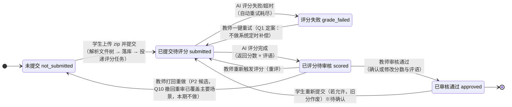
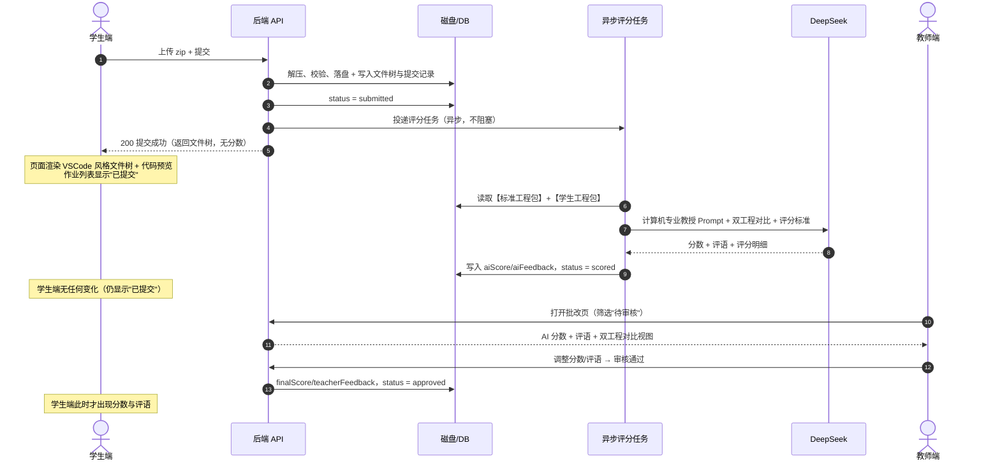

# PRD — 实训题（project 类型）流程定义规范

> 版本：v1.2 ｜ 作者：许清楚（产品经理）｜ 状态：**已定案（Q1~Q12 甲方已确认，见第 8 节；Q9 于 2026-10-09 经甲方确认由「禁止发布」变更为「软警告 + 教师确认」，见 §8.1，新增开放性实训题见第 9 节）**
> 目的：在重构代码之前，先锁定**唯一正确的业务流程**。本文是后续架构设计与开发的唯一流程依据。

---

## 0. 项目信息

| 项 | 内容 |
|---|---|
| Language | 简体中文 |
| 前端 | Vue3 + Ant Design Vue |
| 后端 | Node/Express + Prisma + MySQL |
| 模块 | 实训题（Question.type = `project`） |
| AI 模型 | deepseek-v4-flash（1M 上下文，角色：计算机专业教授） |
| 文档范围 | 只定义流程、状态、可见性、页面行为；**不含代码实现** |

### 原始需求复述

学生进入实训题上传 zip 工程包 → 提交后页面以 VSCode 风格显示文件树与代码预览 → 作业列表显示"已提交" → 再次进入可回看自己提交的文件树与代码 → 提交后 AI 在后台自动评分（对比标准工程包与学生工程包）但学生看不到分数 → 教师审核通过后学生才能看到评分结果。**标准工程包绝不可泄露给学生端。**

---

## 1. 产品目标

> **一句话**：让学生"提交即可见自己的工程、状态明确、不见分数"，让教师"AI 先评、人工把关、一键放分"，并在全链路上物理隔离标准工程包，杜绝答案泄露。

拆解为三个正交目标：

- **G1 提交可靠可回看**：学生的每一次提交都被完整持久化，任何时候重新进入题目都能看到与提交时完全一致的文件树和代码。
- **G2 评分异步不打扰**：AI 评分在后台自动完成，不阻塞学生提交动作，学生全程无感知分数。
- **G3 放分由教师控制**：分数在教师显式审核通过前，任何学生端接口都不返回。

---

## 2. 用户故事

### 学生视角

| 编号 | 用户故事 |
|---|---|
| US-S1 | 作为**学生**，我想上传我的 zip 工程包并提交，以便完成实训作业。 |
| US-S2 | 作为**学生**，我想在提交后立即看到系统解析出的文件树和代码预览（VSCode 风格），以便确认我交对了文件、没有传错包。 |
| US-S3 | 作为**学生**，我想在作业列表看到该题状态为"已提交"，以便知道我已完成、不必重复提交。 |
| US-S4 | 作为**学生**，我想重新进入该题时看到上次提交的完整文件树和代码，以便复查我交了什么。 |
| US-S5 | 作为**学生**，我想在教师审核放分后看到分数和评语，以便了解自己的实训成绩与不足。 |

### 教师视角

| 编号 | 用户故事 |
|---|---|
| US-T1 | 作为**教师**，我想在题目编辑页上传标准工程包并填写评分标准，以便 AI 有对比基准。 |
| US-T2 | 作为**教师**，我想在学生提交后系统自动发起 AI 评分，以便我不必逐个手动点击触发。 |
| US-T3 | 作为**教师**，我想在批改页并排查看"标准工程 vs 学生工程"以及 AI 给出的分数与评语，以便快速判断 AI 评分是否合理。 |
| US-T4 | 作为**教师**，我想调整分数/评语后点击"审核通过"，以便把成绩正式放给学生。 |
| US-T5 | 作为**教师**，我想在列表中按状态筛选（待评分 / 待审核 / 已审核），以便掌握批改进度。 |
| US-T6 | 作为**教师**，我想对「没有唯一答案」的实训题**不上传标准工程包**（开放性题目），由 AI 只依据我写的评分标准做评价式评分，以便布置开放式实训任务。 |
| US-T7 | 作为**教师**，我想在布置含开放性题目的作业时被明确提醒并二次确认，以便清楚这是一份「无参考答案对比」的作业。 |

---

## 3. 核心业务规则（铁律）

| 编号 | 规则 | 说明 |
|---|---|---|
| **R1** | **标准工程包物理隔离** | 标准包存储路径与学生提交路径分离；学生端**任何接口**都不得返回标准包的文件树、文件内容或下载地址。 |
| **R2** | **学生端字段白名单** | 学生端题目详情接口只返回：题目描述、附件（题面素材）、**评分标准（scoringRubric）**、自己的提交。必须剔除：标准工程包、参考答案（referenceAnswer）、其他学生的提交。 |
| **R3** | **AI 评语二次泄露防护** | AI 评语中可能直接引用标准答案代码片段。因此 **AI 原始评语（aiFeedback）永不下发学生端**；对学生可见的只有教师确认/编辑后的评语（teacherFeedback）。 |
| **R4** | **分数下发单一开关** | 学生端能否看到分数，**只取决于状态是否已进入"已审核通过"**，不得由前端控制显隐（前端隐藏 ≠ 接口不返回）。 |
| **R5** | **提交即触发评分** | AI 评分由"学生提交成功"这一事件**自动异步触发**，不依赖教师手动点击（教师手动触发保留为兜底能力）。 |
| **R6** | **评分失败对学生透明** | AI 评分失败不改变学生端展示（仍为"已提交"），只在教师端暴露异常并支持重试。 |
| **R7** | **提交内容不可变** | 一次提交（version）的文件内容在提交后不可被修改；学生重新提交生成新版本，不覆盖历史记录。 |

---

## 4. 提交流程状态机

### 4.1 状态图



### 4.2 状态定义与可见性

| 状态 | 学生端看到 | 教师端看到 | 进入条件 | 离开事件 |
|---|---|---|---|---|
| **未提交**<br/>`not_submitted` | 题目描述、评分标准、上传区；状态标签"**未提交**" | 该生"未提交"，可查看题目与标准包 | 初始状态 / 教师打回 | 学生提交 |
| **已提交待评分**<br/>`submitted` | 自己的文件树 + 代码预览（只读）；状态标签"**已提交**"；**无分数、无评语、无"评分中"字样** | 学生文件树/代码、提交时间；状态"**待评分**"；可手动触发评分 | 学生提交成功且文件解析入库 | AI 评分完成 / 失败 |
| **评分失败**<br/>`grade_failed` | 与"已提交"完全一致（对学生透明） | 状态"**评分异常**" + 失败原因 + [重试] 按钮 | AI 调用异常且重试耗尽 | 教师/系统重试 |
| **已评分待审核**<br/>`scored` | **与"已提交"完全一致**（状态标签仍为"已提交"，不显示"待审核"，避免学生催分） | AI 分数、AI 评语、评分明细；标准工程 ↔ 学生工程并排对比；[修改分数][审核通过] | AI 返回有效评分结果 | 教师审核通过 / 重评 / 打回 |
| **已审核通过**<br/>`approved` | 文件树 + 代码预览 + **最终分数 + 教师评语**；状态标签"**已评分**" | 最终分数、审核人、审核时间；可撤回重审 ※待确认 | 教师点击"审核通过" | 学生重新提交（若允许） |

> **可见性判定唯一规则**：`学生可见分数 = (status == approved)`。除此之外任何状态，学生端接口的 `score` / `feedback` / `aiScore` / `aiFeedback` 字段一律不返回（不是返回 null 后前端隐藏，是**接口层直接不组装**）。

### 4.3 关键时序（提交 → 异步评分 → 审核）



---

## 5. 各页面行为矩阵

### 5.1 总览矩阵（行=页面，列=状态）

| 页面 \ 状态 | 未提交 | 已提交待评分 | 已评分待审核 | 已审核通过 |
|---|---|---|---|---|
| **教师端 · 题目编辑页** | 标准包上传/替换（**可选**，不上传即开放性题目）、评分标准编辑、满分设置；显示"已提交 0/N" | 同左；显示提交进度统计 | 同左 | 同左；标准包**允许替换但提示"将影响后续评分"** |
| **学生端 · 做题页** | 题面 + 评分标准 + zip 上传区 + [提交] | 只读文件树 + 代码预览 + "已提交"标签 + 提交时间；**无分数区** | **与"已提交"完全相同**（学生无感知） | 只读文件树 + 代码预览 + **分数卡片（最终分/满分）+ 教师评语** |
| **学生端 · 作业列表** | 状态列"未提交"（灰）；操作"去完成" | 状态列"**已提交**"（蓝）；分数列显示 `—`；操作"查看提交" | 状态列"**已提交**"（蓝）；分数列 `—` | 状态列"**已评分**"（绿）；分数列显示最终分；操作"查看结果" |
| **教师端 · 批改页** | 该生行"未提交"（置灰，不可批改） | "待评分"（橙）+ [手动触发评分]；可查看学生文件树/代码 | "**待审核**"（紫）+ AI 分数/评语 + 标准↔学生并排对比 + [修改分数][审核通过] | "已审核"（绿）+ 最终分 + 审核人/时间 + [撤回重审]（Q10 已定案） |

> 补充：`评分失败` 状态在学生端等同"已提交"；在教师端批改页显示"**评分异常**"（红）+ 失败原因 + [重试评分]。
>
> 补充（Q9 变更，2026-10-09）：实训题的**标准工程包为可选项**，未上传即为「开放性题目」（判据见 §9.1）。该类题目在教师端批改页**没有「标准答案包」对比栏**，固定为「学生工程 + AI 评语」两栏；布置作业时后端返回软警告请教师确认（见 §9.3）。

### 5.2 页面细则

**A. 教师端 · 题目编辑页（`type=project`）**
- 必填项：题目描述、满分、评分标准（scoringRubric）。
- **标准工程包（zip）为可选项**（Q9 变更，2026-10-09）：上传 → 该题按「标准模式」与标准包对比评分；不上传 → 该题为**开放性题目（open 模式）**，AI 只依据评分标准做评价式评分，不与参考答案对比。
- 标准包上传后展示其文件树供教师自查（**仅教师可见**）；未上传时编辑页固定给出「本项可选：不上传标准工程包即为开放性题目……」提示，并建议在评分标准中逐条写明必须完成的功能及分值。
- 「查看 AI 提示词」按有无标准包切换角色与模板：开放性题目不出现空的「标准答案源码」段（与实评共用同一构建函数，所见即所用）。

**B. 学生端 · 做题页**
- 进入时先请求"我的提交"：有 → 直接渲染只读文件树 + 代码预览；无 → 渲染上传区。
- 上传区：拖拽/点选 zip，前端预校验（后缀、大小），提交后显示解析进度。
- VSCode 风格视图：左侧目录树（可折叠）、右侧代码区（语法高亮、行号、只读）。
- **页面上永远不出现"AI 评分中""待审核"等中间态文案。**

**C. 学生端 · 作业列表**
- 状态列与分数列严格按 5.1 矩阵渲染，分数列在非 approved 状态下由**后端不返回该字段**。

**D. 教师端 · 批改页**
- 支持按状态筛选：全部 / 待评分 / 待审核 / 已审核 / 评分异常。
- 双栏对比视图：左"标准工程"、右"学生工程"，目录树可同步定位。
- 审核区：AI 分数（可编辑）、AI 评语（只读，供参考）、教师评语（可编辑，**这是下发给学生的内容**）、[审核通过]。

---

## 6. 需求池

### P0 — 必须满足（提交 / 回看 / 状态显示）

| ID | 需求 | 验收标准 |
|---|---|---|
| P0-1 | 学生上传 zip 并提交 | 提交成功后返回 200，文件落盘且入库；重复提交按 R7 生成新版本 |
| P0-2 | 提交后立即展示 VSCode 风格文件树 + 代码预览 | 文件树层级正确，点击文件可查看内容，语法高亮，只读 |
| P0-3 | 提交内容持久化，二次进入可回看 | 关闭浏览器/换设备重新进入，展示内容与提交时一致 |
| P0-4 | 作业列表显示"已提交" | 提交成功后列表状态立即变为"已提交"，分数列为 `—` |
| P0-5 | **标准工程包隔离** | 学生端全部接口返回体中不含标准包路径/文件树/内容；接口层做字段白名单 |
| P0-6 | **未审核不下发分数** | 非 approved 状态下，学生端接口返回体**不包含**任何分数/评语字段 |
| P0-7 | 数据模型统一 | 清理重复/废弃表，实训题提交只有**一个**数据来源（见第 7 节） |

### P1 — 应该满足（AI 后台评分 + 教师审核）

| ID | 需求 | 验收标准 |
|---|---|---|
| P1-1 | 提交成功后**自动异步**触发 AI 评分 | 提交接口不等待 AI 返回；任务投递失败要有日志与补偿 |
| P1-2 | AI 评分对比"标准工程 vs 学生工程" | Prompt 角色为"计算机专业教授"，输入含评分标准，输出分数 + 评语（+ 评分明细） |
| P1-3 | 评分完成状态流转至"已评分待审核" | 状态变更原子写入，学生端展示无任何变化 |
| P1-4 | 教师批改页双栏对比 + 审核通过 | 教师可改分改评语；点击审核通过后学生端立即可见 |
| P1-5 | 评分失败可见可重试（教师端） | 失败原因可读；[重试] 后重新进入待评分 |
| P1-6 | 教师手动触发评分（兜底） | 任意已提交状态下可手动发起/重评 |

### P2 — 体验优化

| ID | 需求 |
|---|---|
| P2-1 | 批量审核（勾选多个学生一键通过） |
| P2-2 | 评分明细（按评分标准分项给分并展示雷达/条形图） |
| P2-3 | 历史提交版本切换与 diff 对比 |
| P2-4 | 教师"打回重做"（退回未提交并附退回理由） |
| P2-5 | 代码预览增强：搜索、跳转、大文件懒加载、二进制文件友好提示 |
| P2-6 | 提交前客户端校验提示（缺少 README / 目录结构不符等） |
| P2-7 | 评分队列可观测（管理端查看任务积压与耗时） |

---

## 7. 数据与状态映射建议（给架构师）

> ⚠️ **现存问题（本次重构必须解决）**：`server/prisma/schema.prisma` 中存在**两个同名 `ProjectSubmission` 模型**（约 L421 与 L478），且**都 `@@map("project_submissions")`**——数据源冲突、语义重复。其中 L478 的 `{questionId, studentId, grade Json}` 即用户提到的"未使用的旧表"。

**建议方案（最小改动，无需新增表）**：实训题提交**复用现有 `submissions` 表**（`Submission` 模型已有 `assignmentId + studentId + questionId` 唯一约束、`aiScore/aiFeedback/finalScore/teacherFeedback/status/submittedAt/reviewedAt/attemptCount` 全部字段），与其他题型保持统一批改链路。

状态枚举映射（现有 `SubmissionStatus` 已足够，**无需改枚举**）：

| 业务状态 | 现有枚举值 | 说明 |
|---|---|---|
| 未提交 | `draft` | 无记录或草稿 |
| 已提交待评分 | `submitted` | 提交成功，评分任务已投递 |
| 已评分待审核 | `ai_graded` | AI 返回分数，教师待审 |
| 已审核通过 | `reviewed` | 教师审核通过，**学生可见分数** |
| （批量发布） | `published` | 保留，用于"整份作业统一放分"场景 |
| 评分失败 | — | 建议不新增枚举，用 `submitted` + 独立的 `gradeTaskStatus/失败原因` 字段承载 ※待确认 Q1 |

字段职责约定：
- `answer`（Text）：存实训题提交元信息 JSON — 提交目录、zip 原名、文件数、总大小、版本号、入口路径。
- `aiScore` / `aiFeedback`：**教师专用**，任何学生端接口不得组装（R3）。
- `finalScore` / `teacherFeedback`：**学生可见字段**，仅在 `status ∈ {reviewed, published}` 时下发。
- 文件树与文件内容：磁盘 `uploads/project-submissions/{questionId}/{studentId}/{version}/`；标准包独立目录 `uploads/project-standards/{questionId}/`，两者路径前缀严格分离，便于在网关/静态服务层直接拦截。

---

## 8. 甲方定案记录（Q1~Q12 已确认，2026-08）

> 下表为甲方确认后的最终定案。原「我的建议」保留供追溯；「定案」列为唯一执行依据。落点标注 P1（本期必须实现）/ P2（后续迭代）。

| # | 问题 | 备选方案 | 我的建议 |
|---|---|---|---|
| Q1 | **AI 评分失败怎么处理？** | A. 自动重试 N 次后置为"评分异常"，教师手动重试；B. 失败即转纯人工批改；C. 静默重试直到成功 | **A**：自动重试 2 次（指数退避），仍失败则教师端标红并支持一键重试；学生端全程无感 |
| Q2 | **教师审核是逐个还是批量？** | A. 仅逐个；B. 逐个 + 批量勾选一键通过 | **B**，但批量通过为 P2；P1 先做逐个，保证质量把关 |
| Q3 | **分数是否允许教师修改？** | A. 只能确认不能改；B. 可改，且保留 AI 原始分留痕 | **B**：`aiScore` 保留原值，`finalScore` 记教师最终分，可追溯 |
| Q4 | **`已评分待审核` 时学生端显示什么？** | A. 仍显示"已提交"；B. 显示"待教师审核" | **A**：避免学生知道已出分而反复催分；B 会引发额外沟通成本 |
| Q5 | **学生是否允许重复提交？次数上限？截止后能否提交？** | A. 不限次数，以最后一次为准；B. 限 N 次；C. 审核通过后禁止再交 | **A + C**：审核通过前可无限重交（旧分作废、重新排队评分），审核通过后锁定 |
| Q6 | **AI 评语是否对学生可见？** | A. 完全不可见，只看教师评语；B. 教师编辑脱敏后可见 | **B**：教师在审核页可"一键引用 AI 评语到教师评语"并删改，兼顾效率与防泄露 |
| Q7 | **上传包限制？** | 大小上限（如 50MB）、层级上限、是否禁止 `node_modules`/`.git`/二进制、文件数上限 | 需甲方给出具体数值；建议 50MB / 2000 文件 / 自动忽略 `node_modules`、`.git`、`dist` |
| Q8 | **代码预览范围？** | 哪些后缀高亮预览、单文件大小上限、图片/二进制如何处理 | 建议：文本类全部可看，单文件 >1MB 折叠懒加载，二进制显示"不支持预览" |
| Q9 | **没有标准工程包的实训题能否发布/评分？** | A. 禁止发布；B. 允许发布，AI 仅按评分标准评分 | **A**：无基准的 AI 评分质量不可控 → **2026-10-09 甲方确认变更为 B（软警告 + 教师确认），见 §8.1** |
| Q10 | **审核通过后能否撤回重审？** | A. 不可撤回；B. 可撤回，学生端分数随即隐藏 | **B**，但需给学生一条通知，避免"分数消失"的困惑 |
| Q11 | **是否需要评分明细（分项得分）？** | A. 只要总分+评语；B. 按评分标准分项给分 | **B** 更有教学价值，但排 P2 |
| Q12 | **历史提交版本学生能否回看？** | A. 只看最新；B. 可切换历史版本 | **A**（P0 阶段），B 排 P2 |


### 定案结论

| # | 定案 | 理由与执行要点 | 落点 | 实现现状 |
|---|------|--------------|------|---------|
| Q1 | **A**：自动重试 2 次（指数退避 3s→10s，429 额外退避）→ 仍失败置 `grading.state=failed`，提交状态保持 `submitted`（学生无感）；教师端批改页标红"评分异常"+ 失败原因 + **[一键重试]** | 失败必可救；不做系统定时自动补偿（控制 API 成本）。一键重试即重新走 `enqueueProjectGrade` 同一路径 | P1 | 重试 2 次已实现（deepseek.js）；**教师端一键重试缺失，需补端点 + 按钮** |
| Q2 | **B**：P1 逐个审核（现状）；P2 批量勾选一键放行 | 批量只放行 `ai_graded`，不改分；`submitted/failed` 不参与批量 | P1 逐个 / P2 批量 | 逐个审核已实现；批量未做 |
| Q3 | **B**：可改，`aiScore` 保留 AI 原值留痕，`finalScore` 记教师最终分（0~maxScore 钳制） | 已实现，维持现状；撤回重审后可再改 | P1 | ✅ 已实现（reviewProjectSubmission 只写 finalScore） |
| Q4 | **A**：`ai_graded` 对学生端映射为"已提交"，任何中间态文案不下发 | 避免学生催分；接口层映射（非前端隐藏） | P1 | ✅ 已实现（projectView.toStudentView） |
| Q5 | **A+C 变体，挂钩作业字段**：提交窗口 startTime ≤ now ≤ endTime；`allowResubmit=false` → 仅 1 次，`true` → 不限（版本递增）；`maxAttempts>0` 时以其为上限；**审核通过后锁定**，教师撤回重审（Q10）后重新开放；新提交清空旧 `aiScore/finalScore/teacherFeedback` 并重新排队 | 与编程题语义一致；版本目录天然支持多交（R7） | P1 | 版本递增已实现；**endTime/锁定/次数校验缺失（assertStudentInAssignment 取到字段未使用）；提交未清空旧分，需补** |
| Q6 | **B**：AI 原始评语永不下发（R3，现状）；审核页加 **[引用 AI 评语]** 按钮，一键带入教师评语框供删改 | 效率与防泄露兼顾 | P1 | ✅ 隔离已实现；引用按钮未做（小功能） |
| Q7 | 具体数值定案：zip ≤ **50MB**；解压后文件数 ≤ **2000**；解压总展开 ≤ **200MB**（防解压炸弹）；目录层级 ≤ **20**；符号链接跳过；忽略 `node_modules/.git/__pycache__/.idea/.vscode/dist/build/target/out/venv/.venv/.env` 与二进制/图片/Office/压缩包后缀 | 越限整包拒收并回滚版本目录（沿用现有回滚逻辑） | P1 | 50MB（multer）✅、忽略规则 ✅、Zip-Slip ✅；**文件数/展开大小/层级/符号链接校验缺失，需补** |
| Q8 | 文本类全量预览（扩展名映射语言，未知按 plaintext）；单文件 >1MB 折叠为占位；**图片/二进制/压缩包不进文件树、不参与评分**（维持现状过滤策略） | 简化实现，教学包一般不含二进制资源 | P1 | ✅ 基本已实现（MAX_TEXT_BYTES=1MB、isIgnored） |
| Q9 | ~~**A**：允许存草稿，**布置作业时强校验**——作业含 project 题则该题必须已有非空标准包目录，否则拒绝创建/更新作业；已发布作业可替换标准包但提示"将影响后续评分"~~ → **B（2026-10-09 变更，见 §8.1）**：允许建题免上传，布置时**软警告 + 教师确认**，确认后按开放性题目（评价式评分）布置 | 无基准的 AI 评分质量风险改为**教师知情决策**（原硬拒绝方案让功能不可用，无法覆盖开放式命题） | P1 | ✅ 2026-10 已实现：建题免上传、布置软警告（code=1007）+ 教师确认、无包走 open 评价式评分、审核页两栏、提示词预览按模式切换；**有标准包题目全链路与变更前一致** |
| Q10 | **B**：教师可撤回重审——`reviewed → ai_graded`，`finalScore` 清空、`teacherFeedback` 保留，学生端分数立即隐藏（状态驱动）；学生做题页顶部显示"成绩已被教师撤回重审"横幅；撤回后重新开放提交（配合 Q5） | 不建独立消息系统（无基础设施），横幅由状态驱动实现 | P1 撤回 / P2 通知增强 | **撤回端点缺失，需补**；隐藏逻辑 ✅（canStudentSeeScore） |
| Q11 | **B**：评分明细分项展示，排 P2 | AI 已返回结构化 breakdown/highlights/issues（aiFeedback JSON），数据层就绪，仅差前端展示（条形图/雷达图：教师审核页 + 学生成绩页） | P2 | ✅ 数据结构已落库；展示未做 |
| Q12 | **A**（P1 学生只看最新版本）+ **B**（P2 版本切换） | 版本目录已全量留存（R7），P2 学生端只读切换 + 教师端版本 diff | P1 现状 / P2 切换 | ✅ 版本留存已实现；切换未做 |

### 8.1 Q9 变更记录（2026-10-09 甲方确认）

| 项 | 内容 |
|---|---|
| 变更时间 | 2026-10-09（甲方确认；原定案见 §8 Q9） |
| 原定案 | **Q9-A「禁止发布」**：作业含 project 题则该题必须已有非空标准包目录，否则拒绝创建/更新作业；未上传标准包的实训题只能存草稿、不允许发布。 |
| 新定案 | **软警告 + 教师确认**：无标准包的实训题允许**建题免上传**、允许布置；布置时后端返回 `400 + code=1007 + data.warnings[]`（`requiresConfirmation: true`）请教师确认，教师显式确认（`confirmWithoutStandardPackage: true`）后正常创建。该类题目按**开放性题目**评分：AI 仅依据教师评分标准做**评价式评分**，不与参考答案对比。 |
| 变更理由 | 甲方 2026-10 反馈：实训题中大量任务**本就没有唯一答案**（自由命题/课程设计），教师无法提供标准工程包，原「禁止发布」把 AI 评分质量风险直接变成「功能不可用」。改为软警告 + 显式确认后，风险由**教师知情决策**承担，同时有标准包的题目链路完全不受影响。 |
| 影响面 | ① **建题**：标准包（`tempId`）由必填改为可选；② **布置**：Q9 硬 400 → code=1007 软警告 + 前端确认框；③ **评分**：无包走 `mode='open'`（评审专家角色 + 无「标准答案源码」段的评价式 prompt）；④ **审核**：无包时审核页不渲染「标准答案包」页签，固定「学生提交 + AI 评语」两栏；⑤ **提示词预览**：两个提示词端点按有无标准包切换，响应新增 `data.mode: 'open' \| 'standard'`。 |
| 唯一判据 | `utils/projectPaths.hasStandardPackage(questionId, attachmentUrl)`：`attachmentUrl` 非空 **或** 标准包目录非空 → 标准模式；两者皆无 → **开放性题目**（兼容历史数据：目录有文件但 attachmentUrl 为空的老题不会被误判为开放性题目）。 |
| 业务码 | `1007`（1005/1006 已被项目模块占用），复用既有 `400` HTTP 语义。 |
| 回归保证 | 有标准包的题目：建题/布置/评分/审核/预览全链路与变更前**逐字节一致**（含 deepseek.js 的标准模式 prompt 冻结基线用例）。 |

---

## 9. 开放性实训题（无标准工程包，2026-10 新增）

> 本节是 §8.1 Q9 变更后的**流程补充定义**；第 3~5 节的铁律（R1 标准包物理隔离、R2 学生端白名单、R3 AI 评语防护、R4 分数单一开关）对开放性题目**完全适用**：它只是没有标准包，可见性与放分规则不变。

### 9.1 定义与判据

- **定义**：没有标准工程包的实训题（`Question.type='project'` 且 `attachmentUrl` 为空、标准包目录也没有文件）。
- **判据（唯一）**：`hasStandardPackage(questionId, attachmentUrl)` 为 `false` → 开放性题目。建题、布置、AI 实评、提示词预览**共用同一判据**，不允许各处自行判断。
- **评分模式**：`standard`（有包，对比标准答案）/ `open`（无包，评价式评分）。
- **存储**：**不新增数据库字段**，判据由既有 `attachmentUrl` + 标准包目录推导。

### 9.2 全链路行为

| 环节 | 开放性题目行为 |
|---|---|
| **建题** | 标准工程包可选：不传 `tempId` 直接保存成功（编辑页固定提示「本项可选：不上传标准工程包即为开放性题目……」，建议在评分标准中逐条写明必须完成的功能及分值）。 |
| **布置作业** | 未确认 → `400 + code=1007 + data.warnings[{questionId,title,message}]`，**不创建作业**；前端弹确认框，确认后带 `confirmWithoutStandardPackage=true` 重提 → 创建成功；取消 → 不创建。有标准包/非实训题不产生警告。 |
| **学生提交** | 与标准模式一致：zip 上传、版本目录落盘、返回文件树、异步触发评分；学生端无任何差异（R5/R7）。 |
| **AI 评分** | `mode='open'`：system 角色为「项目评审专家」（明确没有标准答案可比对、不得臆造）；user prompt **不含「标准答案源码」段**，其余（题目/要求/评分标准/学生源码/JSON 结构与输出约束）与标准模式逐字节一致。 |
| **教师审核** | 审核数据端点 `standardFiles` 为空 → 审核页**不渲染「标准答案包」页签**，固定「学生提交 + AI 评语」两栏（有标准包时三栏/两页签不变）。 |
| **提示词查看** | 编辑页模板预览与审核页实际提示词均按判据切换模式，响应带 `data.mode`；开放性题目**预览 = 实评**（逐字节一致），不出现空的「标准答案源码」段。 |
| **学生端可见性** | 与标准模式完全一致：审核通过前不下发任何分数/评语（R3/R4 不变）。 |

### 9.3 布置确认契约（前端 ↔ 后端）

```jsonc
// 请求（未确认）
{ "title": "…", "questionIds": [12], "classIds": [3] }
// 响应：HTTP 400
{
  "code": 1007,
  "message": "以下题目未上传标准工程包，AI 将仅依据评分标准做评价式评分（不与参考答案对比）：〈题名〉、…。确认按开放性题目布置？",
  "data": {
    "requiresConfirmation": true,
    "warnings": [{ "questionId": 12, "title": "〈题名〉", "message": "题目「〈题名〉」未上传标准工程包，将按开放性题目布置：AI 仅依据评分标准做评价式评分，不与参考答案对比" }]
  }
}
// 确认后重提：请求体增加 "confirmWithoutStandardPackage": true → 200 + code 0 + assignment
```

### 9.4 已知边界

- 提示词预览的学生源码段是**占位符**（真实提交在评分时才有），因此预览与实评只在学生源码段不同；其余部分逐字节一致。
- 未回填的标准包目录（历史数据）会让该题按**标准模式**处理——这是刻意为之的兼容策略，避免把老题误判为开放性题目。
- 开放性题目仍走同一套评分失败/重评/审核链路（Q1/Q5/Q10 不变）。

