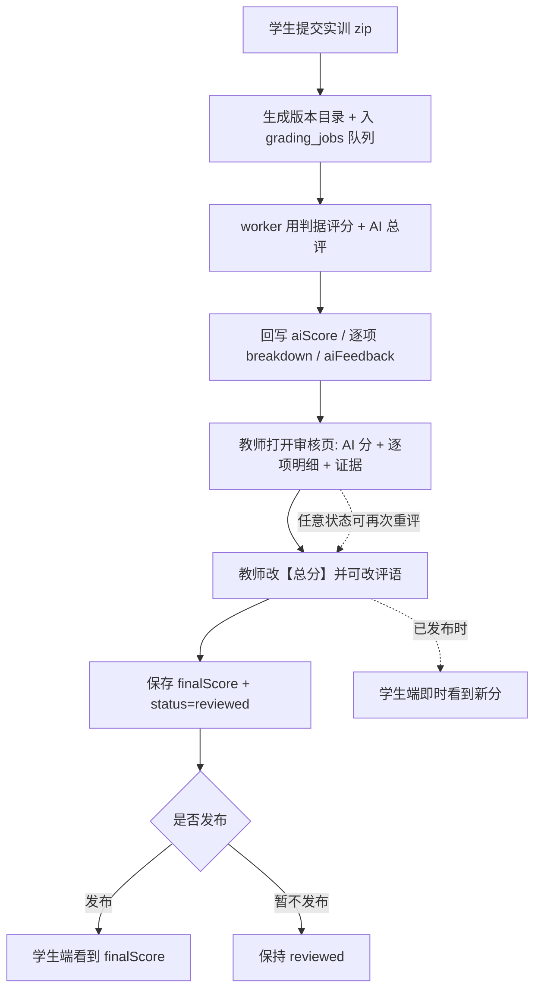
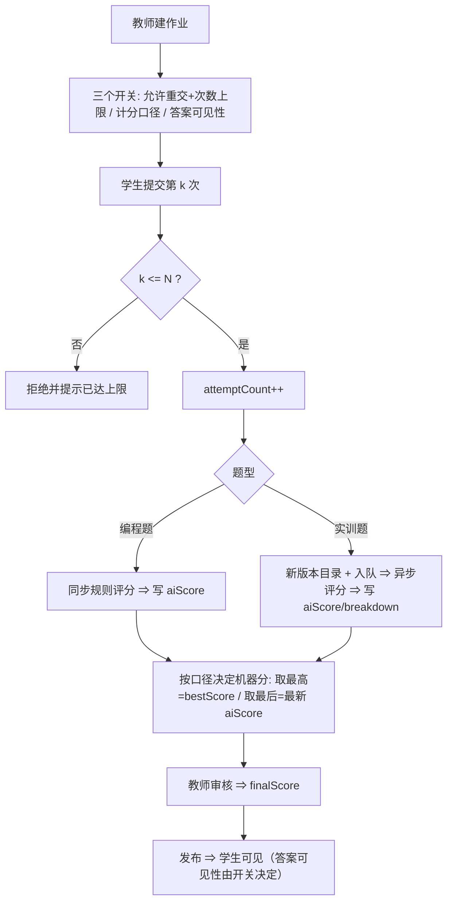

# 需求文档：实训题教师重评 + 反复提交与计分口径（v1.0）

> 模式：**敏捷模式**（Epic → User Story → 验收标准）｜范围：①实训题教师重评 ②反复提交与练习/考试模式收敛
> 来源：2026-10-14 需求分析（8 问澄清 + 3 条拍板）｜关联实现：现有 `submissions.attemptCount/bestScore`、`Assignment.mode/maxAttempts`、编程题 regrade 与实训 project/regrade 接口
> 说明：本文件由需求分析流程产出，**未做实现改动**；文档中"现状"均为读码核实结论。

## 0. 已定决策摘要（本次需求分析的结论，后续需求以此为准）

| # | 决策 | 内容 |
|---|---|---|
| D1 | **三个正交开关**（不恢复"练习模式"这个独立模式） | ①能否重复提交/次数 ②多次提交的计分口径（取最高/取最后）③提交后答案与解析的可见性 |
| D2 | **题型默认值**（能力仍按开关给，教师可改） | 编程题：允许重交、默认不限次、**取最高**、**提交后可看答案解析**；实训题：默认 **1 次**、**取最后**、**发布后可见** |
| D3 | **不允许"退回重交"**（教师不能临时给某个学生 +1 次） | 已知取舍：见 §9.1 与其兜底 |
| D4 | 计分口径**只作用于机器分**（aiScore/bestScore）；**教师分每题只有一个权威值**，以教师最后一次为准 | 零数据库迁移 |
| D5 | 实训题重评**只改总分**（不做逐项改分）；**任意状态**可重评；**教师分覆盖**，学生只看到教师分 | 与现有接口语义一致 |

## 1. 术语表

| 术语 | 含义 |
|---|---|
| 尝试 / attempt | 学生对同一题的一次提交；`submissions.attemptCount` 记录次数 |
| 计分口径 | 多次提交时，**机器分**采用哪一次（取最高 / 取最后） |
| 答案可见性 | 学生何时能看到参考答案与解析（提交后立即 / 发布后） |
| 重评（regrade） | 对**同一份提交**重新算分：①机器重跑（判据更新/装置重跑）②教师改分 |
| 新提交 | 学生改答案后再交一次 —— **不是重评**，走"反复提交"链路 |
| 造尺 / 判据 | 实训题按（题目+标准+评分细则）生成的内容寻址判据集；**构建有 LLM 成本** |
| 机器分 / 教师分 | `aiScore`+`bestScore` / `finalScore`；学生可见值 = `finalScore ?? aiScore` |

## 2. 业务流程

### 2.1 实训题教师重评（D5）

### 2.2 反复提交与计分口径（D1/D2）

## 3. 可行性分析

| 维度 | 结论 | 依据与风险 |
|---|---|---|
| 技术（重评） | **高** | 重评接口、审核页人工评分、状态机均已存在；本期只做口径收敛（只改总分）与"任意状态"回归 |
| 技术（反复提交） | **中** | `attemptCount`/`bestScore`/`maxAttempts` 已有；⚠️ 唯一键使**每题仅一行** ⇒ "取最高"只能表达机器分（D4 已定，零迁移）|
| 业务 | **高** | 去掉"练习模式"壳后语义更简单：练习 = 不限次 + 立即可见答案 + 分数不参与统计 |
| 资源/成本 | **中** | 实训每次提交都会触发（造尺/评分 + LLM 总评）⇒ 默认 1 次；UI 需提示成本 |
| 回归风险 | **低** | 编程题零 LLM、改动面小；实训侧复用既有链路 |

## 4. 需求拆解（Epic / User Story / 验收标准）

### Epic A：实训题教师重评（只改总分、教师分覆盖）

**US-A1（P0，S）教师可对实训提交改总分与评语**
- 作为教师，我希望在审核页直接改这份实训提交的**总分**并保存评语，以便纠正机器评分。
- AC1：Given 我在审核页打开一份实训提交，When 我修改总分并保存，Then `finalScore` 更新为该值，页面即时显示，且不影响 `aiScore`/`breakdown`。
- AC2：Given 我只改评语不改分，When 保存，Then 评语更新、分值不变。
- AC3：Given 输入非法分值（非数字/超出 0–满分范围），When 保存，Then 前端拦截并给出可读提示，**不发起请求**。

**US-A2（P1，S）任意状态可重评，且已发布时学生端即时生效**
- AC1：Given 提交处于 ai_graded / reviewed / published 任一状态，When 教师改分保存，Then 均保存成功（不要求先撤回）。
- AC2：Given 该提交已发布，When 教师改分，Then 学生端刷新后看到新分（无需重新发布）。
- AC3：现状已支持 ⇒ 本期只需**回归断言**（见 §7 追溯）。

**US-A3（P1，XS）重评权限与可见范围**
- AC1：教师只能重评**可见班级**内的提交；越权 ⇒ 403。
- AC2：管理员可重评任意班级（与既有管理端一致）。

### Epic B：三个正交开关与计分口径

**US-B1（P0，M）作业配置暴露三个开关（含题型默认值）**
- 作为教师，我希望在建作业时配置：①是否允许重交 + 次数上限 ②计分口径（取最高/取最后）③答案可见性（提交后立即/发布后），以便用一个作业覆盖"练习/作业/考试"三种形态。
- AC1：Given 我新建作业并选择题型，When 表单渲染，Then 三个开关按 D2 的题型默认值**预填**且可改。
- AC2：Given 我把次数设为 1，When 保存，Then 该作业下学生第 2 次提交被拒绝并给出上限提示。
- AC3：Given 作业未配置（历史数据），When 读取，Then 沿用现有行为（允许重交、取最后、发布后可见），**不产生行为变化**。
- AC4：Given 题型为实训题，When 我展开配置，Then 显示成本提示："每次提交都会触发评分流程（耗时数分钟并产生模型费用），建议设置次数上限"。

**US-B4（P0，M）计分口径落地（只作用机器分，D4）**
- AC1：Given 作业口径=取最后，When 学生第 3 次提交得 78 分（前次 85），Then 该题机器分为 78。
- AC2：Given 作业口径=取最高，When 学生第 3 次提交得 78 分（前次 85），Then 该题机器分为 85（读取 `bestScore`）。
- AC3：Given 教师已给 `finalScore`，When 学生再次提交，Then `finalScore` **不被机器分覆盖**（教师分仍是权威值；教师可再次改分）。
- AC4（**v1.1 修订**）：Given 作业口径=取最高，When 教师打开审核页，Then 页面**并列展示**「计入分（最高分）」与「明细来源（最近一次评分）」，并**明示以计入分为准** ⇒ 消除"分数与明细错配/来源误标"这一真正风险。
  - ⚠️ 原表述"展示最高那次的逐项明细"**在当前数据模型下不可得**（D4 决定零迁移 ⇒ 只存 `bestScore`，没有 per-attempt 的判据明细）。
  - 📌 后续项（P2，需一次迁移或读实训版本归档）：按 attempt/version 存 AI 判据结果 + 新端点「取最高那次的明细」。实训侧每次提交都留版本目录（磁盘上有素材），编程题无历史。

**US-B2（P1，S）答案与解析的可见性**
- AC1：Given 可见性=提交后立即，When 学生提交并评分完成，Then 可查看参考答案与解析（沿用现有"练习"下的展示逻辑）。
- AC2：Given 可见性=发布后，When 尚未发布，Then 学生看不到答案与解析，只看到提交状态。
- AC3：Given 可见性变更，When 学生刷新，Then 立刻按新配置生效（不需要重新提交）。

**US-B5（P1，M）移除"练习模式"壳并清理后端分支**
- AC1：Given 代码中 `isPracticeMode`/`practiceAllGraded` 等分支，When 本需求完成后，Then 不再以"模式"驱动行为，而是由三个开关驱动（保留等价能力）。
- AC2：Given `Assignment.mode` 字段，When 本需求完成后，Then 字段保留但不再作为行为开关（历史数据兼容）；建作业时不再写入 `practice`。
- AC3：Given 既有"练习"形态，When 用新配置复现（不限次 + 提交后可见答案 + 不计分），Then 学生体验等价。

**US-B6（P1，S）学生端展示第几次尝试与可见分**
- AC1：Given 学生已提交 k 次，When 打开作业，Then 显示"第 k 次提交"与本次分数。
- AC2：Given 口径=取最高且当前可见，When 查看，Then 显示"当前计入的最高分"（未发布时按现有可见性规则不下发）。
- AC3：Given 未发布，When 查看，Then 不显示 `finalScore`/`teacherFeedback`（沿用现有规则）。

### Epic C：实训提交的边界

**US-C1（P1，XS）失败的提交不消耗次数**
- AC1：Given 上传的包解压失败或含穿越路径，When 提交，Then 整包拒收、回滚版本目录，**`attemptCount` 不增加**（现状已如此，补回归断言）。

**US-C2（P1，XS）次数上限的拦截与提示**
- AC1：Given 已达上限，When 再次提交，Then 返回明确的"已达提交次数上限"提示（现为通用错误 ⇒ 需细化文案）。
- AC2：Given 已达上限，When 打开提交页，Then 提交按钮禁用并说明原因。

### 非功能需求

- **性能**：编程题评分同步完成（秒级）；实训题异步（分钟级），须在 UI 明示"评分中"并支持轮询/刷新。
- **成本**：实训题每次提交触发造尺/评分 + LLM 总评 ⇒ 需在教师配置侧提示，并在作业详情显示"已产生费用"入口（复用既有用量页）。
- **安全**：重评与配置变更沿用现有鉴权（教师=可见班级范围；管理员=超管链），不得越权。
- **可用性**：评分失败须有明确状态（failed/needs_rerun）与重跑入口（复用既有 rerun）。
- **兼容性**：历史作业/提交不因本需求改变行为（见 US-B1 AC3）。

## 5. 需求矛盾检测报告（6 维度）

| 序号 | 矛盾类型 | 涉及需求 | 矛盾描述 | 建议处理方式 |
|---|---|---|---|---|
| 1 | 业务规则冲突 | D3（不退回重交） vs US-C2 | 实训题限 1 次时，学生若"包能解压但内容不对"，该机会即耗尽；而**提高 maxAttempts 是作业级配置**，会影响全体学生，无法只补救一人 | ✅ **已定（2026-10-14 用户选 ①）**：接受"只能整班调整次数、事后再调回"；不做按学生 +1 次；教师直接改分（US-A1）作为补充补救 |
| 2 | 数据约束冲突 | US-B4 vs US-B6 | `bestScore` 现有下发规则是"已发布或练习模式"；若口径=取最高而未发布，学生看不到最高分 ⇒ 与"取最高"的直觉不一致 | 明确：未发布时**只给教师看**最高分，学生按发布后可见（保持现有安全边界）|
| 3 | 功能冲突 | US-A1 vs US-B4 | 教师已给分后又产生新提交 ⇒ 机器分变化但是否影响教师分 | 已在 D4 解决：教师分不被覆盖；审核页提示"该生有新提交，建议复核" |
| 4 | 角色权限冲突 | US-A3 | 管理员是否可重评 | 默认**可以**（与既有管理端一致），如需限制请说明 |
| 5 | 互斥需求优先级冲突 | P0 集合 | 未发现互斥 | — |
| 6 | 功能与非功能冲突 | US-B1（编程题不限次） vs 成本 | 编程题评分零 LLM ⇒ 无成本冲突；实训题已限次 ⇒ 一致 | — |

> **矛盾 1 未解决前，本文件视为"待确认版"**（仅影响实训题的补救路径，不阻塞其余需求）。

## 6. 需求追溯矩阵

| 流程节点 | 节点描述 | 关联需求 | 覆盖 |
|---|---|---|---|
| N1 | 学生提交（编程/实训） | US-B1 / US-C1 / US-C2 | ✅ |
| N2 | 次数校验与 attemptCount | US-B1(AC2) / US-C2 | ✅ |
| N3 | 机器评分（同步/异步） | US-B4 / US-C1 | ✅ |
| N4 | 按口径确定机器分 | US-B4 | ✅ |
| N5 | 答案可见性 | US-B2 | ✅ |
| N6 | 教师打开审核页 | US-A1 / US-A3 / US-B4(AC4) | ✅ |
| N7 | 教师改总分/评语 | US-A1 | ✅ |
| N8 | 任意状态重评 | US-A2 | ✅ |
| N9 | 发布与学生可见 | US-A2 / US-B6 | ✅ |
| N10 | 移除练习模式壳 | US-B5 | ✅ |

**流程覆盖率：10/10 = 100% ✅**（反向检查：每个 US 均可追溯到 N1–N10 中至少一个节点 ✅）

## 7. 数据与接口影响（实现指引，供排期参考）

| 项 | 影响 |
|---|---|
| 数据 | **本期零迁移**（复用 `attemptCount`/`bestScore`/`maxAttempts`；`mode` 保留不用）。若未来要"教师分也取最高"或"每次提交的分可审计"，需新增 per-attempt 记录（一次迁移）|
| 接口（复用/微调） | 作业创建/更新：新增三个开关字段（`allowResubmit`/`scorePolicy`/`answerVisibility`，或复用 `maxAttempts`+`mode` 扩展）；提交接口：上限文案细化；审核接口：维持 `regrade`/`project/regrade` |
| 前端 | 建作业表单（三开关 + 题型默认 + 成本提示）；提交页（第 k 次、上限提示、答案可见性）；审核页（只改总分、取最高时展示最高那次明细、"有新提交建议复核"提示）|
| 清理 | `isPracticeMode`/`practiceAllGraded` 等"模式"分支改为"开关驱动"（US-B5）|

## 8. 优先级与工作量

| 优先级 | Story | 工作量 |
|---|---|---|
| **P0** | US-A1、US-B1、US-B4 | S + M + M ≈ 5–7 人天 |
| **P1** | US-A2、US-A3、US-B2、US-B5、US-B6、US-C1、US-C2 | ≈ 6–9 人天 |
| P2 | — | — |

**P0 占比：3/11 = 27% ✅**（阈值 ≤30%，无需二次排序）

## 9. 已知取舍与假设

### 9.1 已知取舍
- **D3 不退回重交** ⇒ 实训限 1 次时缺少"单人补救"手段（见矛盾 1）；现有兜底：教师整班调高次数、或用 US-A1 直接改分。
- 计分口径只作用机器分（D4）⇒ 若教师先前给过更高的分、后来改低，最终按**教师最新值**（符合"教师最新判断为准"）。

### 9.2 ⚠️ 假设项（未获答复，按此执行，评审时可推翻）
- ⚠️ 输出模式按**敏捷模式**（你未指定）；如需瀑布软需清单，阶段 3 可重出（业务流程与结论不变）。
- ⚠️ 管理员可重评（矛盾 4 默认）。
- ⚠️ 三开关的字段命名与承载方式由实现方决定（语义以上表为准）。

### 9.3 未取得官方原文（如实标注）
- 目标平台做法（Moodle「Grade method / Review options」、Canvas「Multiple Attempts / Score to keep / Show correct answers」、Gradescope「Resubmit + Regrade Request」）**本次未抓到官方原文**：环境 web_fetch 对 11 个主机（含 raw.githubusercontent.com）返回 non-public IP 阻断。
- 可核验位置（供需要时人工核对）：`moodle/moodle` 仓库 `lang/en/quiz.php` 与 `lang/en/help/quiz/grademethod.html`；`docs.moodle.org/en/Quiz_settings`；`community.canvaslms.com` 的 "What options can I set in a quiz?"。
- ★**本需求的核心结论不依赖上述引文**：三个开关对应我们代码中已有三处实现（`maxAttempts` / `bestScore` / 练习态的答案可见性）。

## 10. 变更日志

| 版本 | 日期 | 变更 | 原因 |
|---|---|---|---|
| v1.0 | 2026-10-14 | 初版：8 问澄清 + 3 条拍板（三开关 / 题型默认值 / 不退回重交）+ 计分口径作用域=A | 需求分析流程产出 |
| v1.1 | 2026-10-14 | US-B4 AC4 修订：因 D4 零迁移 ⇒ 原"展示最高那次明细"不可得，改为「并列展示计入分与明细来源并明示以计入分为准」；真明细列为 P2 后续项（需迁移或读实训版本归档）。实现方已按此落地（t4/D3） | R3 实施中 t4 反馈（队长裁定） |
| v1.2 | 2026-10-14 | **R3 实施完成并整体验收通过**：10 个 User Story 全部实现（B5/B6 于二轮验收转正）；两道终验共抓出 2 条阻塞（F-C4-1 单测漂移、F-C4-2 审核页仍受 mode 驱动）已修复并复验；门禁四项 rc=0（hard-metrics 为既有红灯）；生产零写入、未部署 | R3 团队（A/B/C/D 四角色）交付 |

## 附录 A：待办（本文件之外的动作）
1. 矛盾 1（实训题单人补救路径）待你拍板 —— 影响 US-C2 的范围。
2. 若要"教师分也取最高"或"每次提交可分审计" ⇒ 需要一次数据库迁移（本期不做）。
3. 官方原文核对（可选，见 §9.3）。
