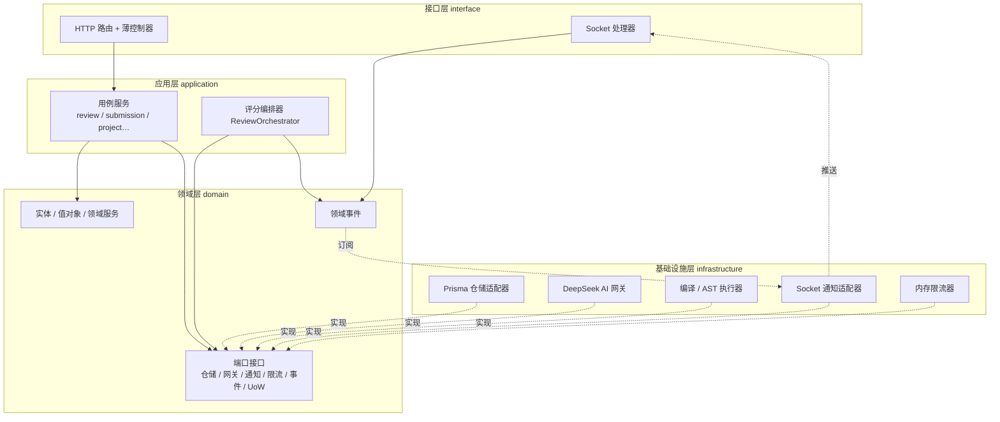
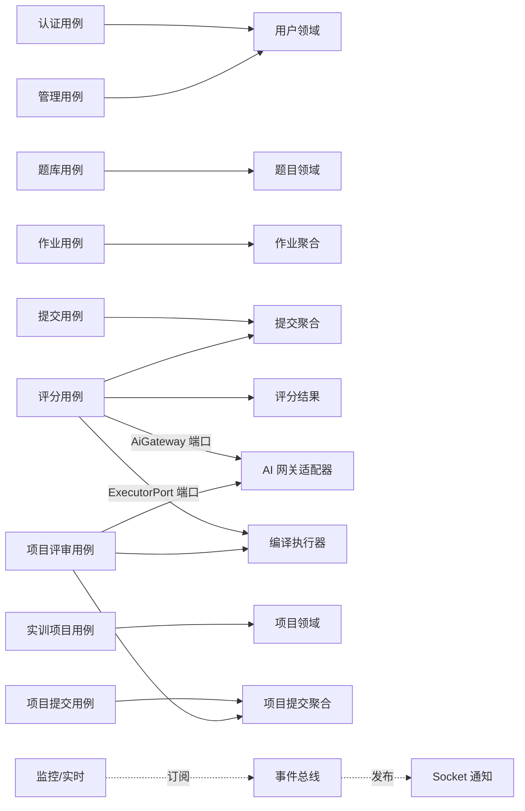
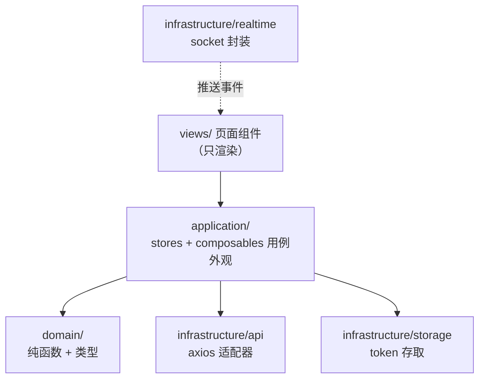

# Exam-DeepSeek 分层架构重构方案

> 版本：v1.0　适用范围：`server/`（Express 5 + Prisma + MySQL + Socket.IO）与 `client/`（Vue 3 + Pinia + Axios）
> 架构约束：分层架构（领域 / 应用 / 基础设施 / 接口）；依赖单向 **接口层 → 应用层 → 领域层 ← 基础设施层**；领域层零框架依赖；禁止循环依赖；跨模块调用一律走接口。
>
> ⚠️ **铁律（最高优先级，不可违背）**：当前版本 UI、交互、动效零改动。所有涉及 `client/src/views`、`components`、`router`、`App.vue` 的改动必须经 **agent-ui-guard** 审核，对照 git 基线 `git diff` 逐项确认无视觉 / 交互 / 动效变化。

---

## 0. 现状诊断（重构动因）

| # | 问题 | 位置（现状证据） | 后果 |
|---|------|------------------|------|
| 1 | **上帝控制器** | `teacherController.js` 1013 行、`studentController.js` 773 行、`reviewController.js` 739 行、`adminController.js` 503 行 | 路由、鉴权、业务规则、AI 调用、文件 IO 混为一体：无法单测、无法复用、改一处崩一片 |
| 2 | **AI 网关与基础设施耦合** | `deepseek.js`（541 行）直接 `import prisma` 读 systemConfig，内联并发信号量与缓存 | 换模型 / 换供应商 / 离线测试都需改业务代码；配置读取与调用逻辑无法分开测试 |
| 3 | **评分引擎混装** | `projectGrader.js`（410 行）把 child_process 编译、AST 分析、AI 评审、加权计算写在同一文件 | 单个引擎无法独立替换或 mock；编译器装没装直接影响评分测试 |
| 4 | **领域规则散落** | `scoring.js` 仅 15 行；分值校验、加权、异常答案判定（ABNORMAL_FEEDBACK）散落在 worker / grader / controller | 规则无单一权威来源，改一处漏多处，规则不可测 |
| 5 | **启动装配污染** | `app.js` 内联登录限流（Map + 响应拦截）、明文密码迁移、admin seed | 启动逻辑不可测；配置文件即业务代码 |
| 6 | **前端逻辑堆在组件** | `reviewStore.js` 仅 6 行；业务逻辑在 `Submit.vue` / `Review.vue` 等组件内部；`api/request.js` 耦合 antd `message` | 组件不可测不可复用；换 UI 框架 / 通知方式需改基础设施 |
| 7 | **无领域模型层** | Prisma 记录直接当领域对象在 controller 间传递 | 业务不变量（分值 > 0、总分上限、提交状态机）无落点 |

---

## 1. 重构后的模块划分及职责说明

### 1.1 后端四层（`server/src/`）

```
server/src/
├── domain/                      # 领域层（零外部依赖：不 import express/prisma/axios/logger）
│   ├── entities/                # 实体与聚合：User, Question, Assignment, Submission,
│   │                            #   ReviewResult, Project, ProjectSubmission, Team, School, Class
│   ├── value-objects/           # 值对象：Score, Feedback, GradingCriteria, QuestionType, SubmissionStatus
│   ├── services/                # 领域服务：ScoringService（分值校验/加权/异常判定/截止判定）
│   ├── ports/                   # 端口接口：仓储、AI 网关、执行器、通知、限流、事件总线、UoW
│   ├── events/                  # 领域事件：SubmissionGraded, ProjectGraded 等
│   └── errors/                  # DomainError 及子类（InvalidScoreError 等）
├── application/                 # 应用层（用例编排；只依赖 domain，不依赖框架/DB/HTTP/AI SDK）
│   ├── use-cases/               # auth, question, assignment, submission, review,
│   │                            #   project, project-review, admin, monitor 用例
│   ├── dto/                     # 入参 DTO 与校验（不依赖 HTTP 层）
│   └── services/                # 跨用例编排：ReviewOrchestrator（机器→AST→AI→加权）
├── infrastructure/              # 基础设施层（实现 domain 端口；禁止反向依赖）
│   ├── persistence/             # Prisma 仓储适配器 + Mapper（记录 ↔ 领域对象）
│   ├── ai/                      # DeepSeekGateway, PromptBuilder, AiResponseParser, 缓存/重试/限流装饰器
│   ├── execution/               # CompileExecutor, AstAnalyzer（child_process 封装，实现 ExecutorPort）
│   ├── storage/                 # LocalFileStorage（uploads）, ProjectArchiveService（adm-zip）
│   ├── notifier/                # SocketNotifier（实现 NotificationPort）
│   ├── rate-limit/              # InMemoryRateLimiter（实现 RateLimiterPort）
│   └── bootstrap/               # 组合根（Composition Root）：依赖装配、启动迁移、admin seed
└── interface/                   # 接口层（出入口：只做翻译，不写业务）
    ├── http/
    │   ├── routes/              # 声明式路由表：auth / admin / teacher / student / projects
    │   ├── controllers/         # 薄控制器：解析参数 → 调用用例 → 映射响应（< 100 行）
    │   └── middleware/          # auth, requireRole, projectAssetGuard, rateLimit, errorHandler, requestLogger
    └── socket/                  # Socket 处理器：订阅领域事件 → 推送给前端
```

**各层职责一句话：**

| 层 | 职责 | 禁止事项 |
|----|------|----------|
| 领域层 | 业务规则与不变量：分值必须 > 0、总分如何加权、异常答案判定、提交状态机 | import 任何框架 / 外部库 / 基础设施模块 |
| 应用层 | 用例流程编排：谁在什么条件下做什么、事务边界、领域事件发布 | import express / prisma / axios / child_process / fs |
| 基础设施层 | 把领域端口翻译为技术实现：MySQL、DeepSeek HTTP、文件系统、进程编译、Socket 推送 | 包含业务规则；反向依赖应用层 |
| 接口层 | HTTP/Socket 请求 ↔ 用例调用的翻译，响应格式与错误码映射 | 包含业务规则、直接触碰 Prisma / AI SDK |

### 1.2 前端分层映射（`client/src/`）

```
client/src/
├── domain/            # 类型定义 + 纯函数：uploadFilter, format, 分值/状态展示规则（与后端规则口径一致）
├── application/       # stores/ + composables/：用例外观（useAuth, useSubmission, useReview,
│                      #   useProjectUpload, stores/user）；只编排不实现 IO
├── infrastructure/    # api/（axios 适配器 + 领域端点 API 封装）、storage/（token 存取）、
│                      #   realtime/（socket.io-client 封装）
└── interface/         # views/、components/、router/ —— 只做渲染与交互
```

前端不做完整的领域层，但遵循同一原则：**纯逻辑下沉到 `domain/`，IO 收敛到 `infrastructure/`，组件只负责渲染**。现有 `composables/useProjectUpload.js`、`utils/uploadFilter.js` 已符合该方向，是正面样板。

> 🔒 前端重构只做**逻辑下沉与目录重组**，不触碰渲染输出、交互行为与动效（铁律，由 agent-ui-guard 把关）。

---

## 2. 每个模块的公开接口定义

> 契约即代码：以下接口在 P0 冻结，实现方（基础设施）与消费方（应用层）并行开发。

### 2.1 领域端口（`domain/ports/`，由基础设施层实现）

```ts
// domain/ports/repositories.ts —— 仓储端口（仓储模式）
export interface QuestionRepository {
  findById(id: string): Promise<Question | null>;
  findByIds(ids: string[]): Promise<Question[]>;
  save(q: Question): Promise<void>;
  search(c: QuestionSearchCriteria): Promise<Page<Question>>;
}
export interface AssignmentRepository {
  findById(id: string): Promise<Assignment | null>;
  save(a: Assignment): Promise<void>;
  listByTeacher(teacherId: string, schoolId: string): Promise<Assignment[]>;
}
export interface SubmissionRepository {
  save(s: Submission): Promise<void>;
  findById(id: string): Promise<Submission | null>;
  findByAssignmentAndStudent(aid: string, sid: string): Promise<Submission | null>;
  listByAssignment(assignmentId: string): Promise<Submission[]>;
}
export interface ReviewResultRepository {
  save(r: ReviewResult): Promise<void>;
  findBySubmissionId(submissionId: string): Promise<ReviewResult[]>;
}
export interface UserRepository {
  findByUsername(username: string): Promise<User | null>;
  findById(id: string): Promise<User | null>;
  save(u: User): Promise<void>;
}
export interface SystemConfigRepository {
  get(key: string): Promise<string | null>;   // deepseek_api_key / base_url / model / ai_concurrency
  set(key: string, value: string): Promise<void>;
}
// ProjectRepository / ProjectSubmissionRepository 同构，此处省略
```

```ts
// domain/ports/gateways.ts —— 外部能力端口（端口与适配器）
export interface AiGateway {
  grade(req: AiGradingRequest): Promise<AiGradingResult>;   // 题目+参考答案+学生答案+评分标准 → {score, feedback}
}
export interface ExecutorPort {
  checkCompile(dir: string, language: 'java' | 'python'): Promise<CompileResult>;  // child_process 封装
}
export interface NotificationPort {
  notifyGraded(schoolId: string, payload: GradingCompletedPayload): Promise<void>;
  notifyProjectGraded(schoolId: string, payload: ProjectGradedPayload): Promise<void>;
}
export interface RateLimiterPort {
  isBlocked(key: string): Promise<boolean>;
  recordFailure(key: string): Promise<void>;
  recordSuccess(key: string): Promise<void>;
}
export interface EventBus {
  publish(e: DomainEvent): Promise<void>;
  subscribe<T extends DomainEvent>(type: DomainEventType, h: (e: T) => Promise<void>): () => void;
}
export interface UnitOfWork {
  withTransaction<T>(fn: (tx: TxContext) => Promise<T>): Promise<T>;
}
```

### 2.2 应用服务接口（`application/use-cases/`，由接口层调用）

```ts
export interface ReviewUseCases {
  gradeSubmission(cmd: GradeSubmissionCommand): Promise<GradeSubmissionResult>; // 机器/AI 编排 + 发布事件
  reGrade(cmd: ReGradeCommand): Promise<GradeSubmissionResult>;
  manualAdjust(cmd: ManualAdjustCommand): Promise<void>;                        // 教师人工改分（审计留痕）
  getReviewDetail(q: ReviewDetailQuery): Promise<ReviewDetailDto>;
}
export interface SubmissionUseCases {
  submit(cmd: SubmitCommand): Promise<SubmitResult>;      // 截止判定 / 分值校验 / 防重复提交
  listMine(q: StudentSubmissionsQuery): Promise<SubmissionSummaryDto[]>;
}
export interface ProjectReviewUseCases {
  gradeProject(cmd: GradeProjectCommand): Promise<ProjectGradeResult>; // 机器→AST→AI→加权（策略组合）
}
export interface AuthUseCases {
  login(cmd: LoginCommand): Promise<LoginResult>;         // 内部走 RateLimiterPort，逻辑可单测
  logout(cmd: LogoutCommand): Promise<void>;
}
// QuestionUseCases / AssignmentUseCases / ProjectUseCases / AdminUseCases 同构，此处省略
```

### 2.3 关键领域对象（节选）

```ts
// domain/entities/submission.js
export class Submission {
  static create({ assignment, student, answers, now }): Submission {
    // 不变量：截止时间已过则抛 DomainError；同一学生同一作业仅允许一次有效提交
  }
  markGraded(result: ReviewResult): void { /* 状态机：SUBMITTED → GRADING → GRADED */ }
}

// domain/services/scoring.service.js —— 从 server/src/utils/scoring.js 迁入并扩充
export class ScoringService {
  resolveSubQuestionScores(subQuestions): { resolved, totalScore }   // 分值必须 > 0
  weightedTotal(parts: { score: number; weight: number }[]): number  // 三引擎加权（从 projectGrader.calculateTotal 迁入）
  isAbnormal(result: AiGradingResult): boolean                       // 从 deepseek.js ABNORMAL_FEEDBACK 逻辑迁入
}
```

---

## 3. 模块间依赖关系图

### 3.1 后端分层总览



> 实线 = 编译期依赖（单向向下）；虚线 = 运行时实现/订阅（方向与依赖方向相反，正是依赖倒置的体现）。

### 3.2 业务模块依赖



### 3.3 前端分层



---

## 4. 每个模块推荐的设计模式及理由

| 模式 | 用在哪个模块 | 解决什么问题 |
|------|--------------|--------------|
| 依赖倒置（DIP） | 全局，贯穿四层 | 依赖方向唯一来源：所有跨层调用反向为"依赖接口"。评分用例不知道 DeepSeek 存在，只知道 `AiGateway` |
| 端口与适配器（Ports & Adapters） | `domain/ports/` ↔ `infrastructure/*` | 把 DB、AI HTTP、文件系统、进程编译、推送、时钟全部挡在领域外；测试注入替身（InMemory / Fake） |
| 工厂模式 | `AiGatewayFactory`（infrastructure/ai）、`QuestionFactory`（domain） | 按 systemConfig 的 provider 创建 DeepSeek/未来供应商/Mock 网关；组卷时保证题目聚合分值不变量 |
| 策略模式 | `GradingStrategy` 家族 + `ReviewOrchestrator` | 机器校验 / AST / AI / 人工四种评分引擎可独立替换、可组合加权（现 `calculateTotal` 加权逻辑迁入策略容器） |
| 仓储模式 | `domain/ports/repositories` ↔ `infrastructure/persistence` | 应用层与 MySQL/Prisma 解耦；查询语义由领域定义，实现可换缓存/读写分离 |
| 观察者模式 | `DomainEventBus` + 订阅者（SocketNotifier / AuditLogger / 缓存失效器） | 评分完成后的推送、审计、缓存失效彼此解耦；替代 `socket.js` 里硬编码的 `notifyGraded` 回调 |
| 命令模式 | `GradeSubmissionCommand` / `GradeProjectCommand` + worker 队列 | 评分任务成为不可变命令对象：天然支持排队、重试、幂等（按 submissionId）、审计留痕 |
| 装饰器模式 | `CachingAiGateway` / `RetryingAiGateway` / `RateLimitedAiGateway` | 相同内容命中缓存免重复扣费；超时指数退避重试；并发限流（替代 deepseek.js 内联信号量）——均不改网关核心 |
| 单元OfWork | `application` 事务边界 + Prisma transaction | 提交 + 评分结果 + 领域事件一次事务原子落库；worker 端以命令幂等键保证一致性 |

**选择逻辑**：先由"端口与适配器 + 依赖倒置"定骨架（架构性模式，P0 冻结），再由"仓储 + 工厂 + 策略"处理三处结构性耦合（持久化、AI 供应商、评分引擎），最后用"命令 + 装饰器 + 观察者 + UoW"处理 AI 评分链路的三个工程痛点（重试扣费、并发限流、完成通知）。命令与装饰器只用于评分链路，其余 CRUD 用例不强行套用，避免过度设计。

---

## 5. 重构实施步骤（按优先级排序）

> 原则：**绞杀者模式（Strangler）**——每步独立可发布，行为基线先行，先有绿线再动刀。

### P0 契约冻结与骨架（agent-arch + agent-test）★最高优先级
- 建立四层目录骨架；冻结第 2 节的端口清单（**契约先行**，后续并行开发依据）
- 引入 `eslint-plugin-import no-restricted-paths` / `dependency-cruiser`：禁止 domain import 外部库、禁止 infra import application、禁止反向依赖
- 跑通现有 Jest（unit + integration）与 Playwright e2e，记录**基线绿线**作为重构安全网
- agent-ui-guard 产出 UI 冻结基线 `docs/ui-freeze-baseline.md`（页面 / 交互 / 动效清单 + 审核检查单），此后一切 UI 相关 diff 必须对照审核
- ✅ 验收：依赖检查图只含允许方向；全部基线测试绿；UI 冻结基线已产出并纳入审核流程

### P1 领域层提取（agent-domain + agent-test）
- 迁移 `scoring.js` → `ScoringService`；从 deepseek.js / gradingWorker 提取加权与异常判定规则进领域
- 建立实体 / 值对象 / 领域错误；lint 强制领域层零依赖
- ✅ 验收：领域层可脱离框架独立运行；核心规则单测 100% 覆盖

### P2 端口落地与适配器（agent-infra-db + agent-infra-ai）
- Prisma 仓储适配器 + Mapper（记录 ↔ 领域对象），查询行为与现状完全一致
- 拆分 `deepseek.js`：`PromptBuilder` + `DeepSeekGateway` + 装饰器，**行为不变、接口收敛**
- 拆分依据（已侦察）：`deepseek.js`（541 行）三大块——① 配置读取（loadConfig/getConfig，DB 优先 ENV 兜底，1 分钟缓存）→ 迁 `SystemConfigRepository`；② `gradeSubmission()`（L66，评分调用 + prompt 构建）→ `PromptBuilder` + `DeepSeekGateway.grade`；③ `parseExamPaper()`（L231，试卷解析，独立角色 prompt）→ 独立端口 `AiGateway.parsePaper` 或独立适配器；并发控制 `getConcurrency()` → `RateLimitedAiGateway` 装饰器；`clearConfigCache()` 随配置仓储迁移
- ✅ 验收：应用层零 Prisma 引用；现有集成测试全绿

### P3 评分链路用例化（agent-app + agent-infra-ai）
- 从 `reviewController`（739 行）抽出 `ReviewUseCases`：评分编排 / 重评 / 人工调整
- `gradingWorker` 改造为命令模式消费；Socket 通知改走 `NotificationPort`
- 拆分依据（已侦察）：`reviewController.js`（739 行）混装 ① 查询构建/数据丰富（buildFilter/enrichWithSchool）② AI 评分调用（import gradeSubmission from deepseek.js）③ 文件系统读取（fs/path/projectView/projectPaths）④ **跨 controller 耦合**（import getVisibleClassIds from teamController.js——重构需一并消除）⑤ 直接 Prisma 操作。拆分后 controller 仅保留参数解析与响应映射
- ✅ 验收：reviewController 只剩路由翻译；评分集成测试与 `GRADING_BENCHMARK.md` 基准持平

### P4 上帝控制器绞杀（agent-app + agent-http）
- 顺序：评分 → 学生 → 教师 → 管理 → 实训，逐个将 controller 迁移为"薄控制器 + 用例"
- 每迁移一个立即跑 integration + e2e 门禁
- ✅ 验收：所有 controller < 100 行；controller 中无业务规则残留

### P5 事件总线化与启动装配重构（agent-infra-ai + agent-http）
- 落地 `DomainEventBus`；`SocketNotifier` 改为订阅领域事件；Monitor 实时数据事件化
- `app.js` 拆为组合根 + `bootstrap/`（迁移 / seed / 健康检查独立）；登录限流改用 `RateLimiterPort`
- ✅ 验收：`app.js` < 60 行纯装配；启动逻辑有测试覆盖

### P6 评分引擎拆分（agent-infra-ai + agent-app）
- `projectGrader.js`（410 行）拆为 `CompileExecutor` / `AstAnalyzer` / `AiReviewer` + `GradingStrategy` 组合
- ✅ 验收：机器校验可在测试中 mock；三引擎可独立替换

### P7 前端分层（agent-ui + agent-app）
- `request.js` 解耦 antd `message` → 前端通知端口；`api/` 按领域端点拆分
- `Submit.vue` / `Review.vue` 等大组件业务逻辑下沉到 `application/`；`uploadFilter` / `format` 移入 `domain/`
- ✅ 验收：views 无业务规则（lint 可查）；Playwright e2e 全绿

### P8 收尾与守护（agent-arch + agent-qa）
- 删除旧 controller 与临时兼容层；依赖方向检查纳入 CI（dependency-cruiser 断言）
- 评分 benchmark 与性能对比回归；更新 README / 架构文档
- ✅ 验收：CI 全绿；依赖图符合约束；无循环依赖

**优先级依据**：P0/P1 是地基（不迁移任何行为，风险最低收益最高）；P2/P3 先行改造评分主链路（本系统核心价值，也是耦合最重处）；P4 按控制器体积从大到小绞杀；P5-P7 收尾结构性债务；P8 把约束固化进 CI，防止退化。

---

## 6. 潜在风险及应对建议

| # | 风险 | 等级 | 应对建议 |
|---|------|------|----------|
| 1 | **大爆炸式重构翻车** | 高 | 绞杀者策略：每步独立可发布；行为基线测试先行；禁止"边重构边加功能" |
| 2 | **领域对象与 Prisma 记录漂移** | 高 | Mapper 收敛 + Mapper 单测；lint 禁止业务代码直接 `import prisma` |
| 3 | **循环依赖（反向依赖悄悄出现）** | 中 | dependency-cruiser CI 门禁；端口只能定义在 domain；Code Review 检查清单 |
| 4 | **AI 评分质量波动**（prompt 拆分/重排引入回归） | 中 | prompt 快照测试；`GRADING_BENCHMARK.md` 基准回归；装饰器开关做灰度 |
| 5 | **事务边界破坏**（主进程与 worker 分离后的原子性） | 中 | UoW 边界文档化；worker 按命令幂等键去重；失败入死信队列可重放 |
| 6 | **多 agent 并行开发冲突** | 中 | 契约先行（P0 冻结接口）；按模块边界分工（见第 7 节）；每日集成并跑基线 |
| 7 | **过度设计 / 抽象泛滥** | 中 | YAGNI 规则：每个端口必须 ≥ 2 个实现或测试替身才允许抽象；新抽象需架构评审 |
| 8 | **前端重构回归** | 高 | Playwright e2e 作为门禁；组件逻辑下沉后补组件级测试（Vitest + Vue Test Utils） |

---

## 7. 团队（Agent）分工速查

| Agent | 职责 | 参与阶段 |
|-------|------|----------|
| agent-arch | 契约冻结、依赖规则、架构评审、收尾守护 | P0 / P8 |
| agent-domain | 领域模型、领域服务、规则单测 | P1 |
| agent-app | 用例服务、评分编排、controller 绞杀 | P3 / P4 / P6 / P7 |
| agent-infra-db | Prisma 仓储适配器、Mapper、事务 | P2 |
| agent-infra-ai | AI 网关拆分、评分引擎拆分、装饰器 | P2 / P3 / P5 / P6 |
| agent-http | 路由 / 中间件 / 组合根装配 / Socket | P4 / P5 |
| agent-ui | 前端分层、组件瘦身、前端测试 | P7 |
| agent-test | 基线测试、集成测试、单测补强 | 全程 |
| agent-qa | e2e 门禁、benchmark 回归、发布验收 | P3 / P8 |
| agent-ui-guard | **UI / 交互 / 动效冻结审核**：产出并维护冻结基线、审核一切 UI 相关 diff、一票否决 | P0 / 全程 |
