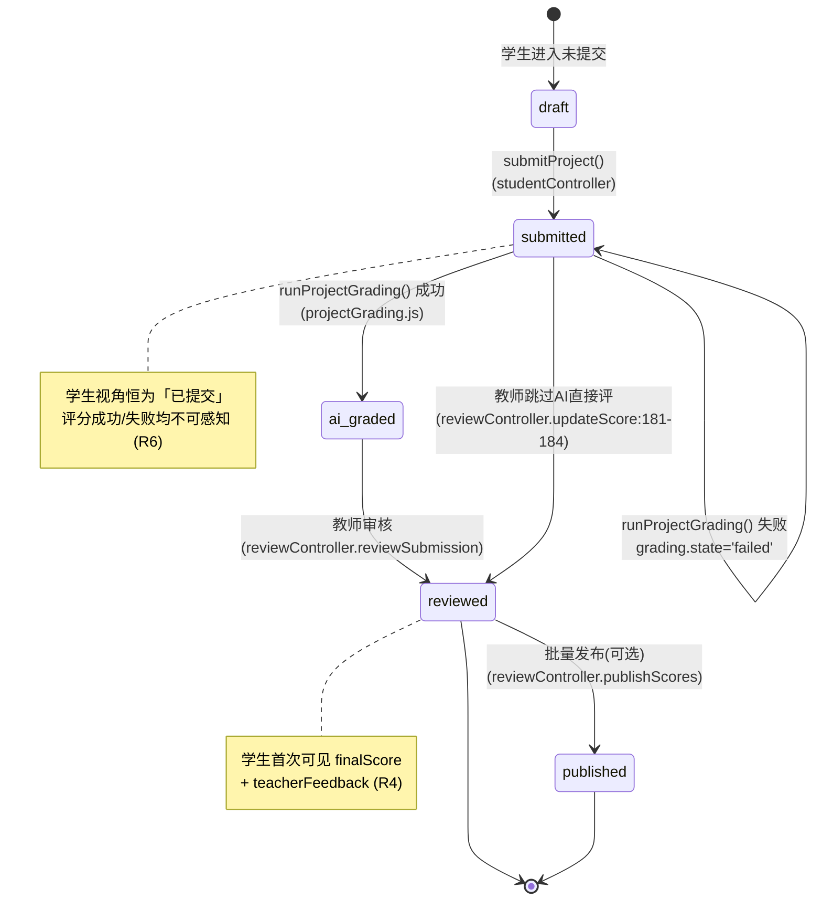
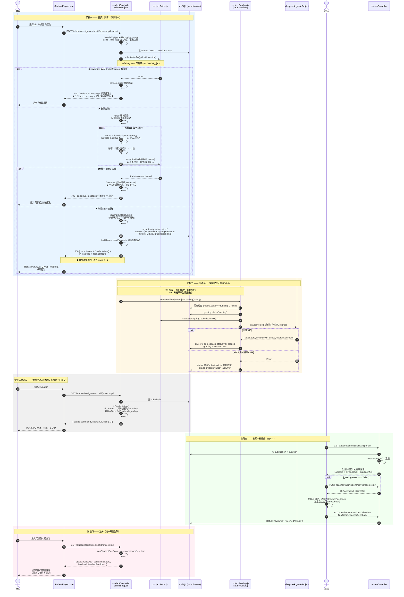
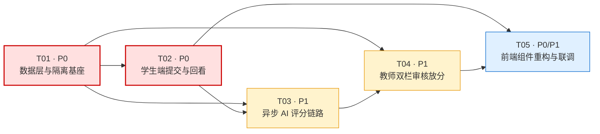

# 实训题（project）模块重构 —— 系统设计与任务分解

> 架构师：高见远（Gao）
> 版本：v1.0
> 输入：PM 的实训题 PRD（4 状态机 + 铁律 R1~R7）
> 范围：**仅设计与任务分解，不含实现代码**
> 代码基线：`Exam-DeepSeek` @ 当前工作区

---

## 第一部分：现状诊断

### 0. 结论先行

当前实训题模块存在 **1 个致命阻断（schema 无法编译）+ 5 个安全/正确性缺陷 + 7 处铁律违反 + 2 套并行架构**。
最严重的问题不是"乱"，而是：

> **`prisma validate` 当前直接失败，项目跑在一份"历史生成的 stale Prisma Client"上。**
> 任何人执行一次 `npx prisma generate` 或 `prisma migrate`，服务立刻无法启动。

实测：

```
$ cd server && npx prisma validate
Error code: P1012
error: The model "ProjectSubmission" cannot be defined because a model
       with that name already exists.
  -->  prisma/schema.prisma:478
```

> **✅ 阻断已于 T01 解除**（2026-04-09）：重复模型 `schema.prisma:478-490` 已删除，复验 `npx prisma validate` → `The schema at prisma/schema.prisma is valid 🚀`，EXIT 0。
> 本节保留原始诊断记录以备追溯，下方各项缺陷仍待 T02–T05 处理。

---

### 1. 致命阻断：Schema 重复模型

| 项 | 模型 A | 模型 B |
|---|---|---|
| 位置 | `server/prisma/schema.prisma:421-447` | `server/prisma/schema.prisma:478-490` |
| 唯一键 | `@@unique([projectId, studentId])` | 无唯一键，`@@index([questionId, studentId])` |
| 字段 | machineScore / astScore / aiScore / totalScore / finalScore / teacherFeedback / status / submittedAt / reviewedAt | questionId / studentId / **grade Json** / createdAt |
| 物理表 | `@@map("project_submissions")` :446 | `@@map("project_submissions")` :489 |
| 归属体系 | 「Project 实训任务体系」（在用） | 「Question type=project 体系」的历史残留（**代码中零引用**） |

附带的关系完整性问题：

- `schema.prisma:32` `User.projectSubmissions @relation("StudentProjectSubmissions")` 只对应模型 A；模型 B 的 `student User @relation(...)`（:486）**没有 User 侧的反向字段**。
- 模型 B 的 `question Question @relation(...)`（:485）**没有 Question 侧的反向字段**（`Question` :149-152 只有 `submissions Submission[]`）。

**验证结论**：模型 B 是一个从未落地、从未被代码引用、且本身关系定义就不完整的废弃模型。**可直接整段删除，无需 migration**（物理表 `project_submissions` 由模型 A 继续持有）。

---

### 2. 安全漏洞（按严重度排序）

#### 🔴 S1 — 标准包通过静态服务完全公开（违反 R1 / R2）

`server/src/app.js:110`

```js
app.use('/uploads', express.static(path.join(__dirname, '../uploads')));
```

- **无任何鉴权中间件**，位于所有 API 路由之后但对 `/uploads/*` 全量放行。
- 学生只要知道 questionId，直接 `GET /uploads/project-questions/331/standard/src/Main.java` 即可拿到**标准答案源码**。
- 同理可越权读取**其他同学**的提交：`GET /uploads/project-submissions/331/1278/...`。
- 已实测目录存在：`uploads/project-questions/331/standard`、`uploads/project-submissions/331/1278`。

#### 🔴 S2 — 教师评分接口存在任意路径遍历

`server/src/controllers/teacherController.js:136-139`

```js
const { studentPath } = req.body || {};
const studentDir = studentPath || standardDir;   // ← 用户可控绝对路径
const studentFiles = readDirFiles(studentDir)
```

- `studentPath` 来自请求体，**未做任何 normalize / 前缀校验**，`readDirFiles` 会递归读取任意目录并把内容发给 DeepSeek + 回显给调用方。
- 次生问题：`studentPath` 缺省时 **fallback 到标准包目录**，即"拿标准答案当学生答案评分"，必得高分——这是一个静默的评分正确性陷阱。

#### 🟠 S3 — 学生端接口下发教师专属字段

`server/src/controllers/studentController.js:331`

```js
select: { id, title, difficulty, maxScore, material, scoringRubric }
```

无白名单分层，`scoringRubric`（评分标准）直接下发。PRD 允许学生看评分标准，但当前是**"恰好只有这些字段"而非"白名单强约束"**——一旦有人给 `select` 加字段（如 `attachmentUrl`），标准包路径立刻泄露给学生，且无任何防线拦截。

#### 🟠 S4 — 前端组件设计上就是"学生直接看 AI 原始评语"（违反 R3 / R4）

`client/src/views/teacher/ProjectQuestionEdit.vue:47-63`（学生模式渲染）+ `:372`

```js
gradeResult.value = q.submission.grade;   // :372
```

模态框把 `breakdown / highlights / issues / overallComment` 原样展示。`gradeProject()` 的 prompt（`deepseek.js:467-488`）明确要求 AI **对比标准答案源码**，其 `issues` / `overallComment` 极易复述标准答案实现。
**当前是"后端恰好没返回 grade 所以没炸"，属于运气不是设计。**

#### 🟠 S5 — 非 ASCII 文件名编码损坏（实施期实测发现）

实测目录：

```
uploads/project-submissions/331/1278/
└── ????24053100104/          ← 原应为「姓名+学号」中文目录
```

zip 中央目录未置 UTF-8 标志位（`flags & 0x800`）时，条目名按 latin1/GBK 读出；multer 的 `file.originalname` 同理。旧代码直接把这个损坏的字符串**当作目录名落盘**，导致：

| 影响 | 说明 |
|---|---|
| 正确性 | 目录名不可逆损坏，无法回溯到学生真实身份 |
| 可用性 | 文件树 / 代码预览显示乱码，AI 评分上下文失真 |
| 安全 | 用户可控字符串直接进路径，与 S2 同源风险 |

> **根因不止于编码**：真正的设计缺陷是"把用户可控的中文串当路径段"。修复方案见 §5.4 —— 物理路径全 ASCII 数字 ID，真实名只入库展示。

---

### 3. 铁律违反清单

| 铁律 | 状态 | 证据（文件:行） | 说明 |
|---|---|---|---|
| **R1** 路径物理隔离 | ⚠️ 部分 | `teacherController.js:187,194` / `studentController.js:336,359` | 前缀确已分离（`project-questions/{id}/standard` vs `project-submissions/{qid}/{sid}`），但 S1 使隔离**在传输层失效**；且标准包前缀与 PRD 约定的 `project-standards/` 不一致 |
| **R2** 学生端字段白名单 | ❌ | `studentController.js:331` | 靠 `select` 手写，无集中式白名单函数，无回归防线 |
| **R3** aiFeedback 不下发 | ❌ | `ProjectQuestionEdit.vue:47-63,372` | 前端为学生渲染 AI 原始 breakdown/issues |
| **R4** 分数单开关在组装层 | ❌ | 同上 | 无任何服务端开关；学生分数可见性由**前端 v-if** 决定 |
| **R5** 提交即异步触发评分 | ❌ | `studentController.js:348-373` | `submitProject` **完全不调用 AI**，只解压到磁盘就返回 |
| **R6** 评分失败对学生透明 | ❌ | — | 无评分链路，无从谈失败处理 |
| **R7** 一次提交不可变 | ❌ | `studentController.js:360` | `fs.rmSync(targetDir, {recursive:true, force:true})` —— **重交直接物理删除上一次提交**，无版本目录 |

---

### 4. 数据链路断裂：提交不落库

`server/src/controllers/studentController.js:348-373` `submitProject()` 全流程：

1. multer 收 zip → 2. `rmSync` 清目录 → 3. `AdmZip.extractAllTo` → 4. `res.json({code:0, data:null})`

**没有任何一行 `prisma.submission.*`。** 直接后果：

| 现象 | 根因 |
|---|---|
| 学生作业列表**永远不显示「已提交」** | `Assignments.vue:98,112` 读 `a.submissions[].status`，而 `submissions` 表里根本没有这条记录 |
| 教师审核页看不到实训题提交 | `reviewController.js:46` `prisma.submission.findMany` 查不到 |
| 「已提交」判定依赖**目录 mtime** | `studentController.js:338-339` `fs.existsSync(subDir)` + `fs.statSync(subDir).mtime` —— 文件系统当数据库 |
| 提交接口不返回文件树（违反 PRD 步骤 1） | `:367` `data: null`；前端 `ProjectQuestionEdit.vue:339` 只能 `router.push` 跳走 |
| 无 assignmentId 上下文 | `submissions` 唯一键是 `[assignmentId, studentId, questionId, subQuestionId]`，而学生端路由 `/student/project/:id`（`router/index.js:53`）**只带 questionId**，缺 assignmentId → 无法写入 |

---

### 5. 两套并行架构（架构级混乱的根源）

| | 体系 A：Question type=project | 体系 B：Project 实训任务 |
|---|---|---|
| 数据模型 | `Question(type=project)` + `Submission` | `Project` / `ProjectFile` / `ProjectSubmission` / `SubmissionFile` |
| 状态枚举 | `SubmissionStatus`（5 值） | `ProjectSubmissionStatus`（6 值，含 `grading`/`graded`） |
| 控制器 | `teacherController.js:69-159`、`studentController.js:327-392` | `projectController.js`、`projectSubmissionController.js` |
| 评分服务 | `deepseek.js:464` `gradeProject()`（纯 AI） | `projectGrader.js`（machine/AST/AI 三方）+ `gradingWorker.js` |
| 路由 | `/api/teacher/questions/:id/*`、`/api/student/questions/:id/*` | `/api/teacher/projects/*`（`app.js:105`） |
| 前端 | `ProjectQuestionEdit.vue`、`Questions.vue` | `Projects.vue` / `ProjectEdit.vue` / `ProjectSubmissions.vue` / `ProjectReview.vue` |
| 上传目录 | `uploads/project-questions/`、`uploads/project-submissions/` | `uploads/projects/` |

**交叉污染的实证**：`ProjectQuestionEdit.vue:128` 从体系 B 引入上传接口

```js
import { uploadPackage } from '../../api/projects.js';   // → /api/teacher/projects/upload-package
```

然后 `:318` 把返回的 `tempId` 提交给体系 A 的 `POST /teacher/questions`。
即：**体系 A 的题目，标准包走体系 B 的上传通道落在 `uploads/projects/{tempId}`，再由 `teacherController.js:186-190` `fs.renameSync` 搬到体系 A 的目录。** 一次创建横跨两套体系三个目录。

---

### 6. 其他工程质量问题

| # | 位置 | 问题 |
|---|---|---|
| Q1 | `routes/student.js:22` | `export default router;` 写在 L22，实训题路由注册在 L24-25 **之后**。ESM 下靠"对象引用可变"侥幸生效，语义极具误导性，任何人把它改成 `export default {...router}` 就静默丢路由 |
| Q2 | `teacherController.js:78,131,186,187` | 使用 `__dirname`，但 `__dirname` 在 **L938** 才 `const` 声明。靠"函数延迟执行"绕过 TDZ，模块顶部读代码时完全反直觉 |
| Q3 | `studentController.js:76,137,198,236,255,307,321` | `catch (err)` 但 body 里用 `e.message` —— **catch 块自身会抛 ReferenceError**，500 响应体丢失真实错误。共 7 处 |
| Q4 | `teacherController.js:154` | `gradeProject` 只 `res.json(result)`，**评分结果不落库**，刷新即失 |
| Q5 | `uploads/projects/` | 27 个 `temp_*` 孤儿目录，**实测占用 1.2 GB**，无任何清理逻辑 |
| Q6 | `uploads/project-submissions/tmp_1785727907783/` | questionId 层级出现 `tmp_*` 目录，说明曾用临时 ID 当 questionId 写入，目录契约未被强制 |
| Q7 | `ProjectQuestionEdit.vue:190-191` | 前端 `codeExts` 白名单过滤展示；后端 `extractAllTo` 全量解压 —— **前后端文件集不一致**，学生看到的树 ≠ AI 评的包 |
| Q8 | `router/index.js:53` | 学生路由复用 `views/teacher/ProjectQuestionEdit.vue`。学生端加载一个 452 行、含教师保存逻辑与 RichEditor 的组件，目录归属与权限边界双重混乱 |
| Q9 | `ProjectQuestionEdit.vue:27-28` | 按钮文案 `'评分中...'` —— UI 语义是**同步等 AI**，与 R5 异步语义冲突 |
| Q10 | `ProjectQuestionEdit.vue:371-379` | 回看时 `hasUploaded=true` 但 `form.packageFile=null`，"提交答案"按钮仍 enabled，点击只弹 warn。无「重新提交」语义 |

---

## 第二部分：目标架构

### 1. 总体原则

```
唯一事实源：submissions 表
唯一链路：  Question(type=project) → Submission
唯一开关：  接口组装层 toStudentView()
唯一入口：  鉴权 API（静态目录对 project 资源全封）
```

**体系 B（Project）本次不改造、不删除，冻结为 legacy**，仅做隔离标记（见「待确认事项 D1」）。

---

### 2. 数据模型方案

#### 2.1 Schema 变更（零 migration）

| 操作 | 目标 | 说明 | 状态 |
|---|---|---|---|
| **删除** | `schema.prisma:478-490` 整个第二个 `model ProjectSubmission` | 代码零引用、关系不完整、废弃 | ✅ T01 已完成 |
| **保留不动** | `schema.prisma:421-447` 第一个 `ProjectSubmission` | 体系 B 在用，继续持有物理表 `project_submissions` | ✅ 已保留 |
| **保留不动** | `Submission`（:252-282）、`SubmissionStatus`（:334-340） | 字段已完备，**不加任何列** | ✅ 未改动 |
| **验收** | `npx prisma validate` 通过、`npx prisma generate` 成功 | | ✅ EXIT 0 |
| **DB 影响** | **无**。不产生 migration，不改表结构 | | ✅ |

> ##### ⚠️ 极易混淆点：本次重构用的是 `Submission`，不是 `ProjectSubmission`
>
> 实施期已发生过一次误读，此处固化澄清：
>
> | | **体系 A —— 本设计使用** | 体系 B —— 冻结不碰 |
> |---|---|---|
> | 主表 | **`Submission`**（L252-282） | `ProjectSubmission`（L421-447） |
> | 唯一键 | `@@unique([assignmentId, studentId, questionId, subQuestionId])` | `@@unique([projectId, studentId])` |
> | 关联 | Assignment / Question（`Question.type='project'`） | Project / ProjectFile |
> | 谁在用 | 作业列表、批阅页、成绩发布**全链路** | 仅 `/api/teacher/projects` + `projectGrader.js` |
> | 本次改动 | T02–T05 全部落在这张表 | **一行不碰**，下线与否见 D5 |
>
> **`@@unique([projectId, studentId])` 属于体系 B，与本次多版本需求无关，不要为它加 `version` 列。**
> 体系 A 的多版本方案见 §2.3，**不加列、不动唯一键**。

#### 2.2 `submissions` 表承载实训题的字段契约

| 列 | 实训题语义 | 学生可见 |
|---|---|---|
| `assignmentId` | 实训题所属作业 | ✅ |
| `questionId` | `Question.type='project'` | ✅ |
| `subQuestionId` | **恒为 `NULL`**（实训题无小题） | — |
| `answer` (Text) | **提交元信息 JSON**（见 2.3），非代码正文 | 部分（裁剪后） |
| `status` | 4 状态机 | ✅ |
| `submittedAt` | 最近一次提交时间 | ✅ |
| `attemptCount` | 提交版本号（= 当前 version） | ✅ |
| `aiScore` | AI 原始分 | ❌ **教师专用** |
| `aiFeedback` | AI 原始评语（含标准答案风险） | ❌ **教师专用，永不下发** |
| `finalScore` | 教师核定分 | 仅 `reviewed`/`published` |
| `teacherFeedback` | 教师编辑后评语 | 仅 `reviewed`/`published` |
| `reviewedAt` | 审核时间 | 仅 `reviewed`/`published` |
| `bestScore` | 实训题不使用 | — |

> **唯一键复用**：`@@unique([assignmentId, studentId, questionId, subQuestionId])` 天然保证"一个学生一道实训题一行记录"，重交走 UPDATE + version+1，历史版本留在磁盘（满足 R7）。

#### 2.3 `answer` 字段 JSON 契约

> **字段名以本节为准（canonical）。** 版本号字段名就是 `version`，不是 `currentVersion`。

```jsonc
{
  "kind": "project",              // 判别式，区分编程题的纯文本 answer
  "version": 3,                   // 当前版本号，与 attemptCount 同步
  "dir": "project-submissions/331/1278/3",   // 相对 uploads/ 的版本目录
  "entry": "src/Main.java",       // 入口文件，供前端默认打开
  "originalName": "张三_24053100104.zip",   // 上传原名，已 utf8 修复；★ 仅展示，绝不参与路径拼接
  "fileCount": 27,
  "totalBytes": 128340,
  "uploadedAt": "2026-04-09T10:23:11.000Z",
  "history": [                    // R7：历史版本索引，永不覆盖
    { "version": 1, "dir": "project-submissions/331/1278/1", "at": "...", "originalName": "..." },
    { "version": 2, "dir": "project-submissions/331/1278/2", "at": "...", "originalName": "..." }
  ],
  "grading": {                    // 评分任务状态（承载"失败"，不新增枚举）
    "state": "success",           // pending | running | success | failed
    "version": 3,                 // 本次评分针对哪个版本（重交后可识别陈旧评分）
    "attempts": 1,
    "startedAt": "...",
    "finishedAt": "...",
    "lastError": null,            // 教师可见，学生裁剪
    "model": "deepseek-v4-flash"
  }
}
```

**设计取舍**：`answer` 是 `@db.Text`（64 KB），存元信息绰绰有余。用 JSON 内嵌 `grading` 承载失败态，**完美满足铁律"评分失败不新增枚举，用 submitted + 独立任务状态承载"，且零 migration**。

##### 多版本（R7）如何在"一行记录"上成立

`Submission` 的唯一键决定了「一个学生 · 一次作业 · 一道题 = 一行」。**这一行表示"当前态"，而不是"某一次提交"**，因此多版本无需任何 schema 改动：

| 载体 | 存什么 | 谁写 | 谁读 |
|---|---|---|---|
| `Submission` 行（唯一，UPDATE） | 当前状态、当前分数、当前版本号 | T02 提交 / T03 评分 / T04 审核 | 全部 |
| `answer.version` | 当前展示版本 | T02 | 学生端默认打开此版本 |
| `answer.history[]` | 全部历史版本索引 | T02 追加（**只 append，禁止改写既有项**） | 教师端版本切换 |
| 文件系统 `{qid}/{sid}/{version}/` | 各版本真实文件 | T02 每次**新建**目录 | 文件树 / AI 评分 |

**铁律落地**：重交 = `version+1` + 新建版本目录 + `history` 追加 + UPDATE 同一行。
**绝对禁止** `fs.rmSync(targetDir, ...)` 覆盖旧版本目录 —— 现有 `studentController.js:348-373` 正是因为这行覆盖，导致"提交后无法回看"，这是 R7 的现行违规点。

**文件树不入库**：文件树由 `fs.readdirSync` 递归实时读取磁盘生成，不建 `submission_files` 映射表。理由 —— ①维持零 migration；②文件树必须以磁盘为准，库/盘双写不一致是最难排查的一类 bug。若未来单包文件数过大导致性能问题，再加内存缓存层，不在本次范围。

---

### 3. 接口层设计

#### 3.1 组装层：两个纯函数（架构核心）

所有实训题响应**必须**经过其一，禁止任何 controller 直接 `res.json(submission)`。

```
server/src/utils/projectView.js   （新建）

  toStudentView(submission, question) → 学生视图（白名单构造，非 delete 剔除）
  toTeacherView(submission, question) → 教师视图（全量 + 标准包引用）

  canStudentSeeScore(submission) := submission.status ∈ { reviewed, published }
```

> **关键约束：白名单必须"新建对象逐字段拷贝"，禁止 `{...submission, aiFeedback: null}` 这类黑名单写法。**
> 黑名单在新增字段时静默失效，白名单不会。这是 R2 唯一可靠的落地方式。

`toStudentView` 输出的**完整字段集**（超出即为 bug）：

```
id, questionId, assignmentId, status, submittedAt, version,
files: { tree, contents, entry },
score:    canStudentSeeScore ? finalScore      : null,
feedback: canStudentSeeScore ? teacherFeedback : null,
reviewedAt: canStudentSeeScore ? reviewedAt    : null
```

**永不出现在学生响应中的字段**（硬性黑名单，供 Code Review / 测试断言）：
`aiScore`、`aiFeedback`、`answer`（原始 JSON）、`answer.grading.lastError`、`answer.history`、`question.attachmentUrl`、`question.referenceAnswer`、任何 `standard*` 前缀路径。

#### 3.2 学生端 API 裁剪规则表

| # | 接口 | 请求 | 响应（学生） | 裁剪规则 |
|---|---|---|---|---|
| S-1 | `GET /api/student/assignments/:aid/project/:qid` | path | `{ question, submission }` | `question` 仅 `{id,title,difficulty,maxScore,material,scoringRubric}`；**禁 `attachmentUrl`**。`submission` 走 `toStudentView` |
| S-2 | `POST /api/student/assignments/:aid/project/:qid/submit` | `multipart: file(zip)` | `{ submission: toStudentView() }`，内含 `files.tree` + `files.contents` | **同步返回文件树，不等待 AI**（R5）。响应必含树，前端原地渲染不跳页 |
| S-3 | `GET /api/student/assignments/:aid/project/:qid/files` | `?version=` | `{ tree, contents, entry }` | 仅允许读**自己**的 `studentId` 目录；`version` 越界或非自己 → 403 |
| S-4 | `GET /api/student/scores` | — | 现有结构 | 实训题项仅当 `status ∈ {reviewed, published}` 才纳入 |
| S-5 | `GET /api/student/assignments` | — | 现有结构 | `submissions[].status` 现在**真实存在**，`Assignments.vue` 无需改判定逻辑 |

**学生端接口的三条硬性禁止**：
1. ❌ 任何学生接口不得返回 `attachmentUrl` / 标准包目录名 / 标准包文件树。
2. ❌ 任何学生接口不得返回 `aiScore` / `aiFeedback`（即使 `status=ai_graded`）。
3. ❌ 学生 `status=ai_graded` 时，`toStudentView` 的 `status` **对外映射为 `submitted`**（R6：评分对学生不可感知）。

> 状态对外映射表（学生视角）：
> `draft → 未提交`｜`submitted → 已提交`｜`ai_graded → 已提交`（**降级显示**）｜`reviewed / published → 已出分`

#### 3.3 教师端 API

| # | 接口 | 响应 | 说明 |
|---|---|---|---|
| T-1 | `GET /api/teacher/questions/:id/project-files` | `{ tree, contents }`（标准包） | 复用现有 `teacherController.js:69`，仅改路径常量 |
| T-2 | `GET /api/teacher/submissions/:id/project` | `{ standard:{tree,contents}, student:{tree,contents}, ai:{score,feedback}, grading, final:{score,feedback} }` | **双栏对比数据源**，走 `toTeacherView` |
| T-3 | `PUT /api/teacher/submissions/:id/review` | — | 复用 `reviewController.js:194`，写 `finalScore/teacherFeedback` → `reviewed` |
| T-4 | `POST /api/teacher/submissions/:id/regrade-project` | `{ accepted: true }` | **兜底手动触发**，立即 202 返回，异步执行 |
| T-5 | ~~`POST /api/teacher/questions/:id/grade-project`~~ | — | **删除**。S2 路径遍历漏洞源头，且职责已被 T-4 取代 |

---

### 4. 异步评分方案

#### 4.1 选型：进程内 `fire-and-forget` + 状态落 `answer.grading`

```
submitProject()
  ├─ 1. 解压到 uploads/project-submissions/{qid}/{sid}/{version}/
  ├─ 2. prisma.submission.upsert → status='submitted'
  │                                 answer.grading.state='pending'
  ├─ 3. res.json({ submission: toStudentView(...) })   ◄── 立即返回，含文件树
  └─ 4. setImmediate(() => runProjectGrading(submissionId))   ◄── 不 await
                                    │
                                    ├─ grading.state='running'
                                    ├─ 读标准包 + 学生包 → deepseek.gradeProject()
                                    ├─ 成功 → aiScore/aiFeedback 落库, status='ai_graded',
                                    │         grading.state='success'
                                    └─ 失败 → catch, status 保持 'submitted',
                                              grading.state='failed', lastError=msg
```

#### 4.2 方案对比与取舍

| 方案 | 优点 | 缺点 | 判定 |
|---|---|---|---|
| **A. `setImmediate` fire-and-forget**（推荐） | 零新增依赖、零 migration、~80 行代码、当天可交付 | 进程重启丢失 in-flight 任务；无跨实例调度 | ✅ **采纳** |
| B. 独立 `grading_tasks` 表 + 轮询 worker | 可恢复、可重试、可观测 | 需 migration + 新 worker 进程 + 运维成本 | ⏸ 待确认 D2 |
| C. BullMQ / Redis 队列 | 工业级 | 引入 Redis 依赖，当前单机部署不匹配 | ❌ 过度设计 |

**采纳 A 的依据**：项目当前单实例部署（`app.js:143` 单 `server.listen`），实训题并发量低（uploads 下仅 1 个 questionId）；且 `answer.grading` 已完整记录任务状态，**T-4 手动重评 + 启动时扫描 `grading.state ∈ {pending,running}` 的记录重新入队**即可覆盖进程重启场景，代价远低于引入任务表。

#### 4.3 失败兜底（R6）

| 层 | 行为 |
|---|---|
| 服务端 | `status` **保持 `submitted`**（绝不回退到 draft，绝不新增枚举）；`grading.state='failed'`、`lastError` 记录原因 |
| 学生端 | `toStudentView` 剥离整个 `grading` 对象 → 学生仍看到「已提交」，**完全无感** |
| 教师端 | 审核列表出现「⚠ 评分失败」标记 + 错误摘要 + 「重新评分」按钮（T-4） |
| 重试 | `runProjectGrading` 内 `attempts` 计数；`deepseek.js:490` 已有 2 次重试 + 429 退避，不再叠加外层自动重试，避免打爆配额 |

#### 4.4 并发保护

`runProjectGrading` 入口检查 `grading.state === 'running'` 则直接 return，防止「快速重复提交」或「手动重评撞上自动评分」导致同一 submission 并行调用 AI。

---

### 5. 文件路径隔离方案

#### 5.1 目录契约（`server/src/utils/projectPaths.js`）　✅ T01 已交付

```
server/uploads/
├── project-standards/{questionId}/          ← 标准包（教师）  【R1 新前缀】
├── project-submissions/{questionId}/{studentId}/{version}/   ← 学生包【R1 + R7】
└── projects/                                ← 体系 B legacy，冻结
```

**所有路径拼接必须出自该模块导出的函数，禁止 controller 内手写 `path.join(__dirname, '../../uploads', ...)`。**

已交付并**冻结**的 API（T02–T04 直接引用，不得修改签名）：

| 导出 | 语义 |
|---|---|
| `ROOT` / `UPLOADS_ROOT` / `STANDARDS_ROOT` / `SUBMISSIONS_ROOT` | 根路径常量 |
| `standardDir(questionId)` | → `<uploads>/project-standards/{qid}` |
| `submissionDir(questionId, studentId, version)` | → `<uploads>/project-submissions/{qid}/{sid}/{v}` |
| `assertInside(base, ...segments)` | 路径逃逸守卫，越界抛 `Path traversal denied`（封堵 S2） |
| *（内部）* `safeSegment(value, label)` | 路径段白名单 `^[A-Za-z0-9_-]+$`，非法即抛错 |

`assertInside` 语义：`path.resolve(...)` 必须以 `path.resolve(base) + path.sep` 开头，否则抛异常。**所有接受外部输入拼路径的地方（questionId、studentId、version、entry 相对路径）强制过一遍。**

##### 5.1.1 错误映射（controller 必须实现）

`safeSegment` / `assertInside` 抛出的都是**普通 Error**，controller 层必须捕获并转成 400，**且不得把 `err.message` 原样下发**（会泄漏目录结构）：

| 抛错来源 | HTTP | 响应体 | 日志 |
|---|---|---|---|
| `safeSegment` 校验失败（id/version 非法） | 400 | `{ code: 400, message: '参数非法' }` | `console.error` 原始错误 |
| `assertInside` 逃逸（含 zip entry 逃逸） | 400 | `{ code: 400, message: '压缩包内容非法' }` | `console.error` 原始错误 + 触发路径 |

##### 5.1.2 解压安全：逐 entry 校验（zip slip）

`AdmZip.extractAllTo()` **不做 entry 级路径校验**，`../` 内嵌于 entry 名即可写出目录外。因此禁止直接调用 `extractAllTo`，必须改为**手动遍历 + 逐条校验**：

```
for (const entry of zip.getEntries()):
    name = decodeZipName(entry)                       // ① 编码修复，见 §5.4
    reject if name 含 \0 / 以 '/' 开头 / 任一段为 '.' 或 '..'
    abs  = assertInside(submissionDir(qid, sid, ver), name)   // ② 逐条守卫
    write(abs, entry.getData())
```

**失败即整包拒收**：任一 entry 校验不通过，立即中止并 `fs.rmSync(版本目录, { recursive:true, force:true })` 回滚，返回 400。
**不要"跳过坏 entry 继续解压"** —— 残缺半包的排查成本远高于直接拒收。

#### 5.2 存量迁移

| 从 | 到 | 方式 |
|---|---|---|
| `uploads/project-questions/{qid}/standard/` | `uploads/project-standards/{qid}/` | 一次性脚本，同步更新 `Question.attachmentUrl` |
| `uploads/project-submissions/{qid}/{sid}/` | `uploads/project-submissions/{qid}/{sid}/1/` | 存量视为 version=1 |
| `uploads/project-submissions/tmp_*/` | 删除 | Q6 脏数据 |
| `uploads/projects/temp_*`（27 个，**1.2 GB**） | 删除 | Q5 孤儿临时包；同时给 `upload-package` 加 TTL 清理 |

#### 5.3 静态服务层拦截（封堵 S1）

在 `app.js:110` 的 `express.static` **之前**插入守卫中间件：

```
app.use('/uploads', projectAssetGuard);          ◄── 新增，必须在前
app.use('/uploads', express.static(...));
```

`projectAssetGuard` 规则：

| 路径前缀 | 处置 |
|---|---|
| `/uploads/project-standards/**` | **一律 403**（含教师）。标准包只经 T-1 鉴权 API 下发 |
| `/uploads/project-submissions/**` | **一律 403**。学生包只经 S-3 / T-2 鉴权 API 下发 |
| `/uploads/projects/**` | **一律 403**（legacy 同样封） |
| `/uploads/materials/**` | 放行（现有题目附件行为不变） |

> 取「一律 403 + 内容走 API」而非「静态服务里做鉴权」：静态中间件做鉴权需解析 token、映射 URL→资源归属，复杂且易漏。**全封 + 单一 API 出口**是唯一能审计的方案。

#### 5.4 中文文件名编码方案（修复 S5）

**问题**（实施期实测）：`uploads/project-submissions/331/1278/` 下出现乱码目录 `????24053100104`，原应为「姓名+学号」中文目录。根因是 zip 中央目录未置 UTF-8 标志位时按 latin1 读出，multer 的 `file.originalname` 同理。

**方案：物理路径全 ASCII + 真实名分层处置。** 分三层，各层规则不同：

| 层 | 处置 | 说明 |
|---|---|---|
| **目录层**（qid / sid / version） | **纯数字 ID，天然 ASCII** | `submissionDir` 三段均为数字，`safeSegment` 白名单已强制。乱码目录在新链路下**不可能再产生** —— 旧代码用「姓名+学号」当目录名，新链路不走这条路。**本层无需额外工作。** |
| **上传包原名**（`file.originalname`） | 修复编码后**只入库**，落盘固定名 | 存 `answer.originalName` / `history[].originalName`，仅供展示。物理 zip 固定命名 `package.zip`。**绝不参与路径拼接。** |
| **包内 entry 名**（`entry.entryName`） | 修复编码后**保留真实相对路径落盘** | 见下方说明 |

##### 为什么 entry 名不改名、不哈希、不建映射表

曾评估「entry 全部改 hash 名 + 建 `submission_files` 映射表」，**不予采纳**：

1. 实训项目的价值就在真实目录结构（`src/main/java/com/xx/Service.java`），改 hash 后文件树不可读、代码预览失去意义；
2. AI 评分 prompt 需要真实路径提供上下文，hash 名会显著降低评分质量；
3. 新增映射表破坏零 migration 原则，且引入库/盘不一致风险（见 §2.3）；
4. 中文文件名在 ext4 / overlayfs / APFS 上均合法，落盘本身没有问题。

**真正的风险不是"中文"，是路径分隔符与控制字符** —— 已由 §5.1.2 的逐 entry 校验覆盖（`../`、绝对路径、`\0`、`.`/`..` 段）。

##### 统一编码修复出口

新增单一工具函数，**两处调用点共用，禁止各自实现**：

```
decodeZipName(nameOrEntry) → string
```

调用点仅两处：① multer 后修复 `file.originalname`；② 解压循环修复 `entry.entryName`。

**实现要点（防二次破坏）**：`Buffer.from(name,'latin1').toString('utf8')` 对**本来就正确的 UTF-8 名字会造成二次乱码**，必须先判别再转换。二选一：

- **优先**：读 zip 通用位标记 `entry.header.flags & 0x800`（UTF-8 标志位）—— 置位则原样返回，未置位才按 GBK/latin1 修复。判别最准确。
- 兜底：名字中不含 `\u0080-\u00ff` 可疑区间字符时原样返回。适用于 multer 的 `originalname`（拿不到 zip 标志位）。

##### 存量乱码目录

`uploads/project-submissions/331/1278/????24053100104` 属存量脏数据，纳入 §5.2 迁移脚本：**该学生目录直接删除**（内容已不可靠且无库记录对应），学生重新提交即按新链路生成。

---

### 6. 状态机落地

#### 6.1 状态定义与转移



#### 6.2 转移触发点（唯一写入位置）

| 转移 | 触发函数 | 文件 | 写入字段 |
|---|---|---|---|
| `draft → submitted` | `submitProject` | `studentController.js`（重写） | `status`, `submittedAt`, `attemptCount`, `answer` |
| `submitted → ai_graded` | `runProjectGrading` 成功分支 | `services/projectGrading.js`（新建） | `aiScore`, `aiFeedback`, `status`, `answer.grading` |
| `submitted → submitted(failed)` | `runProjectGrading` catch 分支 | 同上 | 仅 `answer.grading` |
| `ai_graded → reviewed` | `reviewSubmission` | `reviewController.js:194-206`（复用） | `finalScore`, `teacherFeedback`, `status`, `reviewedAt` |
| `reviewed → published` | `publishScores` | `reviewController.js:295-308`（复用） | `status` |

> **注意 `reviewController.js:178`**：`updateScore` 在 `ai_graded → reviewed` 时执行 `if (!sub.teacherFeedback) data.teacherFeedback = sub.aiFeedback || ''`
> —— 即**把 AI 原始评语直接拷贝为教师评语并对学生放出**。对实训题这是 **R3 的直接违反**（AI 评语含标准答案对比）。
> 必须在实训题分支禁用该 fallback：`teacherFeedback` 为空时保持 `null`，学生看到「教师未填写评语」，而不是看到 AI 原文。

#### 6.3 单一分数开关（R4）

```
canStudentSeeScore(submission) := submission.status ∈ { 'reviewed', 'published' }
```

- **唯一实现点**：`utils/projectView.js`。
- 前端**不做任何分数隐藏判断**——学生端拿不到就是拿不到，`score` 字段为 `null`。
- 回归测试断言：对 `status ∈ {draft, submitted, ai_graded}` 的记录调用 `toStudentView`，`score === null && feedback === null && !('aiFeedback' in result)`。

---

## 第三部分：时序图

### 3.1 完整链路：提交 → 异步评分 → 教师审核 → 放分



---

## 第四部分：任务分解

### 依赖图



---

### T01 · 数据层与隔离基座　【P0｜依赖：无】

**目标**：解除 schema 阻断，建立路径 / 白名单 / 静态拦截三大基座。后续所有任务都建立在此之上。

| 涉及文件 | 动作 | 状态 |
|---|---|---|
| `server/prisma/schema.prisma` | **删除 L478-490** 第二个 `ProjectSubmission` 模型 | ✅ 已完成 |
| `server/src/utils/projectPaths.js` | **新建**：`standardDir` / `submissionDir` / `assertInside`（+ `safeSegment`） | ✅ 已交付，API 冻结 |
| `server/src/middleware/projectAssetGuard.js` | **新建**：`/uploads` 前置守卫，403 拦截 project 资源 | ✅ 已交付 |
| **`server/src/utils/projectView.js`** | **新建**：`toStudentView` / `toTeacherView` / `canStudentSeeScore`（白名单构造） | ❌ **缺件，必须补** |
| **`server/src/utils/decodeZipName.js`**（或并入 `projectPaths.js`） | **新增**：统一编码修复出口（§5.4） | ❌ **新增，必须补** |
| `server/src/app.js` | L110 前插入 `app.use('/uploads', projectAssetGuard)` | 待核 |
| `server/scripts/migrate-project-dirs.mjs` | **新建**：一次性迁移脚本（5.2 表 + 清理 S5 乱码目录） | 待做 |
| `server/src/controllers/teacherController.js` | **删除** `gradeProject`（L104-159，封堵 S2）；`getProjectFiles` 改用 `projectPaths`；`__dirname` 上移至文件头（Q2） | 待做 |
| `server/src/routes/teacher.js` | 删除 L25 `grade-project` 路由 | 待做 |
| `server/src/controllers/studentController.js` | 修复 7 处 `catch(err)` 内误用 `e.message`（Q3） | 待做 |

> **⚠️ T01 补件说明**：`projectView.js` 是 R2 / R3 / R4 三条铁律的**唯一落点**，T02–T04 全部依赖它。
> 若缺此文件，白名单会再次散落到各 controller，等于复刻当前的架构问题。**T02 开工前必须补齐。**
>
> 三个函数的强制约束：
> - `canStudentSeeScore(sub)` —— 全系统**唯一**的分数放行判断，`return sub.status === 'reviewed' || sub.status === 'published'`；
> - `toStudentView()` —— **显式字段拷贝**组装，**禁止** `delete` / 置 `null` 的黑名单写法（黑名单漏一个字段就是一次泄漏，且无回归防线）；
> - `toTeacherView()` —— 全量，含 `aiScore` / `aiFeedback` / `grading.lastError` / `history[]`。

**验收标准**
1. `npx prisma validate` 与 `npx prisma generate` **均成功**（当前失败）。
2. 未登录 / 学生 / 教师身份 `GET /uploads/project-standards/331/xxx` **全部 403**；`GET /uploads/materials/xxx` 仍 200。
3. `assertInside(standardDir(1), '../../etc/passwd')` 抛异常；`POST /teacher/questions/:id/grade-project` 返回 404（路由已删）。
4. 迁移脚本执行后：`uploads/project-standards/331/` 存在且 `Question.attachmentUrl` 已同步；`uploads/projects/temp_*` 27 个孤儿目录清空（**回收 1.2 GB**）。
5. 单测：对构造的 `status ∈ {draft, submitted, ai_graded}` 记录调用 `toStudentView`，断言 `score===null && feedback===null && !('aiFeedback' in r) && !('aiScore' in r) && !('grading' in r)`。

---

### T02 · 学生端提交与回看　【P0｜依赖：T01】

**目标**：提交落库 + 版本化 + 同步返回文件树 + 可回看。打通 PRD 步骤 1/2/3。

| 涉及文件 | 动作 |
|---|---|
| `server/src/controllers/studentController.js` | 重写 `submitProject`（L348-373）：解析 version → **逐 entry 校验解压**（§5.1.2，**移除 `extractAllTo` 与 `fs.rmSync`**）→ `prisma.submission.upsert` → 返回 `toStudentView` 含 tree/contents |
| 同上 | **错误映射**：`safeSegment` / `assertInside` 抛错统一转 400，响应体用固定文案，**不回传 `err.message`**（§5.1.1） |
| 同上 | **编码修复**：`file.originalname` 与 `entry.entryName` 各调一次 `decodeZipName`（§5.4） |
| 同上 | 重写 `getProjectQuestion`（L327-346）：改为按 `assignmentId+questionId` 查 DB（**不再用 `fs.existsSync` + mtime**），走 `toStudentView` |
| 同上 | **新增** `getProjectFiles`（S-3）：按 version 读文件，`assertInside` + 归属校验 |
| `server/src/routes/student.js` | **把 `export default router` 移到文件末尾**（Q1）；路由改为 `/assignments/:aid/project/:qid` 与 `/assignments/:aid/project/:qid/submit`、`/files` |
| `client/src/router/index.js` | L53 改为 `/student/assignments/:assignmentId/project/:questionId` |
| `client/src/views/student/Assignments.vue` | L144-146 跳转补 `assignmentId` |

**验收标准**
1. 学生提交 zip → 接口 **P95 < 3s** 返回，响应体含 `files.tree` 非空；**响应中不含任何 `ai*` 字段**。
2. `submissions` 表新增一行：`status='submitted'`、`attemptCount=1`、`answer` 为合法 JSON 且 `kind='project'`。
3. 学生作业列表该题显示**「已提交」**（`Assignments.vue:114` 现有逻辑无需改动即生效）。
4. 退出后重新进入 → 文件树与代码内容与提交时**完全一致**。
5. **R7 验证**：二次提交后 `uploads/project-submissions/{qid}/{sid}/` 下 `1/` 与 `2/` 目录**同时存在**，`answer.history` 含 version 1 记录。
6. 越权验证：学生 A 请求学生 B 的 `submissionId` / `version` → 403。
7. **S5 编码验证**：上传含中文文件名（如 `src/工具类.java`）且未置 UTF-8 标志位的 zip → 磁盘落盘文件名与文件树显示**均为正确中文**，无 `????`；`answer.originalName` 为中文原名；**同时**上传一个本身已是 UTF-8 标志位的 zip → 中文名**不被二次破坏**。
8. **zip slip 验证**：构造含 `../../evil.txt` entry 的 zip → 返回 400 `压缩包内容非法`，且版本目录**已被回滚删除**（不留半包），`uploads/` 外无任何文件写出。
9. **错误信息验证**：非法 `version=../x` → 400，响应体 `message` 为固定文案 `参数非法`，**不含**任何绝对路径或 `Path traversal denied` 原文。

---

### T03 · 异步 AI 评分链路　【P1｜依赖：T01, T02】

**目标**：提交即触发后台评分，成功落 `ai_graded`，失败对学生透明。

| 涉及文件 | 动作 |
|---|---|
| `server/src/services/projectGrading.js` | **新建**：`runProjectGrading(submissionId)` —— 幂等锁 → 读双包 → 调 `deepseek.gradeProject` → 落库 → catch 写 `grading.failed` |
| `server/src/controllers/studentController.js` | `submitProject` 末尾 `setImmediate(...)` 触发（**不 await**） |
| `server/src/services/deepseek.js` | `gradeProject`（L464）保持算法不变；补 `model/耗时/token` 结构化日志 |
| `server/src/controllers/reviewController.js` | **新增** `regradeProjectSubmission`（T-4），202 立即返回 |
| `server/src/routes/teacher.js` | 注册 `POST /submissions/:id/regrade-project` |
| `server/src/app.js` | 启动时扫描 `grading.state ∈ {pending, running}` 的 project 提交，重新入队（覆盖进程重启） |

**验收标准**
1. 提交接口返回后 **≤ 500ms** 内日志出现 `runProjectGrading start`；提交响应耗时**不受 AI 耗时影响**（对比 mock 30s 延迟的 AI）。
2. 成功路径：`status` 由 `submitted → ai_graded`，`aiScore`/`aiFeedback` 落库，`grading.state='success'`。
3. **失败路径（R6 核心）**：mock `gradeProject` 抛错 → `status` **仍为 `submitted`**、`grading.state='failed'` 且 `lastError` 有值；此时学生端 S-1 返回 `status='submitted'`、`score=null`、**响应体不含 `grading`**。
4. 幂等：连续两次触发同一 submission，第二次直接 return，`deepseek` 只被调用 1 次。
5. 学生在 `ai_graded` 状态下调 S-1，响应 `status` 字段值为 `'submitted'`（对外降级映射）。

---

### T04 · 教师双栏审核与放分　【P1｜依赖：T01, T03】

**目标**：教师看到标准包 ‖ 学生包对比 + AI 评语，改写后放分。

| 涉及文件 | 动作 |
|---|---|
| `server/src/controllers/reviewController.js` | **新增** `getProjectSubmissionDetail`（T-2）：返回 `{standard, student, ai, grading, final}` |
| 同上 | 修改 `updateScore`（L162-192）：**实训题分支禁用 L178 的 `teacherFeedback = aiFeedback` fallback**（R3） |
| 同上 | `getSubmissions`（L40）列表补 `questionType` 与 `grading.state`，供「⚠ 评分失败」标记 |
| `server/src/routes/teacher.js` | 注册 `GET /submissions/:id/project` |
| `client/src/views/teacher/ProjectReviewDetail.vue` | **新建**：左右双栏 Monaco + AI 评语面板 + 分数/评语表单 + 重新评分按钮 |
| `client/src/views/teacher/Review.vue` | 实训题行跳转到新页面 |
| `client/src/router/index.js` | 注册 `/teacher/review/project/:submissionId` |

**验收标准**
1. 教师打开详情页：左栏标准包、右栏学生包，两侧文件树独立可展开，Monaco 语法高亮正常。
2. AI 面板展示 `aiScore` + `breakdown` + `issues` + `overallComment`；`grading.state='failed'` 时展示错误摘要与「重新评分」按钮，点击后 202 返回且状态转 `running`。
3. 教师提交 `{finalScore, teacherFeedback}` → `status='reviewed'`、`reviewedAt` 非空。
4. **R3 回归**：教师**不填** `teacherFeedback` 直接放分 → 学生端 `feedback` 为 `null`（**绝不出现 AI 原文**）。
5. 放分后学生端 S-1 返回 `score=finalScore`、`feedback=teacherFeedback`；`status` 显示「已出分」。

---

### T05 · 前端组件重构与联调　【P0/P1｜依赖：T02, T04】

**目标**：拆分教师 / 学生组件，移除学生端分数展示，端到端跑通 PRD 五步。

| 涉及文件 | 动作 |
|---|---|
| `client/src/views/student/StudentProject.vue` | **新建**：从 `ProjectQuestionEdit.vue` 抽学生态。**删除评分结果模态框**（原 L47-63）与 `gradeResult`（原 L372）；提交成功后**原地渲染文件树不跳页**；顶部状态条按 `status` 显示「未提交 / 已提交 / 已出分」；已提交时按钮变「重新提交」（修 Q10） |
| `client/src/views/teacher/ProjectQuestionEdit.vue` | 瘦身为**纯教师**组件：移除 `mode` prop、`isTeacher` 分支、学生提交逻辑（原 L27-29/34-63/329-344/371-379） |
| `client/src/components/CodeTreeViewer.vue` | **新建**：抽出文件树 + Monaco + Tab 公共逻辑，供学生页 / 教师编辑页 / 双栏审核页复用 |
| `client/src/router/index.js` | L53 指向 `views/student/StudentProject.vue`（修 Q8） |
| `client/src/api/projects.js` | 标准包上传改走 `/teacher/questions/upload-standard`，切断与体系 B 的交叉引用（原 L128 依赖） |
| `client/src/views/student/Assignments.vue` | 状态列文案对齐 4 状态机 |

**验收标准**
1. **PRD 五步端到端**：上传 zip → 提交 → **原地**显示文件树+代码（不跳页）→ 列表显示「已提交」→ 二次进入可回看 → 后台已自动评分但学生看不到 → 教师审核后学生看到分数与评语。
2. **DevTools Network 审计**：学生端**所有**请求响应体中，`aiScore` / `aiFeedback` / `attachmentUrl` / `grading` 出现次数均为 **0**。
3. 学生端组件源码中**不存在**任何 `aiFeedback` / `gradeResult` / `breakdown` 引用（grep 为空）。
4. 学生路由不再加载 `views/teacher/` 下任何组件。
5. 教师端创建实训题、编辑、预览标准包功能无回归。

---

### 任务汇总

| ID | 名称 | 优先级 | 依赖 | 覆盖铁律 | 核心风险消除 |
|---|---|---|---|---|---|
| T01 | 数据层与隔离基座 | **P0** | — | R1, R2 | 🔴 schema 阻断、S1、S2 |
| T02 | 学生端提交与回看 | **P0** | T01 | R7 | 提交不落库、覆盖式提交 |
| T03 | 异步 AI 评分链路 | P1 | T01,T02 | R5, R6 | 无评分链路 |
| T04 | 教师双栏审核放分 | P1 | T01,T03 | R3, R4 | AI 评语泄露（`reviewController.js:178`） |
| T05 | 前端组件重构联调 | P0/P1 | T02,T04 | R3, R4 | S4 前端展示 AI 原文 |

---

## 第五部分：跨任务共享约定（Shared Knowledge）

1. **统一响应体**：`{ code, message, data }`，`code: 0` 为成功（沿用现状）。
2. **实训题判别式**：`Question.type === 'project'` 且 `Submission.subQuestionId === null`。
3. **`answer` 字段**：实训题为 JSON 字符串（`kind:'project'`）；编程题仍为纯文本。**读取前必须判 `kind`**。
4. **路径**：一律经 `utils/projectPaths.js`，禁止手写 `path.join(__dirname, '../../uploads', ...)`。
5. **学生响应**：一律经 `toStudentView()`，**白名单构造新对象**，禁止 `{...submission}` 展开后置空。
6. **时间**：DB 存 UTC，前端本地化渲染（沿用现状）。
7. **日志**：`logger.info({ submissionId, questionId, studentId, version }, '...')` 结构化字段固定这四个。
8. **异步任务**：只用 `setImmediate` + `.catch()` 兜底，**禁止 floating promise 无 catch**。
9. **状态映射**：学生端 `ai_graded` 一律对外呈现为 `submitted`。
10. **数据模型**：实训题只用 `Submission` 表。**`ProjectSubmission`（体系 B）本次一行不碰**，不要为它加 `version` 列。
11. **版本**：`answer.version`（字段名以 §2.3 为准，非 `currentVersion`）+ `answer.history[]` **只 append** + 文件系统版本目录。不加列、不动唯一键。
12. **文件名编码**：非 ASCII 名一律经 `decodeZipName()`，**仅此一个出口**。物理目录段永远是数字 ID；真实中文名只入库展示，**绝不参与路径拼接**。
13. **解压**：禁止 `AdmZip.extractAllTo()`，必须逐 entry `decodeZipName` → 字符校验 → `assertInside`；任一失败**整包拒收 + 回滚版本目录**。
14. **错误映射**：`safeSegment` / `assertInside` 抛错 → 400 + **固定文案**，原始 `err.message` 只进日志，**不下发前端**。
15. **禁止清单**（Code Review 硬性检查项）：
    - 学生响应含 `aiScore` / `aiFeedback` / `attachmentUrl` / `grading` / `history`
    - `fs.rmSync` 出现在提交**成功**路径（仅允许用于校验失败时的版本目录回滚）
    - `teacherFeedback = aiFeedback` 的隐式赋值（现行违规点：`reviewController.js:178`）
    - 未经 `assertInside` 的外部输入拼路径
    - `AdmZip.extractAllTo()` 出现在任何提交路径
    - 用户可控字符串（文件名、姓名、学号原文）直接作为目录段
    - `err.message` 直接进 HTTP 响应体

---

## 第六部分：待确认事项（需主理人决策）

| # | 决策点 | 选项 | 我的建议 | 影响 |
|---|---|---|---|---|
| **D1** | **体系 B（Project 实训任务）如何处置？** 现有 `Projects.vue` / `ProjectEdit.vue` / `ProjectSubmissions.vue` / `ProjectReview.vue` 4 个页面 + 4 张表 + 三方评分引擎 `projectGrader.js`，与本次重构的体系 A 功能高度重叠 | (a) 本次冻结，标 legacy，后续单独下线<br>(b) 本次一并下线（删路由+页面+表）<br>(c) 反向：废弃体系 A，改造体系 B 承载 PRD | **(a)** —— 本次重构范围已足够大，同时下线两套会显著抬高回归风险。冻结即可，`projectAssetGuard` 已封住其静态资源 | 决定 T01 工作量；若选 (b) 需 +1 个任务 |
| **D2** | **异步评分：`setImmediate` 还是独立任务表？** | (a) `setImmediate` + `answer.grading` + 启动时扫描重入队（零 migration）<br>(b) 新建 `grading_tasks` 表 + 轮询 worker | **(a)** —— 单实例部署、实训题量小；`grading` JSON 已完整承载任务状态；T-4 手动重评 + 启动扫描已覆盖重启场景。若后续并发上量再演进到 (b)，届时 `grading` JSON 可无损迁移为表行 | 决定 T03 工作量（(a) 约 80 行 vs (b) 约 300 行 + migration） |
| **D3** | **学生可见分数的门槛：`reviewed` 还是 `published`？** 铁律 R4 写「`status == reviewed`」，但现有编程题 `getScores`（`studentController.js:264-271`）只认 `published`，`reviewed → published` 还有一道 `publishScores` 批量发布闸门 | (a) 实训题 `reviewed` 即可见（与 R4 字面一致，与编程题不一致）<br>(b) 实训题也必须 `published`（全站一致，但教师多一步操作）<br>(c) `reviewed` 与 `published` 均可见（我方案的默认） | **(c)** —— 满足 R4「reviewed 即可见」，同时兼容 `published`，不与现有编程题链路打架。**但这是与 PM 铁律字面不同的解读，需主理人拍板** | 影响 `canStudentSeeScore` 实现与 T04/T05 验收 |
| **D4** | **实训题必须挂在作业（Assignment）下吗？** `submissions` 唯一键含 `assignmentId`，而当前学生路由 `/student/project/:id` 只有 questionId | (a) 必须挂作业，路由改为 `/assignments/:aid/project/:qid`（我方案）<br>(b) 允许脱离作业独立做题 → 需给 `assignmentId` 造虚拟值或改唯一键（**要 migration**） | **(a)** —— 现有入口 `Assignments.vue:144` 本来就是从作业列表进入的，改造成本仅是路由带上 `assignmentId`；选 (b) 则必须改表结构，与「零 migration」目标冲突 | 决定 T02 是否触发 migration |
| **D5** | **存量数据（`uploads/project-submissions/331/1278`）如何处理？** | (a) 迁移为 version=1 并补建 `submissions` 记录<br>(b) 视为测试数据直接清空 | 若 1278 是真实学生提交则选 (a)，否则 **(b) 更省事**。**需主理人确认该数据是否有效** | 决定 T01 迁移脚本复杂度 |
| **D6** | **AI 评分并发上限**：`deepseek.js` 无全局并发控制，一个班 40 人同时提交会瞬间打出 40 个 1M 上下文请求 | (a) 本次不管，观察后再加<br>(b) T03 内加简单信号量（如最多 3 并发） | **(b)** —— 成本极低（约 20 行），可避免首次真实课堂使用即触发 429 雪崩 | T03 +20 行 |

---

## 附：本次重构不触碰的部分

- 编程题（`type='code'`）全链路 —— `submitAnswer` / `saveDraft` / `gradingWorker` 逻辑零改动
- 用户 / 班级 / 学校 / 团队管理
- AI 试卷解析（`parseExam*`）、参考答案生成（`generateReference`）
- 体系 B 的 4 张表与 4 个前端页面（仅静态资源被 guard 拦截，D1 待定）
- `submissions` / `questions` 表结构（**全程零 migration**）
