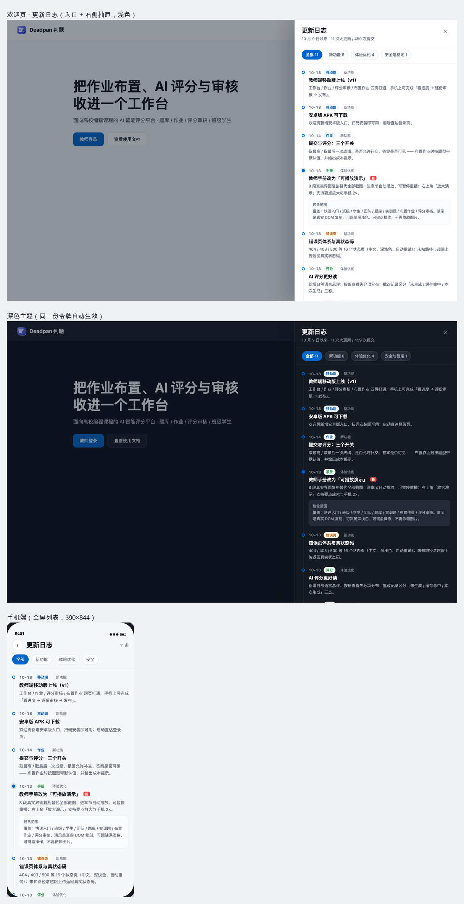

# 欢迎页 · 更新日志（设计稿 v1）

> 按 afrexai-ui-design-system Phase 1→9 出的评审稿；视觉用真实 `tokens.css` 渲染，深浅色共用同一份令牌。

## 一、设计简报（Phase 1）

| 项 | 内容 |
|---|---|
| 类型 | 落地页内的二级功能（drawer），不是独立营销页 |
| 用户 | 教师 / 管理员 / 想了解系统进展的访客 |
| 场景 | 打开欢迎页时顺手看一眼「最近改了什么」 |
| 目标 | 让更新可见、可扫读、不打断浏览；不要求注册 |
| 设备 | 桌面优先（抽屉），手机全屏列表 |
| 约束 | 纯前端、只读、无后端；内容由仓库提交记录整理 |

## 二、信息架构（Phase 2）

- **入口**：欢迎页导航右侧「更新日志」（有未读时带红点）；页脚也留一个文字入口
- **容器**：右侧抽屉 520px（桌面）/ 全屏（手机）；点遮罩、Esc、右上 ✕ 关闭
- **顶部**：标题 + 「10 月 9 日以来 · 11 次大更新 / 459 次提交」+ 分类筛选胶囊
- **主体**：时间线（日期 → 分类 → 标题 → 一两句摘要），影响最大的那条默认展开「包含范围」
- **底部**：一句「只展示影响使用的更新 · 完整记录见仓库」

## 三、内容来源与口径

数据：`git log --since=2026-10-09`（实测 **459 个提交**）→ 人工收敛为 **11 条大更新**：

| 日期 | 分类 | 更新 |
|---|---|---|
| 10-18 | 移动端 | 教师端移动版 v1（工作台/作业/审核/布置） |
| 10-18 | 移动端 | 安卓版 APK 可下载（欢迎页入口） |
| 10-14 | 作业 | 提交与评分三开关（取最高/取最后、允许补交、答案可见性） |
| 10-13 | 手册 | 教师手册改为可播放演示（8 段 · 替代全部截图） |
| 10-13 | 错误页 | 错误页体系与真状态码（16 个状态页） |
| 10-13 | 评分 | AI 自然语言总评 + 按班失分项分布 + 批改记录三态 |
| 10-13 | 安全 | 改密即失效 / JWT 快速失败 / 上传 413 / CSP 观察模式 |
| 10-12 | 作业 | 布置作业改为一页式（单选/人数/默认时间/草稿） |
| 10-12 | 列表 | 列表样式统一 v2（11 个列表、两行式主列） |
| 10-12 | 个人 | 「我的信息」卡片（三端同形态、可复制） |
| 10-11 | 欢迎页 | 欢迎页重构 + 站点二维码 |

**筛选规则（给以后自动化用）**：只收 `feat` / `perf` 中「用户可感知」的变更；`docs`/`test`/`chore`/`refactor` 不进更新日志；同主题多次提交合并为一条。

## 四、实现方案（待拍板后做）

| 方案 | 优点 | 缺点 |
|---|---|---|
| **A. 静态 JSON（推荐）** `client/src/data/changelog.js`，手写 11 条 | 文案可控、零构建依赖、可直接上线 | 每次要手写一条 |
| B. 构建脚本从 git log 生成候选 | 不漏更新 | 噪音多、仍需人工写摘要 |
| **A+B 混合（最终建议）** | 脚本产出「候选清单」放到 PR 描述，人工确认后改 JSON | 多一步流程 |

组件：`ChangelogDrawer.vue`（入口在 `views/Landing.vue` 导航；`?changelog=1` 可直接打开，便于分享）。
未读红点：`localStorage['changelog:lastSeen']` 与最新条目日期比较。

## 五、待确认

1. 入口放**导航右侧**还是页脚？（稿里两处都有）
2. 容器用**抽屉**（不打断浏览）还是**独立页 `/changelog`**（可分享）？我建议抽屉 + `?changelog=1` 直开兜底。
3. 11 条是否合适？要不要加**版本号**（如 v1.2.0）而不是只写日期？
4. 分类口径：移动端 / 作业 / 手册 / 错误页 / 评分 / 安全 / 列表 / 个人 / 欢迎页 —— 是否合并成 4 类（新功能 / 体验优化 / 安全与稳定 / 移动端）？
5. 要不要「未读红点」（按最新条目日期判断）？
