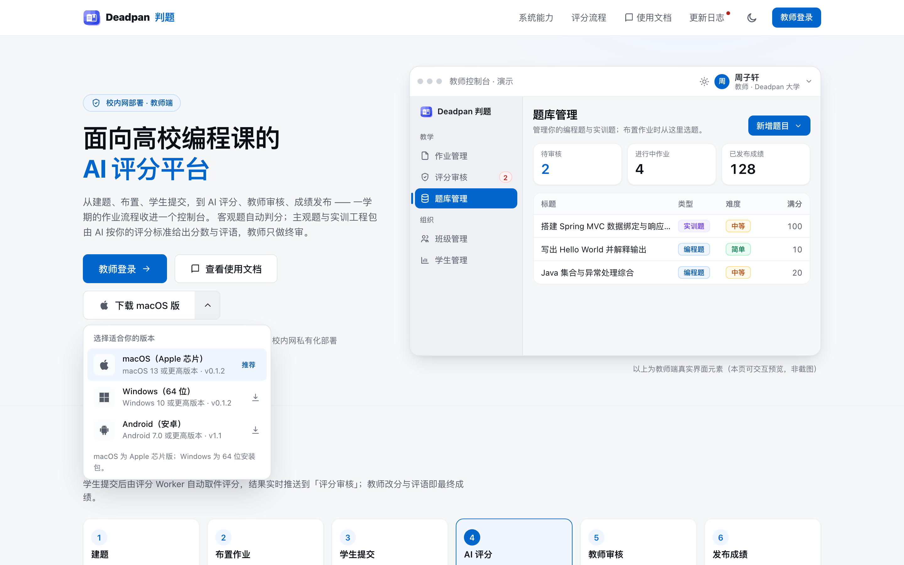
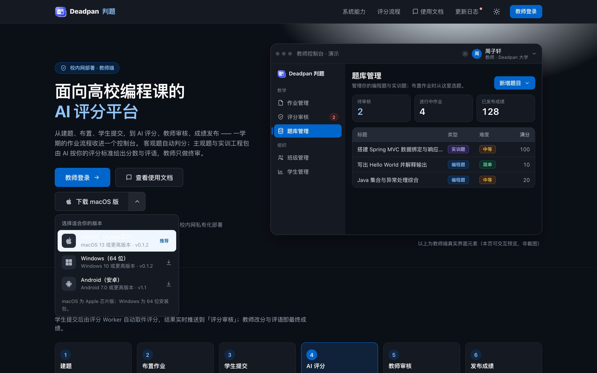
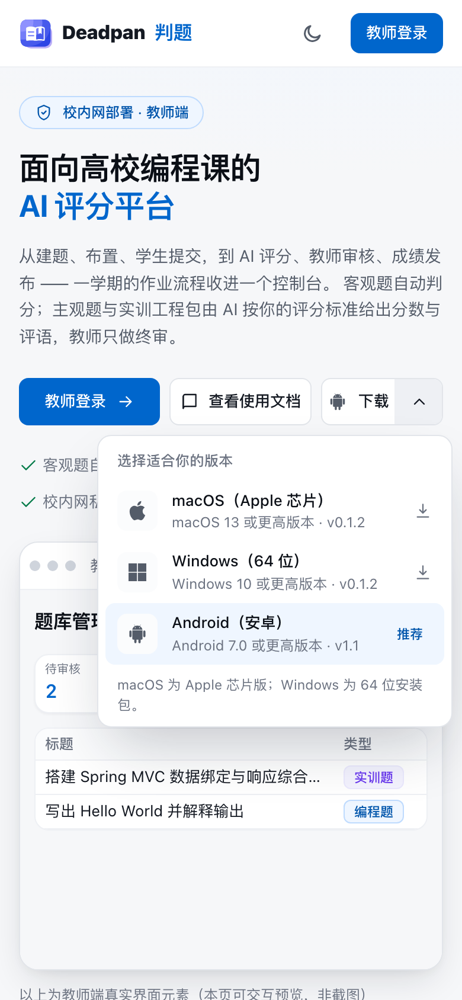

# 欢迎页下载按钮（统一样式）

原实现（后端团队加的 `DownloadMenu`）逻辑没问题（系统识别 + 平台下拉），但视觉与本项目设计语言不一致：
整体胶囊 999 圆角 + 重阴影 + 写死 `#fff/#111827/#e5e7eb`，深色模式下变成**一块白板**；平台选项只有 APK/DMG/EXE 文字角标，没有系统图标。

## 改法（只动 2 个文件）

| 维度 | 改前 | 改后 |
|---|---|---|
| 高度 | 46（但用了 999 胶囊） | `46px` = 同排 `.btn-lg`；手机 40px = 手机 `.btn-lg` |
| 圆角/描边 | 999 + 重阴影 | `--radius-md`（8）+ `--card-bd` 1px，阴影只留给面板 |
| 颜色 | 写死 6 个十六进制 | 全部 `tokens.css` 变量（卡片/悬停/文字/品牌/焦点环） |
| 深色 | 白块（不可用） | 自动跟随（实测面板背景 `rgb(20,25,34)`） |
| 平台图标 | 只有 APK/DMG/EXE 文字角标 | 内联 SVG：**Android 机器人 / Apple / Windows 四格**（用户提供），`fill=currentColor` |
| 触发按钮 | 只有通用下载箭头 | 显示**当前系统图标** + 「下载 macOS 版」；未知/iOS 为通用下载图标 + 「下载客户端」 |
| 面板 | 文字角标 + 白底 | 图标磁贴 + 标题 + 「系统要求 · 版本」+ 当前平台「推荐」胶囊；行悬停 `--bg-surface-2` |
| 手机 | 标签被挤成「下…」 | 窄屏显示「图标 + 下载」，与另两个 CTA 并排不截断 |
| 无障碍 | 部分 aria 缺失 | `aria-haspopup/expanded/controls`、`role=menu/menuitem`、`Esc` 关闭、焦点环 `--ring-focus`、`prefers-reduced-motion` |

## 截图

| 桌面（macOS 识别） | 深色 | 手机（Android 识别） |
|---|---|---|
|  |  |  |

## 实测（Playwright 五组 UA）

| UA | 触发文案 | 图标 | 高度 | 面板背景 | 推荐项 | JS 异常 |
|---|---|---|---|---|---|---|
| macOS Chrome | 下载 macOS 版 | Apple | 46px（= 同排按钮） | 白 | macOS | 0 |
| Windows Chrome | 下载 Windows 版 | Windows | 46px | 白 | Windows | 0 |
| Android Chrome | 下载 Android 版 | Android | 40px（= 手机按钮） | 白 | Android | 0 |
| iOS Safari | 下载客户端 | 通用下载 | 40px | 白 | 无（正确） | 0 |
| macOS + 深色 | 下载 macOS 版 | Apple | 46px | `rgb(20,25,34)` | macOS | 0 |

面板宽度：桌面 300px、手机 `min(300, 100vw-32)`；均无横向溢出。

## 说明

- 逻辑（`detectPlatform` / `defaultDownloadFor` / 面板定位 / 点外关闭）原样保留，未改 `downloadTargets.js`。
- 版本号来自现有数据：macOS/Windows `0.1.2`、Android `1.1`；发新版时只改 `downloadTargets.js`。
