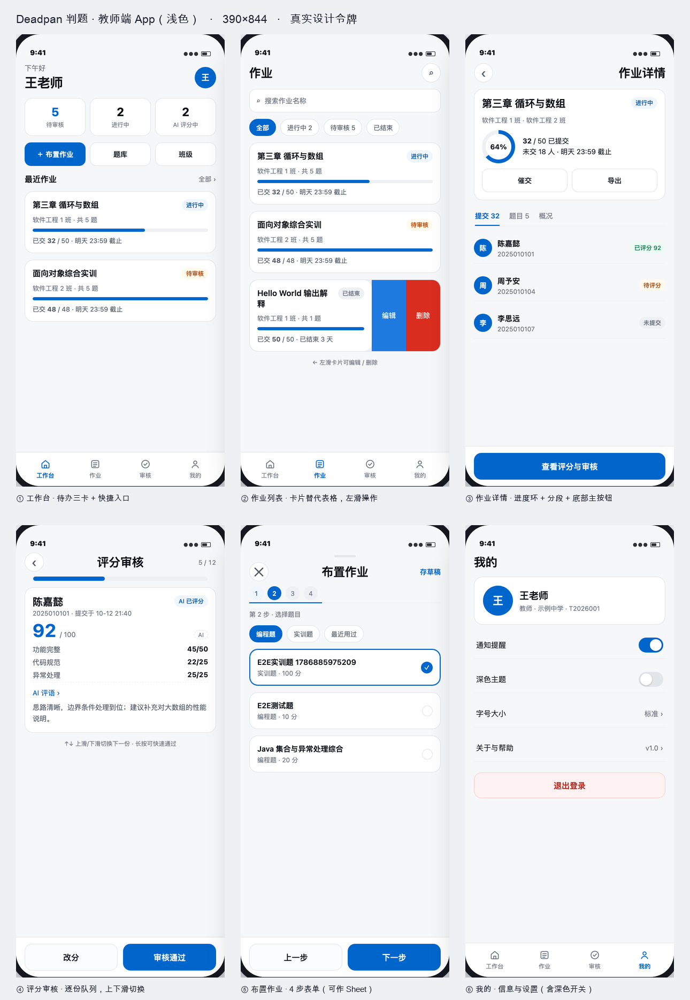
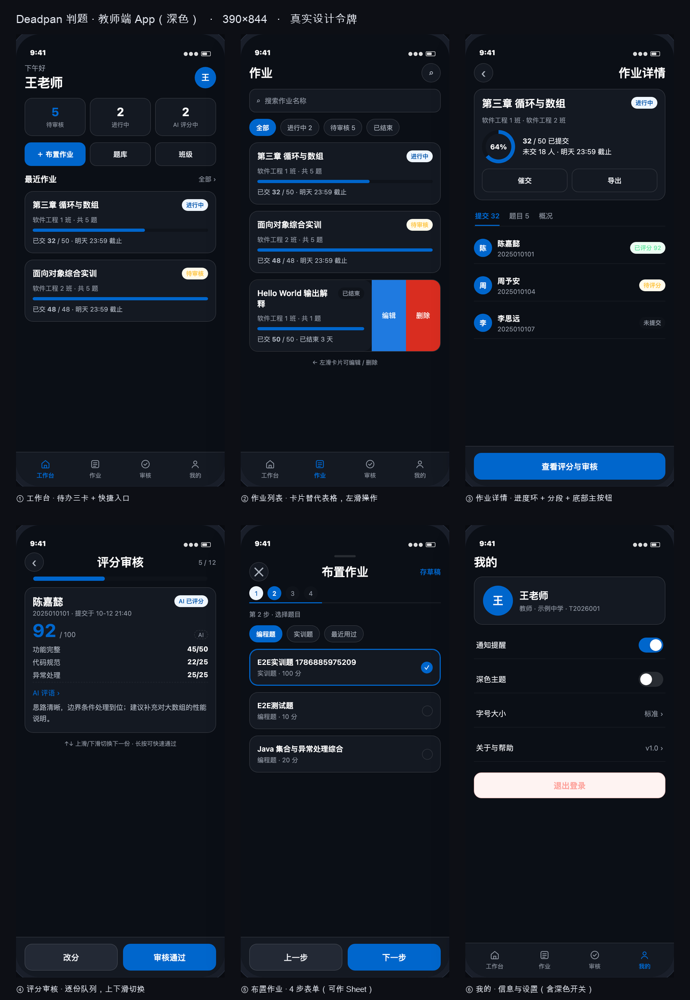

# 教师端 App 设计稿（移动优先）

> 依据 `afrexai-ui-design-system` 的 Phase 1→9 流程产出。**视觉稿由真实设计令牌渲染**（`client/src/styles/tokens.css`），不是凭空配色。
> 可直接双击打开看交互细节：`mock-light.html` / `mock-dark.html`（390×844，含两套主题）。

## Phase 1 · 设计简报（基于现有系统的合理假设，待确认项见文末）

| 项 | 内容 |
|---|---|
| 产品 | Deadpan 判题 · 教师端（题库/作业/评分审核/班级学生/团队） |
| 类型 | 移动 App（mobile_first），与桌面端并存而非替代 |
| 主要用户 | 高校教师，技术熟练度中等，**移动端高频场景 = 碎片时间看进度、催交、逐份审核** |
| 设备 | iPhone 390×844 基准（360–430 自适应），需适配安全区与深色 |
| 业务目标 | 让教师不用开电脑也能完成"看作业进度 / 审核发布 / 催交" |
| 用户目标 | 30 秒内知道"今天有什么事要我做"，一次审完一批 |
| 成功度量 | 待审核清零耗时可测；移动端完成一次审核 < 20 秒 |
| 品牌基调 | 克制、专业、可信任（沿用现有品牌蓝 #0066cc） |
| 约束 | Vue3 技术栈；WCAG AA；必须深色；中文内容；不做原生重写 |

## Phase 2 · 信息架构

**导航**：底部 4 Tab（工作台 / 作业 / 审核 / 我的）—— 桌面端 11 个菜单在手机上归并为 4 个高频入口，其余（题库、班级、学生、团队）**从工作台快捷入口与「我的」二级页进入**。

| 页面 | 核心内容 | 关键动作 |
|---|---|---|
| ① 工作台 | 待办三卡（待审核 5 / 进行中 2 / AI 评分中 2）+ 3 个快捷入口 + 最近作业 2 条 | 一眼看到今天要做什么 |
| ② 作业列表 | 搜索 + 状态筛选胶囊 + **作业卡片**（标题/状态/班级/提交进度/截止） | 左滑编辑·删除；点击进详情 |
| ③ 作业详情 | 进度环 64%（32/50）+ 催交/导出 + 分段（提交/题目/概况）+ 学生行（已评分/待评分/未提交） | 底部固定「查看评分与审核」 |
| ④ 评分审核 | 队列进度 5/12 + 学生卡 + AI 分 92（分项 45/22/25）+ 折叠 AI 评语 | 上下滑切换；底部「改分 / 审核通过」 |
| ⑤ 布置作业 | 4 步分步表单（基本信息/题目/班级/时间）+ 可点整行选题 + 存草稿 | 底部「上一步 / 下一步」 |
| ⑥ 我的 | 个人信息 + 通知/深色主题/字号/关于 + 退出 | 设置项 |

**关键设计决策（为什么这样改）**
1. **表格 → 卡片**：桌面 12 列表格在 390px 上必然要横向滚动；卡片只保留"能决策"的 4 个字段，其余进详情。
2. **弹窗 → 分步表单**：布置作业在桌面是一页两栏弹窗，手机上改 4 步，每步只做一件事，底部固定主按钮。
3. **批量审核 → 逐份队列**：桌面"左列表右详情"在手机上改为"队列 + 上下滑"，教师审完一份自动下一份，效率更高。
4. **状态用胶囊 + 文案**：不只靠颜色（色弱可读），状态色只做辅助。

## Phase 3 · 用到的设计令牌（全部来自 tokens.css）

| 类别 | 取值 |
|---|---|
| 品牌 | `--brand-600 #0066cc` / `--brand-500 #1f7ae0` / `--brand-50 #eff6ff` |
| 文字 | `--text-strong` > `--text-primary` > `--text-secondary` > `--text-tertiary` |
| 表面 | 页面 `--bg-canvas`、卡片 `--card-bg` + `--card-bd`、下沉 `--bg-sunken` |
| 圆角 | 卡片 16 / 按钮 12–14 / 胶囊 999 |
| 阴影 | 卡片 `--shadow-sm`，浮层 `--shadow-md` |
| 字号 | 标题 22/24、卡片标题 15、正文 13–14、说明 11–12 |
| 动效 | `--duration-base 220ms` + `--ease-out cubic-bezier(.16,1,.3,1)`；全部遵循 `prefers-reduced-motion` |

## Phase 6 · 手势与移动端硬指标

- 触控目标 **≥44×44px**（按钮 44–50 高，Tab 项含 padding 52 高）
- 安全区：底部 `env(safe-area-inset-bottom)`；页面高度用 `100dvh` 而非 `100vh`
- 手势：左滑露出操作（编辑/删除）、上下滑切换审核队列、下拉刷新、上拉加载更多、长按多选
- 冲突处理：左滑只在卡片内响应；`overscroll-behavior-y: contain` 防串页
- 输入：数字键盘 `inputmode="numeric"`、日期用原生 picker、禁用双击缩放延迟用 `touch-action: manipulation`（不禁缩放本身）

## Phase 8 · 设计评分（自评，0–100）

| 维度 | 权重 | 得分 |
|---|---|---|
| 视觉层级 | 20 | 18 |
| 一致性 | 15 | 14 |
| 留白 | 15 | 13 |
| 无障碍 | 15 | 12 |
| 响应式 | 10 | 9 |
| 交互设计 | 10 | 7 |
| 字体 | 10 | 9 |
| 配色 | 5 | 5 |
| **合计** | 100 | **87**（Good，需少量精修） |

扣分点（下一版要补）：**空状态、加载骨架、错误态、下拉刷新动效、360/430 宽适配、深色下状态色对比校验、返回手势与长按多选**尚未画出。

## Phase 9 · 交付与待确认

- 源文件：`mock-light.html` / `mock-dark.html`（内联真实 tokens.css，双击即开）
- 分屏图：`screens/light-*.png`、`screens/dark-*.png`（各 6 张，2× DPR）
- 实现建议：新增 `/m` 路由区 + 独立移动 Layout（Vant 4 按需引入），桌面端不动
- **待你确认**
  1. 4 个 Tab 的口径对不对（练习/题库/班级是否要独立 Tab？）
  2. 审核队列默认是"逐份"还是"按提交列表点进去"？
  3. 「我的」里是否要"切换学校/团队"（现有系统有多学校/团队）
  4. 字号设置要不要做（适老/大屏教师）
  5. 学生写代码是否明确"请用电脑"，移动端只做查看/上传
