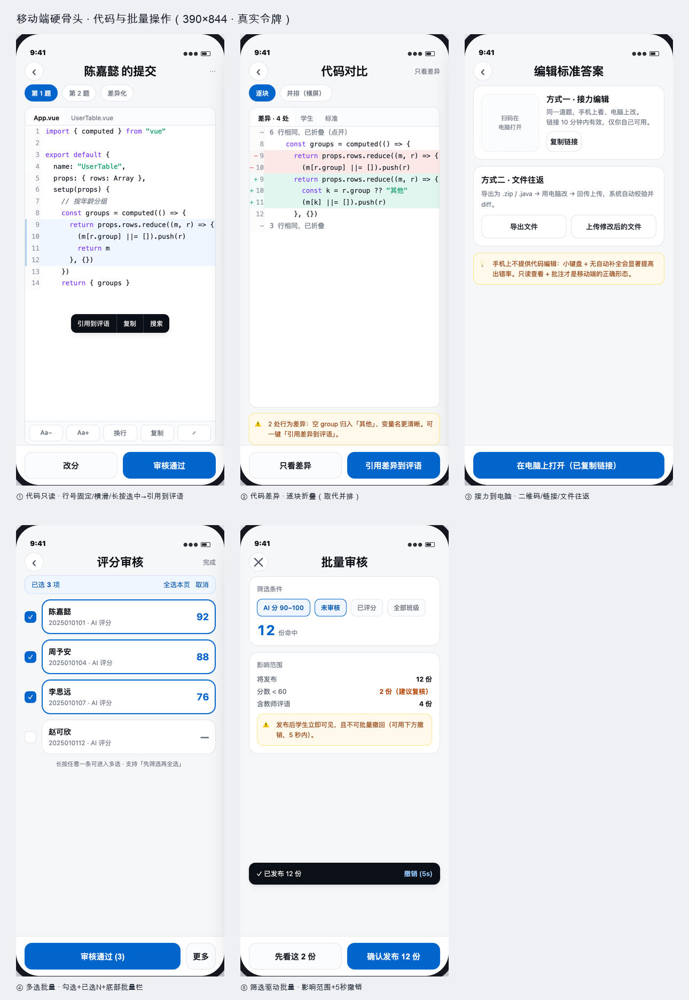

# 移动端两个硬骨头：代码 与 批量操作

> 用户的判断是对的：「手机屏幕小，这两个操作不好」。所以本稿**不做隐藏**，而是各给一套专用交互。
> 依据 afrexai-ui-design-system 的 Phase 1→9；视觉由真实 tokens.css 渲染，390×844。

## 一、代码（Monaco）

### 问题拆解

| 场景 | 手机上是否可行 | 结论 |
|---|---|---|
| **读代码**（审核时看学生提交） | ✅ 只读 + 横滑 + 长按选中 | 高频，必须做 |
| **批注代码**（选中片段引用到评语） | ✅ 长按 → 上下文菜单 | 必须做 |
| **写代码**（改标准答案 / 写参考解） | ❌ 软键盘遮挡、无补全、光标定位难、误触 | 不做本地编辑，走接力 |

### 方案对比（含否决理由）

| 方案 | 结论 |
|---|---|
| 保留 Monaco 全功能 | ❌ 软键盘 + 滚动冲突 + 手指光标定位，成功率低 |
| 换 CodeMirror 6 | △ 轻一些，但移动端仍「能用不好用」 |
| **只读面板 + 引用到评语** | ✅ 采纳（教师端 90% 是读代码打分） |
| **接力到电脑**（二维码 / 一次性链接 / 文件往返） | ✅ 采纳（真要改代码时） |
| 简化逐行编辑（大字号 textarea + lint） | ○ 备选，只适合学生端简单题 |

### 交互规格

- 行号 `position: sticky; left: 0`（横滑时行号不跑）；等宽 12.5px / 行高 1.75
- 横滑看长行；默认不折行，提供「换行」开关
- 长按选中 → 浮动菜单：引用到评语 / 复制 / 搜索
- 字号 Aa− / Aa+（12–16px，记忆偏好）；双指缩放同样调字号
- 选中态**不只靠颜色**：左侧 3px 品牌色竖条 + 浅底
- 底部固定：改分 / 审核通过（与审核队列一致）
- **不做并排 diff**（390px 放不下）→ 逐块折叠 diff + 「只看差异」开关

## 二、表格批量操作

### 问题拆解

手机上表格三宗罪：① 横滑找不到列 ② 单元格太窄点不准 ③ 44px 行里没法勾选。

### 四层设计（逐层替代表格）

| 层 | 做法 | 解决什么 |
|---|---|---|
| 1 | **列表卡片**（不用表格） | 每卡只留姓名/学号/分数，整卡可点 |
| 2 | **长按进入多选**：勾选框 + 已选 N / 全选本页 / 取消 | 勾选目标 ≥44px |
| 3 | **批量操作栏**：主「审核通过 (N)」，导出/标异常/删除收进「更多」 | 主次分明，不误触 |
| 4 | **筛选驱动批量**：AI 分 90–100 + 未审核 → 命中 12 → 看影响范围 → 一键发布 | 规模化正确操作 |

### 安全设计（批量最怕误操作）

- **影响范围摘要**：将发布 12 份 / 其中 2 份分数 < 60（建议复核）/ 含教师评语 4 份
- 次按钮「**先看这 2 份**」→ 跳到有风险的那几条
- 主按钮写明数量：「确认发布 12 份」
- 发布后 Toast + **撤销（5 秒）**
- 危险操作（删除/标异常）二次确认 + 说明后果

### 性能与实现要点

- 勾选状态**跨页保持**（本地 Map，按作业 id 隔离）
- >200 条用虚拟滚动；分页 pageSize=50
- 批量提交：确认后端已有 review/batch 控制器（server/src/interface/http/controllers/review/batch.js），需核对是否覆盖「批量通过」；不覆盖则逐条并发 5
- 撤销：建议后端支持「延迟 5 秒生效」或软标记，而不是前端假撤销

## 三、设计自评（Phase 8）

| 维度 | 权重 | 得分 | 扣分点 |
|---|---|---|---|
| 视觉层级 | 20 | 18 | 代码屏工具条与选区菜单同屏略密 |
| 一致性 | 15 | 15 | 与教师端 6 屏一致 |
| 留白 | 15 | 13 | 代码屏下半留白多（真实代码更长） |
| 无障碍 | 15 | 13 | 选区不只靠颜色 ✓；已选数量待加 aria-live |
| 响应式 | 10 | 8 | 横屏/平板未画（≥768 回退表格视图待补） |
| 交互 | 10 | 9 | 菜单/多选/撤销已定义；缺长按反馈动效 |
| 字体 | 10 | 9 | — |
| 配色 | 5 | 5 | — |
| **合计** | | **89** | Good，横屏与读屏待补 |

## 四、待确认

1. **教师端真的需要编辑标准答案吗？**（若极少发生可砍掉「接力编辑」，只留只读）
2. **批量接口能力**：review/batch 是否支持「批量审核通过」？不支持需后端补一条（我先核对再提）
3. **撤销机制**：后端能否支持 5 秒延迟生效？否则只能提示、实际已提交
4. **横屏/平板（≥768）**：是否自动回退「表格视图」（多列）？我建议是
5. **学生端 Monaco**：本稿只覆盖教师端；学生作答页需单独定（建议上传文件 / 简单题轻编辑）