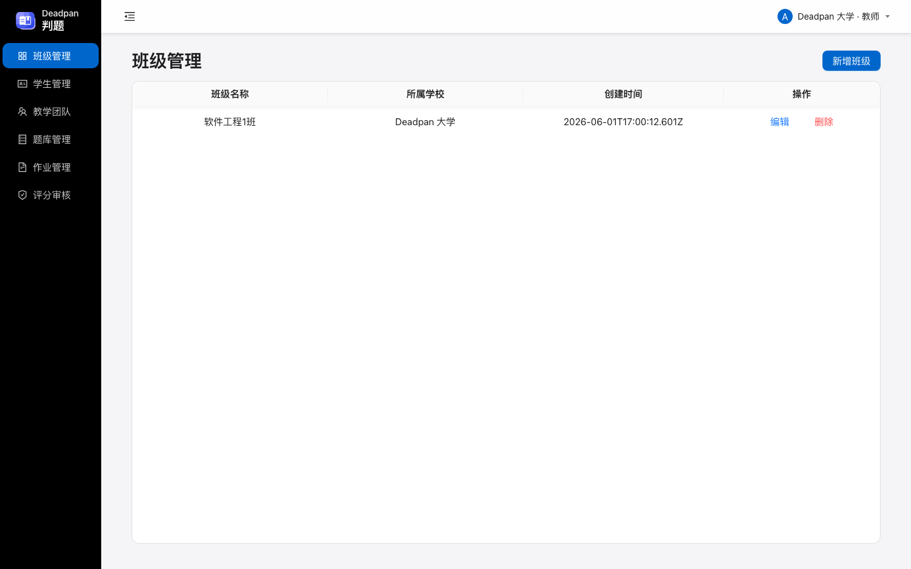
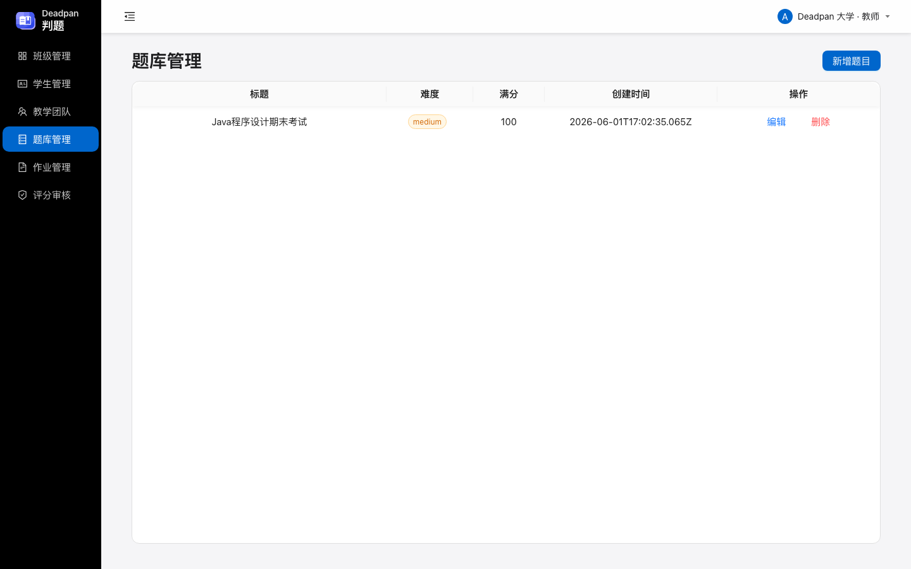
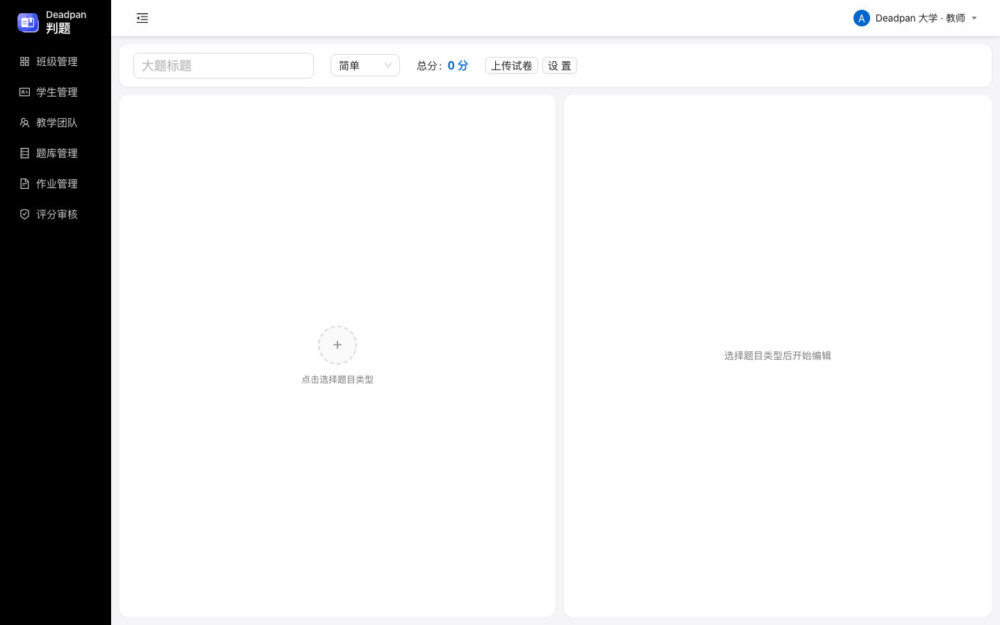
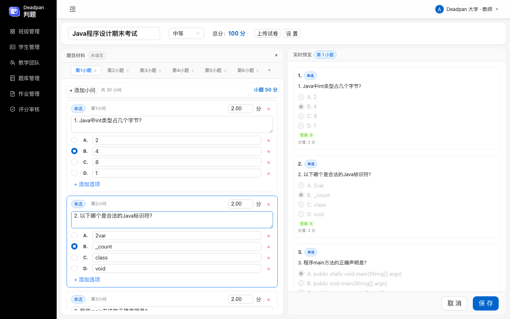
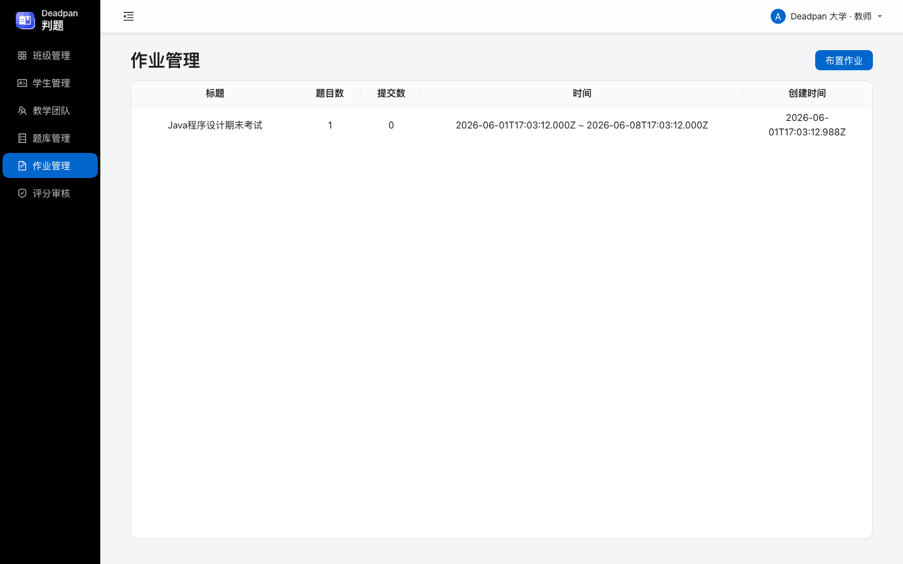
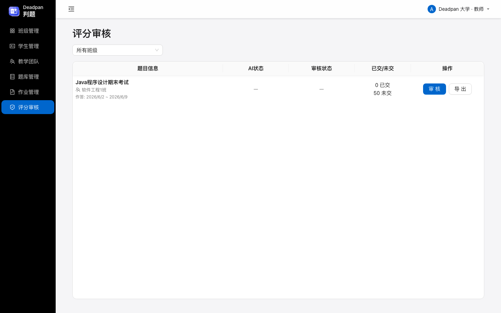
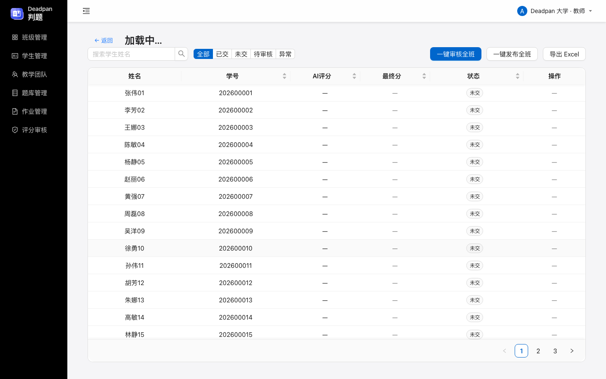
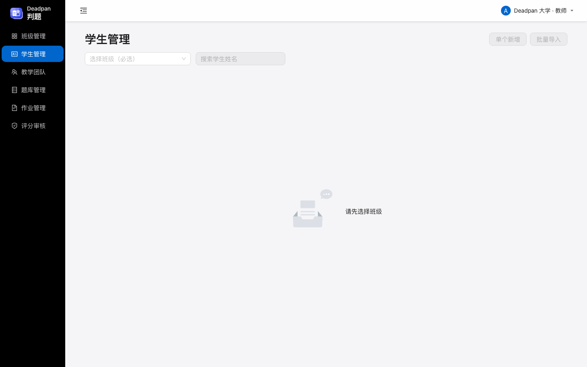
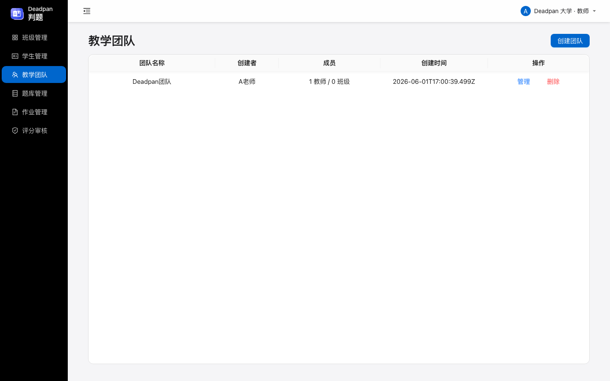

> **适用对象：** 教师  
> **系统版本：** Deadpan 判题 v2.0  
> **演示环境：** Deadpan 大学 | A老师 | 软件工程1班（50人）

---

## 目录

1. [系统概述](#1-系统概述)
2. [登录与切换学校](#2-登录与切换学校)
3. [题库管理](#3-题库管理)
4. [新建题目（AI 解析）](#4-新建题目)
5. [AI 生成参考答案](#5-ai-生成参考答案)
6. [布置作业](#6-布置作业)
7. [评分与审核](#7-评分与审核)
8. [学生管理](#8-学生管理)
9. [班级与团队管理](#9-班级与团队管理)
10. [导出成绩](#10-导出成绩)

---

## 1. 系统概述

Deadpan 判题是一款面向高校教师的在线考试系统，支持**客观题自动批改**与**编程题 AI 评分**。

### 核心功能一览

| 模块 | 功能 |
|------|------|
| 📝 题库管理 | AI 解析试卷文档、编辑题目、设置分值 |
| 🤖 AI 辅助 | 解析 Word 试卷、生成编程题参考答案、智能评分 |
| 📋 作业管理 | 选题→选班→定时发布 |
| ✔️ 评分审核 | 查看 AI 评分、修正分数、批量审核 |
| 👥 班级/学生 | 管理班级、批量导入学生 |
| 👨‍👩‍👧 教学团队 | 教师协作共享班级 |
| 📊 导出成绩 | 一键导出 Excel 成绩表 |

---

## 2. 登录与切换学校

使用工号和密码登录系统。教师登录后可看到自己管辖的班级和题目。

登录后系统会自动进入教师工作台：

---

## 3. 题库管理

题库管理页面展示教师创建的所有题目，支持表格排序、搜索和分页。

### 表格功能说明

| 特性 | 说明 |
|------|------|
| 🔍 搜索 | 暂未开放，可通过标题快速定位 |
| ↕️ 排序 | 点击表头进行排序（升序/降序/取消排序） |
| 📄 分页 | 每页 20 条，底部固定分页栏，翻页有淡入动效 |

### 操作按钮

- **新增题目**：跳转到题目编辑页，支持 AI 解析或手动录入
- **编辑**：修改已有题目的内容、分值和参考答案
- **删除**：软删除题目（保留历史提交记录）

---

## 4. 新建题目（AI 解析）

Deadpan 判题支持通过 **AI 解析 Word 文档** 来快速创建题目。以下为完整流程：

### 步骤一：进入新建页面

点击题库管理页面的「新增题目」按钮：

### 步骤二：编辑题目

在题目编辑页中，完成以下操作：

1. **设置标题**：输入题目名称（如"Java 程序设计期末考试"）
2. **设置难度**：选择 easy / medium / hard
3. **上传材料**：点击「AI解析」按钮，粘贴 Word 文档内容或直接粘贴文本
4. **等待解析**：DeepSeek AI 会自动提取文档中的题目结构和答案
5. **确认小题**：解析完成后，左侧会显示所有小题，右侧可逐题检查

### 步骤三：编辑时操作说明

- **客观题**：可增减小问、修改选项、调整分值
- **编程题**：可修改题面、设置语言类型、调整分值
- **分值联动**：小问增减后，小题分值自动重算
- **总分**：顶部显示所有小题分值之和（只读）
- **保存拦截**：如某题分值为空/0，系统会阻止保存并提示具体题号

> 💡 **提示：** 推荐使用「AI解析试卷」功能，将 Word 试卷一键转换为系统题目，大幅减少手工录入时间。

---

## 5. AI 生成参考答案

对于编程题（主观题），系统支持 **AI 自动生成参考答案**：

> 在题目编辑页中，编程题的「参考答案」区域点击「AI 生成」按钮，DeepSeek 会根据题目描述生成标准参考答案代码。

生成的参考答案将用于后续的自动评分。

---

## 6. 布置作业

### 布置流程（三步走）

**第一步：选题**  
在弹窗中选择需要布置的题目（支持搜索和按难度筛选）

**第二步：选班**  
选择目标班级（支持多选）

**第三步：设时间**  
填写作业标题、说明、起止时间，选择是否允许补交

### 关键功能

| 功能 | 说明 |
|------|------|
| ⏰ 定时发布 | 设置起止时间，到期自动关闭提交 |
| 🔄 允许补交 | 开启后学生可在截止后重新提交 |
| 📊 提交统计 | 列表实时显示各作业的提交数 |

---

## 7. 评分与审核

### 7.1 审核总览

评分审核页面展示所有布置的作业，包含以下信息：

- **AI 状态**：已评分 / 待评分 / 评分异常
- **审核状态**：已审核 / 待审核
- **提交统计**：已交人数 / 未交人数

> 💡 系统通过 **WebSocket** 实时推送 AI 评分进度，无需手动刷新。

### 7.2 审核具体班级

点击「审核」按钮进入班级评分详情：

| 功能 | 操作 |
|------|------|
| 🔍 搜索 | 按学生姓名搜索 |
| 📊 筛选 | 全部/已交/未交/待审核/异常 |
| ✏️ 修改分数 | 点击最终分旁的数值进行修改 |
| 📝 逐题审核 | 点击「审核」进入学生详情页 |

### 7.3 批量操作

| 按钮 | 功能 |
|------|------|
| 一键审核全班 | 将全班 AI 已评分的提交批量审核通过 |
| 一键发布全班 | 将全班已审核的提交批量发布（学生可见） |
| 导出 Excel | 导出全班成绩表（含每题得分） |

---

## 8. 学生管理

### 核心操作

| 操作 | 说明 |
|------|------|
| 单个新增 | 填写学号和姓名，选择班级 |
| 批量导入 | 上传 Excel 文件（表头：学号、姓名） |
| 编辑/删除 | 修改学生信息或删除 |
| 搜索 | 按姓名搜索 |

> 💡 批量导入支持 `.xlsx` 和 `.xls` 格式，可先下载模板按格式填写。

---

## 9. 班级与团队管理

### 9.1 班级管理

支持新增、编辑、删除班级。团队共享的班级会显示「团队共享」标签。

### 9.2 教学团队

教学团队允许多位教师共享班级和题目：

- **创建团队**：输入团队名称即可创建
- **管理团队**：添加/移除教师成员、分配班级
- **退出/删除**：成员可退出，创建者可删除

---

## 10. 导出成绩

审核完成后，在「评分审核」页面点击「导出 Excel」按钮：

1. 系统自动将学生成绩按每题得分展开
2. 表头包含：姓名、学号、学校、班级、状态、总分、以及每道小题的得分
3. 生成 `.xlsx` 文件供下载

---

## 附录

### 快捷键

| 快捷键 | 操作 |
|--------|------|
| Enter | 确认/提交 |
| Esc | 取消/退出编辑 |

### 常见问题

**Q：AI 评分不准怎么办？**  
A：教师可在审核页面逐题调整分数，AI 评分仅作参考。

**Q：学生提交后还能修改吗？**  
A：取决于布置作业时的「允许补交」设置。

**Q：如何批量导入学生？**  
A：学生管理页 → 批量导入 → 上传 Excel（含学号、姓名两列）。

**Q：多人同时审核可以吗？**  
A：可以，系统支持多位教师同时审核不同学生的提交。

---

> 📅 最后更新：2026-06-02  
> 🏫 演示环境：Deadpan 大学 | A老师 | 软件工程1班
