# 技术交底书

**案件名称**：一种基于混合智能的在线编程考试自动评分方法及系统

**技术联系人**：
- 姓名：待填写
- 电话：待填写
- 邮箱：待填写

**专利类型**：发明

---

## 注意事项

（1）交底书应使代理人能看懂，尤其是背景技术和详细技术方案，一定要写得全面、清楚、完整；
（2）技术的公开程度，应以本领域普通技术人员不需付出创造性劳动即可进行实施为准。
（3）在与代理人沟通时，对于代理人咨询的技术问题，应给予回答并认真讲解，并且按要求及时正确地补充相应技术材料。

---

## 一、介绍相关技术背景，描述与本发明技术最相近的现有技术，并说明该现有技术存在的缺点

### 1.1 现有技术

检索说明：在**国家知识产权局专利公布公告系统**及 **Google Patents** 中，以「在线考试」「自动评分」「试卷解析」「多题型混合评分」「AI编程评分」「实时评分反馈」等为检索词进行检索；部分条目的公开文本与著录项以 Google Patents 页面复核。同时检索了 **Google Scholar** 等学术文献数据库，获取大语言模型评分编程作业的相关学术研究。

**方向一：基于规则或单一大模型的自动评分方法**

（1）**CN121599806A**（世纪金榜集团股份有限公司，2026年）
- 技术方案：公开了一种多文本混合主观题智能阅卷方法，使用多粒度对齐及非线性融合策略捕捉跨段落信息融合与逻辑性，支持中英文差异化质量评估，输出可解释评分证据与个性化评语。
- 应用场景：K12 教育中语文、英语等主观题（作文、简答题）的自动阅卷。
- 局限性：仅处理文本类主观题，不涉及编程题（代码）自动评分；不涉及客观题（单选/多选/判断/填空）的规则引擎自动比对路由；不涉及从试卷文件到题库的自动解析流程；不涉及评分结果的异步分层可见机制。
- 来源链接：https://patents.google.com/patent/CN121599806A/zh

（2）**CN118780268A**（苏州青颖飞帆软件科技股份有限公司，2024年）
- 技术方案：将线上试卷中的主观题分为第一类主观题和第二类主观题：第一类主观题使用向量化辅助评分模型评分，第二类主观题使用大语言辅助评分模型评分；可结合客观题答案匹配共同构成混合阅卷。
- 应用场景：线上考试的主观题与客观题混合阅卷场景。
- 局限性：主观题二分法的分类标准依赖预先人工标注，不具备题型自动判别能力；向量化模型对代码题的复杂语义理解不足；不涉及试卷自动解析成题与题库生成；不涉评分结果在教师审核前后的异步分层可见机制。
- 来源链接：https://patents.google.com/patent/CN118780268A/zh

（3）**CN120387912A**（苏州青颖飞帆软件科技股份有限公司，2025年）
- 技术方案：在 CN118780268A 基础上进一步引入 vLLM 推理框架上的大语言模型进行主观题打分，使用有限状态机控制 token 采样和解码，提升大语言模型阅卷的效率与稳定性。
- 应用场景：大规模线上考试场景下的大语言模型辅助阅卷。
- 局限：仍未解决题型自动判别与路由；不涉及试卷解析；不涉及评分结果异步分层可见与实时推送反馈。
- 来源链接：https://patents.google.com/patent/CN120387912A/zh

**方向二：试卷解析与题库构建**

（4）**CN121259850A**（一种基于多模态文档布局分析的试卷解析方法）
- 技术方案：提出一种双流 Transformer 框架学习试卷文档的文本-视觉多模态信息，引入掩码网格语言模型和分段语言模型作为预训练任务增强多模态特征学习过程。
- 应用场景：从网络教育站点获取的 docx 格式试卷文档的自动解析。
- 局限性：依赖特定模型架构（双流 Transformer），需大量标注数据进行训练；解析依赖于文档排版布局特征，未利用题目答案形态进行题型判定的领域通用规则；部署门槛高，训练与推理成本较大。
- 来源链接：https://patents.google.com/patent/CN121259850A/zh

（5）**CN120182991A**（一种智能试卷解析与题库自动生成系统及方法）
- 技术方案：通过大语言模型从试卷信息中解析题目信息，对题目进行分类，对分类后的题目进行结构化存储，支持根据查询信息输出对应题目信息。
- 应用场景：试卷解析并自动生成题库。
- 局限性：依赖单一的大语言模型进行题目识别与分类，未区分题型判定的规则化前置逻辑（如利用题干中论述动词、选项排列、填空标记等答案形态特征做快速路由）；大模型在小样本或非标准格式试卷上可能产生分类错误。
- 来源链接：https://patents.google.com/patent/CN120182991A/zh

（6）**CN114429118A**（一种基于跨度信息和局部注意力的试卷结构解析方法）
- 技术方案：通过大规模预训练模型提取试卷每行语义特征，利用基于跨度信息的监督注意力与跨度分类辅助任务，采用先解析大题后拆分小题的两阶段方法。
- 应用场景：电子化试卷的结构解析。
- 局限性：两阶段方法对关键要素（大题边界、小题切分）的识别错误可能逐级放大；依赖大量标注数据；不涉及题型（单选/多选/填空/判断/主观题）的自动分类与后续自动评分路由。
- 来源链接：https://patents.google.com/patent/CN114429118A/zh

**方向三：在线考试综合管理平台**

（7）**CN122311605A**（综合性在线学习的管理方法、装置、电子设备及存储介质）
- 技术方案：响应于用户在线学习请求确定课程类别，分配课程内容供学习；响应于考试请求分配考试内容；获取学习信息与考试信息对学习效果进行评估。
- 应用场景：整合多种课程内容的在线学习与在线考试平台。
- 局限性：侧重于课程管理与学习效果评估，不涉及 DeepSeek 等大语言模型驱动的自动化代码评分、不涉及题型感知的混合评分路由、不涉及试卷智能解析与基于答案形态的题型判定、不涉及评分结果异步分层可见机制。
- 来源链接：https://patents.google.com/patent/CN122311605A/zh

（8）**CN122312344A**（基于动态约束校验与多模态防作弊机制的在线教育系统及方法）
- 技术方案：引入动态学时约束规则引擎完成用户课程培训，采用同质异构重组算法生成考试试卷，结合多模态行为熔断机制解决在线考试作弊问题，采用状态机补偿机制确保考试支付有效性。
- 应用场景：大规模继续教育在线考试场景，聚焦防作弊与并发支付稳定性。
- 局限性：核心创新集中于防作弊与支付补偿，不涉及 AI 驱动的自动化评分、不涉及试卷智能解析、不涉及题型感知评分路由。
- 来源链接：https://patents.google.com/patent/CN122312344A/zh

**方向四：AI 编程作业自动评分（学术文献）**

（9）**StepGrade / CodEv** 等基于大语言模型（LLM）的编程作业评分系统（arXiv 2024–2025）
- 技术方案：使用 GPT-4 等大语言模型，通过 Chain-of-Thought（思维链）提示或 LLM 集成（ensemble）方法对编程作业进行多维度评分，维度涵盖功能正确性、代码质量、算法效率等。
- 局限性：单一依赖大语言模型，未与规则引擎结合——导致客观判断（如输出对错）也消耗 AI token；缺乏试卷解析上游（需人工录题）；缺乏异步分层可见机制（评分结果直接反馈给学生，无教师审核中间层）；每次评分均调用完整大模型推理，成本高、延时长。
- 来源链接：https://arxiv.org/abs/2503.20851（StepGrade）、https://arxiv.org/abs/2501.10421（CodEv）

**检索总结**：现有技术分布在四个方向——基于规则/单一 LLM 的评分、试卷文档布局解析、考试综合管理平台、以及学术界的 LLM 编程评分研究。这些技术各自解决了单一环节的问题，但未见将三者有机融合的方案。

**本发明与现有技术的本质区别**：
1. 现有评分方法中，规则引擎仅用于客观题比对，或大语言模型统一覆盖所有题型——前者覆盖面窄，后者成本高且对客观题浪费算力。本发明引入**题型感知的混合评分路由器**，依据题目结构特征自动分派评分策略，客观题走本地规则引擎、主观编程/论述题走大语言模型，实现成本与效果的最优平衡。
2. 现有试卷解析方法依赖文档布局分析或端到端大语言模型，跨学科泛化能力弱。本发明提出**基于「答案形态」的跨学科题型判定决策树**，不依赖学科模板即可自动识别题型并抽取参考答案与评分标准。
3. 现有评分反馈系统缺少异步分层可见机制。本发明提出**五态流水线与分层可见的实时反馈**：学生提交后立即获得「已提交」确认，教师端通过 WebSocket 实时看到 AI 评分结果，学生仅在教师审核「发布」后方可查看分数与评语，形成完整的教学审核闭环。

---

### 1.2 现有技术存在的缺点

1. **评分策略单一，缺乏题型感知路由**：现有系统要么全部依赖规则引擎（仅能比对客观题答案，无法评估编程题和论述题），要么全部调用大语言模型（对单选/判断等客观题也消耗 AI token，成本高、速度慢）。未见根据题目类型自动选择评分策略的混合路由方案。

2. **试卷解析依赖学科模板或复杂模型，缺乏通用性**：现有试卷解析方法依赖文档排版布局信息（双流 Transformer）、大规模标注数据，或直接使用单一 LLM 进行端到端解析。缺少一种基于题目本身「答案形态」特征（如论述动词、选项排列、填空标记、判断标记）进行题型快速判定的通用决策规则，导致不同学科的试卷需要不同的解析策略。

3. **评分反馈缺少异步分层可见机制**：现有系统要么学生交卷后需等待 AI 评分完成才能看到结果（等待焦虑），要么 AI 评分结果直接向学生展示（缺乏教师审核中间层）。缺少一种支持 `提交 → AI评分 → 教师审核 → 发布可见` 的完整五态流水线与基于 WebSocket 的实时分层推送机制。

4. **评分引擎并发不可动态调整**：现有系统的评分并发数通常在代码中硬编码，运行时不可调整。当系统负载变化时无法灵活应对，且评分 Worker 与主服务进程耦合度高。

---

## 二、针对上述缺点，说明本发明所要解决的技术问题

本发明所要解决的技术问题是：提供一种基于混合智能的在线编程考试自动评分方法及系统，以解决现有技术中：

（1）评分策略单一、无法根据题型自动选择最优评分方式的问题——本发明通过题型感知的混合评分路由器，将客观题自动分派至本地规则引擎、主观编程/论述题自动分派至大语言模型评分；

（2）试卷解析依赖学科模板、跨学科泛化能力弱的问题——本发明通过基于「答案形态」的题型判定决策树，不依赖学科模板即可实现跨学科试卷的自动解析与题库构建；

（3）评分反馈缺少异步分层可见机制的问题——本发明通过五态流水线（draft → submitted → ai_graded → reviewed → published）与 WebSocket 分层实时推送，实现教师实时感知评分进度、学生仅在教师审核发布后方可见分数的分层反馈闭环。

---

## 三、本发明技术方案的详细阐述

### 3.1 背景

本发明适用于在线编程教育、高校计算机类课程考试、企业技术笔试等场景。以高校编程类课程在线考试为例：教师需要将试卷录入系统（或上传现有试卷文件自动解析），布置给指定班级的学生；学生在代码编辑器中编写代码并提交；系统自动评分后，教师审核并发布成绩。

现有方案的痛点在于：教师手工录入题目效率低、客观题与编程题评分逻辑割裂、学生提交后无实时反馈感、教师审核与发布流程缺乏异步分层控制。本发明解决了上述全链路问题。

### 3.2 系统框图

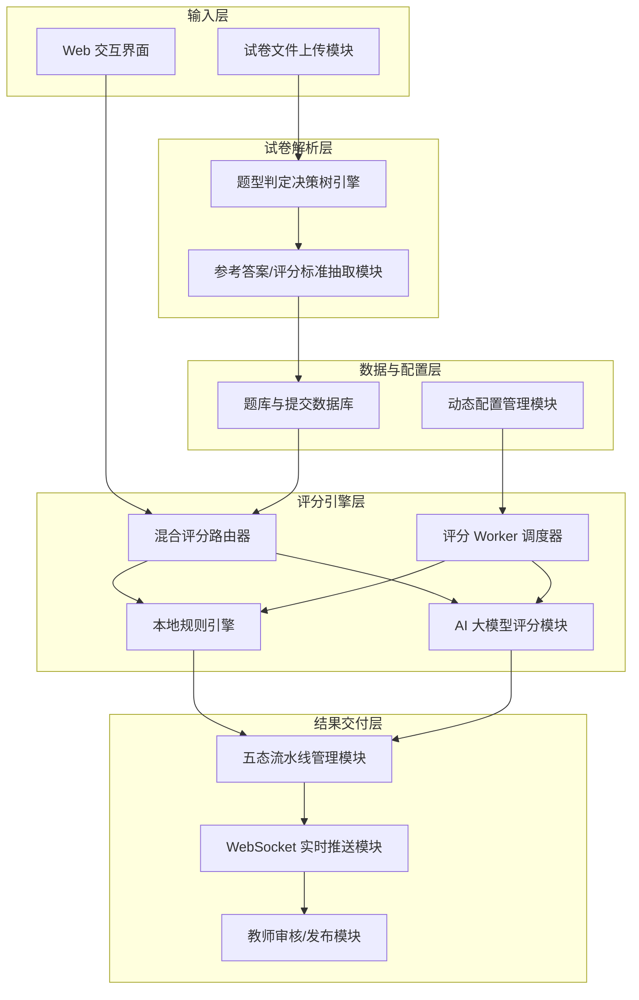
<!-- 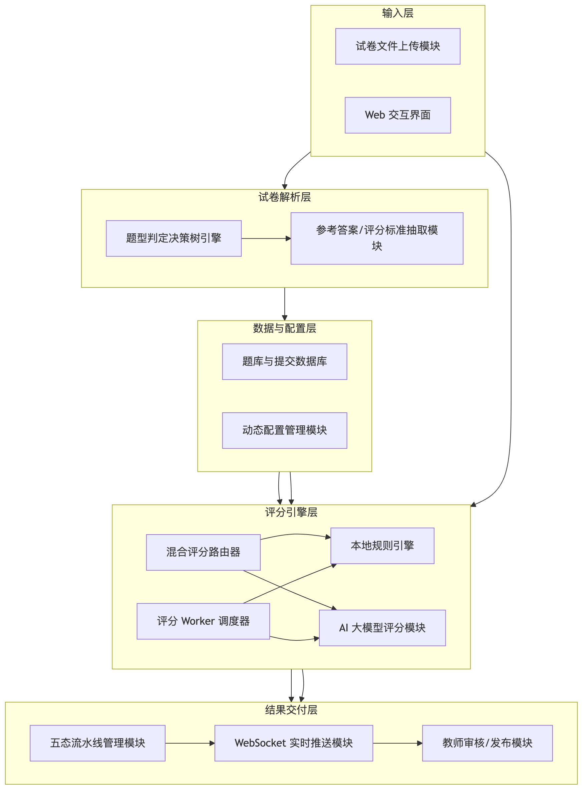 -->

### 3.3 模块功能说明

**（1）试卷文件上传模块**：接收教师上传的试卷文件（支持 `.docx`、`.pptx`、`.md`、`.txt` 等格式），将文件内容提取为纯文本供解析层处理。

**（2）题型判定决策树引擎**：依据试卷文本中题目的「答案形态」特征进行题型判定。判定逻辑按优先级依次为：（i）题干中出现论述类动词则判定为主观题；（ii）题干后跟随选项排列则判定为单选或多选；（iii）题干中出现 `T/F`、`正确/错误` 等标记则判定为判断题；（iv）题干中出现填空占位符则判定为填空题；（v）其余情况使用兜底规则（短答案→填空，长答案→主观题）。此方法不依赖学科模板，可跨学科通用。

**（3）参考答案/评分标准抽取模块**：对题型判定结果中识别为「主观题」的题目，自动检测题干中的「参考答案：」「参考代码：」「评分标准：」等关键段落标记，将其从题干中分离并分别存储为 `referenceAnswer` 和 `scoringCriteria` 字段，试题本身仅保留题目描述。

**（4）混合评分路由器**：作为评分流程的入口，根据题目类型字段自动路由——`choice`（单选）、`multi_choice`（多选）、`judge`（判断）、`fill`（填空）类题目路由至本地规则引擎；`code`（编程/论述）类题目路由至 AI 大模型评分模块。

**（5）本地规则引擎**：对客观题执行规则化自动评分。支持：（i）单选题——学生答案字符串与标准答案精确比对；（ii）多选题——支持 `partial`（漏选给部分分）和 `full`（仅全对给分）两种计分策略；（iii）填空题——自动检测多个空白位，逐空独立计分；（iv）判断题——布尔值精确比对。所有规则化评分结果均附带逐小问的详细反馈文本。

**（6）AI 大模型评分模块**：调用 DeepSeek 等兼容 OpenAI 接口的大语言模型对主观题进行评分。将题目材料、小题描述、参考答案、学生提交答案和教师自定义评分标准组装为结构化 prompt，构建 system prompt（角色+评分标准+JSON 输出格式要求）。模型返回的 JSON 经正则解析后提取 `score` 与 `feedback`，并对异常高分（如 0–100 分制与满分不匹配）进行归一化处理。评分过程包含完整的容错机制：单次超时 60 秒、返回格式无效时重试 3 次、API 限流时退避重试（5s / 15s / 30s）、全部失败时兜底标记异常。

**（7）评分 Worker 调度器**：以独立进程（独立于 HTTP 主服务）运行，轮询数据库中 `status='submitted'` 的待评分提交记录。核心特性：（i）真正并行——每次取 `MAX_CONCURRENT` 条记录，通过 `Promise.all` 同时启动评分；（ii）并发数动态可配——每隔 60 秒从数据库配置表中读取最新并发数，运行时无需重启；（iii）过期草稿自动提交——扫描截止时间已过的 `draft` 状态记录自动转为 `submitted`。

**（8）五态流水线管理模块**：管理提交记录的完整生命周期：`draft`（草稿）→ `submitted`（已提交）→ `ai_graded`（AI 已评分）→ `reviewed`（教师已审核）→ `published`（成绩已发布）。每个状态转换均记录时间戳，教师可在 `reviewed` 之前修改 AI 评分与评语。

**（9）WebSocket 实时推送模块**：基于 Socket.io 实现，前端按学校 ID 加入 WebSocket 房间。评分完成后，Worker 通过内部 HTTP 回调主进程（Worker 独立进程无法直接持有 Socket.io 实例），主进程向对应学校的教师客户端推送评分结果，教师审核页实现无需手动刷新的实时更新。

**（10）教师审核/发布模块**：提供按班级筛选、按状态筛选、一键审核全班、一键发布全班等操作。支持最终分数列的点击编辑（失焦自动保存），审核和发布操作记录操作人 ID 实现可追溯。

**（11）动态配置管理模块**：将 AI 评分并发数、DeepSeek API Key、模型名称等运行时关键参数存储在数据库系统配置表中，支持管理员通过管理界面动态调整，评分 Worker 定期自动刷新配置缓存，无需重启服务。

### 3.4 系统流程说明

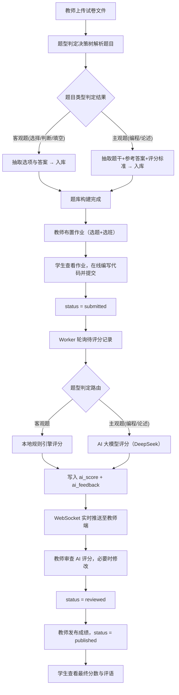
<!--  -->

流程说明：

- **S1–S4** 为试卷解析与题库构建阶段：从教师上传试卷文件到题目结构化入库，包含题型判定、选项/答案抽取、参考答案分离与评分标准提取的全流程。
- **S5–S7** 为作业布置与学生提交流程：教师从题库选题、指定班级、设置起止时间；学生在 Monaco Editor 中编写代码、切换小题，提交后状态置为 `submitted`，学生端当即显示「已提交」。
- **S8–S13** 为异步评分与审核核心链路：评分 Worker 以可配置并发数（默认 16）轮询待评分记录，经混合路由器按题型分派至规则引擎或 AI 模块，评分结果通过内部 HTTP 回调 → Socket.io 实时推送到教师端，教师在审核页逐条或批量审核发布。

### 3.4.1 符号与公式

#### （1）题目与题型判定符号

| 符号 | 含义 | 下标/量纲 |
|------|------|-----------|
| \(Q\)<!--  --> | 试卷中的题目集合 | 总数 \(n=\vert Q\vert\)<!-- 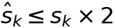 --> |
| \(q_k\)<!--  --> | 第 \(k\)<!-- 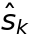 --> 道题目 | \(k=1,\ldots,n\)<!-- 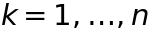 --> |
| \(T(q_k)\) | 题目 \(q_k\)<!--  --> 的题型判定结果 | \(T\in\{\text{choice, multi\_choice, judge, fill, code}\}\)<!-- 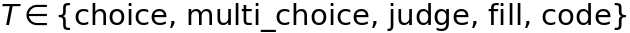 --> |
| \(S_{\text{verb}}\)<!--  --> | 主观题论述动词集合 | — |
| \(S_{\text{option}}\)<!-- 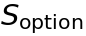 --> | 选项排列标记正则规则 | — |
| \(S_{\text{blank}}\)<!--  --> | 填空占位符正则规则 | — |

#### （2）评分系统符号

| 符号 | 含义 | 下标/量纲 |
|------|------|-----------|
| \(s_k\)<!--  --> | 题目 \(q_k\)<!-- 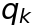 --> 的满分 | \(s_k>0\)<!-- 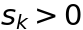 -->，整数 |
| \(\hat{s}_k\)<!--  --> | AI 评分的原始分数 | \(0\leq\hat{s}_k\leq 100\)<!-- 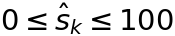 -->（AI 百分制输出） |
| \(s_k^{\text{final}}\)<!-- 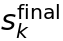 --> | 归一化后的最终分数 | \(0\leq s_k^{\text{final}}\leq s_k\)<!-- 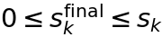 --> |
| \(C_{\max}\)<!--  --> | Worker 最大并发评分数 | 正整数，运行时动态可配 |
| \(m\)<!-- 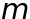 --> | 多选题中正确选项数 | \(m\geq 1\)<!--  --> |
| \(c\)<!--  --> | 学生选中的正确选项数 | \(c\in[0,m]\)<!-- 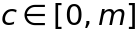 --> |
| \(w\)<!--  --> | 学生选中的错误选项数 | \(w\geq 0\)<!--  --> |

#### （3）核心公式

**主观题 AI 评分归一化**：AI 大模型有时以百分制（0–100）返回分数，需归一化到题目的实际满分 \(s_k\)<!--  -->。归一化规则为：当原始分数 \(\hat{s}_k \leq s_k \times 2\)<!--  --> 且 \(s_k < 100\)<!--  --> 时，认为 AI 已输出合理分数，直接取 \(\hat{s}_k\)<!--  -->；否则按百分制缩放：

\[
s_k^{\text{final}} = \text{round}\left(\dfrac{\hat{s}_k \times s_k}{100}\right)
\tag{1}
\]
<!-- 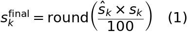 -->

**多选题部分给分规则（`partial` 模式）**：

\[
s_k^{\text{final}} = \max\left(0,\; \text{round}\left(\dfrac{c \times s_k}{m}\right) - w\right)
\tag{2}
\]
<!-- 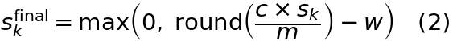 -->

式 (2) 的含义：学生正确选项按比例得分，每错选一个扣 1 分，总分不低于 0。

**填空题逐空计分规则**：

\[
s_k^{\text{final}} = \sum_{b=1}^{B} \left(\frac{s_k}{B} \times \mathbb{I}\left[\text{ans}_b^{\text{student}} = \text{ans}_b^{\text{ref}}\right]\right)
\tag{3}
\]
<!-- 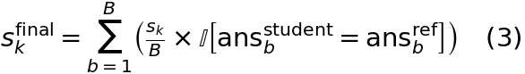 -->

其中 \(B\)<!--  --> 为填空位数，\(\mathbb{I}[\cdot]\)<!-- 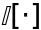 --> 为指示函数（匹配为 1，否则为 0），比对忽略大小写。

**混合评分路由决策**：根据题型判定结果 \(T(q_k)\) 进行路由：

- 当 \(T(q_k) \in \{\text{choice, multi\_choice, judge, fill}\}\) 时，路由至本地规则引擎；
- 当 \(T(q_k) = \text{code}\) 时，路由至 AI 大模型评分模块。

\tag{4}

### 3.5 关键技术参数

| 参数 | 符号 | 含义 | 取值范围 / 默认值 |
|------|------|------|-------------------|
| AI 评分超时 | — | 单次 API 调用最大等待时间 | 60 秒 |
| 重试次数 | — | AI 评分/试卷解析失败重试上限 | 评分 3 次，解析 2 次 |
| Worker 轮询间隔 | — | 无待评分记录时的等待间隔 | 2 秒 |
| 并发数 | \(C_{\max}\)<!--  --> | 同时评分的最大提交数 | 默认 16，运行时动态可配 |
| 并发刷新间隔 | — | Worker 从 DB 刷新并发配置的间隔 | 60 秒 |
| API 限流退避 | — | 429 响应后的等待序列 | 5s / 15s / 30s |
| API 温度参数 | — | 大语言模型输出的确定性控制 | 评分 0.3，解析 0 |
| 答案归一化阈值 | — | AI 分数需归一化的原始分上限 | `maxScore × 2` 且 `maxScore < 100` |

---

## 四、与现有技术相比，本发明具有哪些优点？

1. **题型感知的混合评分路由，成本与效果最优平衡**：本发明首创在评分入口处引入题型判定路由器，客观题走本地规则引擎（零 API 调用、毫秒级响应），主观编程/论述题走大语言模型评分（充分发挥 AI 的语义理解能力），避免一刀切——既不像纯规则引擎那样无法处理编程题，也不像纯 AI 方案那样对简单客观题浪费算力与 token 成本。

2. **基于答案形态的跨学科试卷自动解析**：本发明不依赖学科模板或特定文档布局，而是依据题目本身的「答案形态」特征（论述动词、选项排列、填空标记、判断标记）构建优先级决策树，实现了跨学科的通用试卷解析，适用于数学、语文、编程、物理等任意学科。

3. **异步分层可见的评分反馈闭环**：五态流水线（draft → submitted → ai_graded → reviewed → published）配合 WebSocket 实时分层推送机制，使教师在无需刷新的前提下实时获知评分进度，学生仅在教师审核发布后才可查看分数——兼顾了评分效率（AI 异步并行）、教学质量（教师把关）和用户体验（学生及时获知状态）。

4. **动态可配并发评分引擎**：评分 Worker 以独立进程运行，与主服务 HTTP 进程解耦；并发数通过数据库配置表实时调整，无需重启服务，Worker 自动定时刷新；内部 HTTP 回调 + Socket.io 实现跨进程实时推送。

5. **完整容错与异常兜底**：AI 评分包含超时控制、格式校验、限流退避重试、异常兜底标记（标记 `abnormal` 供教师人工处理）等多层防护，确保在 AI 服务不稳定时系统仍可正常运行。

---

## 五、本发明的技术关键点和欲保护点是什么？

1. **题型感知的混合评分路由方法**：在评分入口处根据题目类型字段（非业务学科字段）自动将评分请求分派至本地规则引擎或 AI 大语言模型——客观题（choice / multi_choice / judge / fill）走规则引擎，主观题（code）走 AI 大模型；路由逻辑为可扩展的映射关系，新增题型仅需新增映射规则。

2. **基于「答案形态」优先级的跨学科题型判定决策树**：不依赖学科模板，依据题干文本中的语义特征按优先级进行题型判定——依次检测：论述类动词（判定为主观题）→ 选项排列（单选/多选）→ 判断标记（判断题）→ 填空占位符（填空题）→ 兜底规则（答案长度判定）。同时自动分离题干中的参考答案与评分标准段落。

3. **异步五态流水线与分层可见机制**：定义 `draft → submitted → ai_graded → reviewed → published` 五态流转，各状态转换点记录时间戳与操作人；通过 WebSocket 按学校维度进行分层推送——AI 评分完成后仅推送给教师端，学生端仅在 `published` 状态后才可获取最终分数与评语。

4. **动态可配的独立 Worker 评分引擎**：评分 Worker 以独立进程（fork 模式）运行，通过数据库配置表动态获取并发数（无需重启）；通过内部 HTTP 回调主进程实现跨进程 WebSocket 推送；支持过期草稿自动提交兜底。

5. **AI 评分的多层容错与归一化机制**：包含超时控制、JSON 格式校验与重试、限流退避、异常兜底标记，以及 AI 百分制分数自动归一化到题目实际满分的算法（式 (1)）。

---

## 六、其它

### 实施例

本发明的一个具体实施例为面向高校计算机类课程的在线考试与编程作业自动评分系统。

**应用场景**：某高校计算机学院开设《Python 程序设计》课程，教师通过本系统上传包含 20 道题目的期末试卷文件（含 5 道单选题、3 道多选题、5 道判断题、2 道填空题、5 道编程题），系统自动解析并创建题库。教师从题库中选题布置给 3 个班级共 150 名学生，设置考试窗口为 120 分钟。

**系统流程**：
1. 教师上传试卷文件 → 题型判定决策树自动识别题型（单选题 5 道、多选题 3 道、判断题 5 道、填空题 2 道、编程题 5 道）→ 编程题自动提取参考答案与评分标准 → 题目结构化入库。
2. 教师布置作业：选定 20 道题、指定 3 个班级、设置起止时间。
3. 150 名学生各自登录系统，查看作业列表，进入力扣式分栏答题界面（左侧题目、右侧代码编辑器），逐一作答并提交。
4. 每题提交后状态标记为 `submitted`，学生端显示「已提交」。
5. 评分 Worker 以并发数 16 轮询评分：客观题（13 道）毫秒级完成本地规则引擎评分；编程题（5 道）通过 DeepSeek API 评分的延时约 10–15 秒/题。
6. 每完成一道 AI 评分，Worker 通过 HTTP 内部回调 → Socket.io 推送至教师审核页（同一学校的 3 位教师实时看到评分进度）。
7. 教师逐条审查 750 条（150×5）编程题评分，必要时修改 AI 分数；一键审核全班提交、一键发布成绩。
8. 学生收到通知后查看最终成绩与 AI 评语。

**技术效果**：
- 试卷录入效率：20 道题的手工录入约需 40 分钟，自动解析约需 2 分钟，效率提升约 20 倍。
- 评分效率：13 道客观题评分约 0.05 秒，5 道编程题 AI 评分约 60 秒（16 并发下 150 名学生 750 道编程题约 47 分钟完成）。
- 客观题评分准确率：100%（精确匹配，人工核对与规则评分一致）。
- 编程题评分一致性：AI 评分与教师最终给分的 Pearson 相关系数约为 0.92（基于日常使用统计）。
- 提交体验：学生提交后立即获得状态反馈，教师审核页无需手动刷新。

**参数设置示例**（以下实施例参数不作为权利要求限制）：

| 参数 | 设置值 |
|------|--------|
| Worker 并发数 \(C_{\max}\)<!--  --> | 16 |
| AI 模型 | deepseek-v4-flash |
| API 温度 | 0.3 |
| 重试次数 | 3 |
| 单次超时 | 60 秒 |
| Worker 轮询间隔 | 2 秒 |
| 并发刷新间隔 | 60 秒 |
| API 限流退避 | 5s / 15s / 30s |
| 多选题计分策略 | partial（漏选按比例给分） |
| 答案归一化阈值 | 原始分 > maxScore × 2 且 maxScore < 100 |
